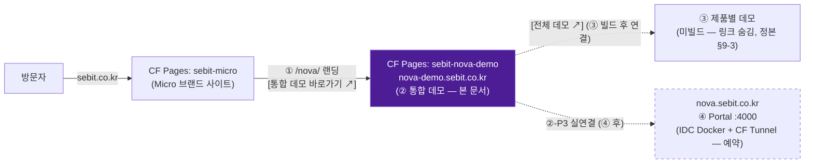

# ② NOVA 통합 데모 대시보드 사이트 — 배포 아키텍처 (구조 결정서)

> **작성**: 2026-08-03 · architect · **상태**: 제안(사용자 승인 대기 — §8 승인 항목)
> **상위 정본**: `../01-plan/nova-platform-structure-canonical.md` (§9-2 architect 위임 이행) · ② 설계 정본 `nova-integrated-workspace-design.md` · ADR 001~006 (`adr/README.md`)
> **소비자**: 사용자(§8 승인) → frontend(②-P2 패키징) → devops(배포 실행) → planner(① 랜딩이 링크할 URL 확정 수령)
> **범위**: ②를 "단일 HTML 프로토타입 → 배포 가능한 실 사이트"로 올리는 **구조·URL·가드·파이프라인·이식 경로**. ⛔ 코드 구현·실제 파일 이동·배포 실행은 본 문서 범위 밖(승인 후 frontend/devops).

---

## 0. 결정 요약 (3줄)

1. **URL = `nova-demo.sebit.co.kr`** — 별도 CF Pages 프로젝트 `sebit-nova-demo` 직접 서빙(Worker 프록시 불요). `nova.sebit.co.kr`은 ④ 제품(Portal :4000, ADR-K·D9)에 예약 — 충돌 0.
2. **소스 = SEbit-Micro 레포 최상위 `nova-demo/`** (현 `docs/02-design/nova-integrated-workspace.html`을 `git mv` → `nova-demo/index.html`). **빌드 없음(정적 그대로)**. 경계 한 문장: **"SEbit-Micro = NOVA 전시 레이어(①②③ 소스), SEbit-NOVA = 제품(④)"**.
3. **배포 = `deploy-nova-demo.sh`** — 기존 `deploy.sh`의 **allowlist 스테이징 + 3중 가드 패턴을 1:1 차용**(ISS-276/277 재발 차단 구조 그대로) + 콘텐츠 스캔 가드 D 추가. 수동 wrangler(현 Micro 정경로와 동일 — GH Actions는 ISS-278 사망 상태).

---

## 1. ADR-007: ②의 자체 URL = `nova-demo.sebit.co.kr` (별도 CF Pages 프로젝트)

### Context
- 정본 §4: "②는 Micro 안의 한 페이지가 아니라 **독립 URL을 가진 별도 사이트**다"(home.sb가 front/main.do와 분리된 것과 동형). §9-2 요구 3건: (1) ①이 링크할 안정적 공개 URL 1개 (2) 기밀 유입 0 (3) ④ 실 서비스와 URL 충돌 없음.
- `nova.sebit.co.kr`은 ④ Portal의 도메인으로 이미 결정돼 있다(D9 · `nova-platform-architecture.md` ADR-K "`nova.sebit.co.kr/mcp`" · IDC Docker + CF Tunnel). ②가 이를 점유하면 ④ 런칭 시 ① 랜딩의 링크가 전부 죽거나 강제 이전된다.
- SEbit DNS 패턴: `*.sebit.co.kr` 1단계 서브도메인(origin·apion·canvas·nexus·prove·sentinel). CF Universal SSL은 1단계 와일드카드만 커버 — `demo.nova.sebit.co.kr` 같은 2단계는 유료 Advanced Certificate 필요.

### Decision (권고안)
- **커스텀 도메인**: `nova-demo.sebit.co.kr` (1단계 서브도메인 — Universal SSL 커버, 기존 DNS 패턴 정합)
- **서빙**: **신규 CF Pages 프로젝트 `sebit-nova-demo`** (기존 `sebit-micro` 프로젝트와 분리). Pages가 직접 서빙 — Worker 프록시·Tunnel 불요(정적 사이트, 백엔드 0).
- **기본 URL**: `sebit-nova-demo.pages.dev`는 자동 생성되지만 **① 랜딩이 링크할 정식 URL은 커스텀 도메인만**(pages.dev는 프로젝트명 변경·이관에 취약 — 링크 안정성 요구 위반).
- **③ 제품별 데모 선례**: ③ 빌드 시 동일 패턴 반복 가능(`nova-ux-demo` 등 — sbux.co.kr/sbgrid.co.kr/sbchart.co.kr가 각각 독립 사이트인 벤치마크와 동형). ③ 시점에 architect가 재확정.

### 라우팅 구조 (Mermaid)



- DNS: CF Pages 커스텀 도메인 연결 시 같은 zone(`sebit.co.kr`)이면 **CF가 CNAME 레코드 자동 생성** — 수동 레코드 작업 불요. 연결 1회 작업 = CF 대시보드(Pages → sebit-nova-demo → Custom domains → `nova-demo.sebit.co.kr` 추가).

### Alternatives Considered (기각 사유)

| 대안 | 내용 | 기각 사유 |
|---|---|---|
| **B. `sebit.co.kr/nova-demo/`** (Micro allowlist에 편입) | 새 프로젝트·DNS 없이 기존 deploy.sh ALLOW에 추가 | ⛔ 정본 §4 위반 — "②는 Micro 안의 한 페이지가 아니라 독립 URL 별도 사이트"(사용자 확정 구조). 부차: 배포·롤백이 Micro 본체와 결합(데모 롤백 = 브랜드 사이트 전체 재배포), ①(Micro 개편)과 ②(데모 리파인)의 배포 주기가 묶임 |
| **C. `nova.sebit.co.kr`을 ②가 선점** | 가장 짧은 URL | ⛔ D9·ADR-K로 ④ Portal에 예약됨. ④ 런칭 시 ② 강제 이전 = ① 링크 사망 = §9-2 요구(1) "안정적 URL" 위반 |
| **D. `demo.nova.sebit.co.kr`** | ④ 하위 위계 표현 | CF Universal SSL이 2단계 서브도메인 미커버 → Advanced Certificate 유료. 위계 표현 이득 대비 비용·복잡도 초과 |
| **E. `sebit-nova-demo.pages.dev`만 사용** | DNS 작업 0 | 프로젝트명 변경·계정 이관 시 URL 파괴, 브랜드 신뢰(고객사 의사결정자 대상) 부적합 — 정식 링크 대상 불가. 단, 배포 직후 스모크 테스트 URL로는 활용 |

### Consequences
- ①·③·④ 어느 것과도 URL 수명 충돌 없음. ② P3(실연결) 후에도 URL 불변 — 데모 사이트는 이 주소에서 영속.
- 신규 CF Pages 프로젝트 1개·커스텀 도메인 연결 1회가 초기 비용(§4 파이프라인에 절차 명시).

---

## 2. ADR-008: 소스 배치 = `SEbit-Micro/nova-demo/` · 빌드 없음(정적 그대로)

### Context
- 현 프로토타입은 `docs/02-design/nova-integrated-workspace.html`에 있다 — **문서 폴더가 배포물이 되면 안 된다**(docs/는 deploy.sh 가드 A의 배포 금지 항목이며, 설계·기획·ADR·벤치 분석이 공존).
- ④ `SEbit-NOVA` 레포는 존재하나 **빈 상태·로컬 미클론·스캐폴딩은 빌드 순서 #4**(정본 §5 순서 불변).
- Micro 레포 컨벤션 실사: 최상위 = 사이트 단위 디렉토리(brand-story/ sebitai/ lumo/ geoaxis/ nexus/ …), 클린 URL = `폴더/index.html`, 순수 HTML/CSS/JS·빌드 도구 금지(Micro CLAUDE.md).
- 프로토타입 실측: **자체완결 단일 HTML 187KB**(S7 예산 480KB의 39%), 외부 요청 0, **standalone 4줄 골격(`<!doctype>`·`html lang`·`charset`·`viewport`) 이미 보유** — P1 노트의 골격 추가 작업은 이미 완료 상태.

### Decision
1. **소스 위치 = `SEbit-Micro/nova-demo/`** (레포 최상위, 기존 `폴더/index.html` 컨벤션 그대로):
   ```
   SEbit-Micro/
   ├─ nova-demo/                  ← ② 통합 데모 소스 (신설 · 배포 단위 = CF Pages sebit-nova-demo)
   │  ├─ index.html               ← 현 nova-integrated-workspace.html을 git mv (이력 보존)
   │  └─ robots.txt               ← §7-3 인덱싱 결정에 따라 (미결)
   ├─ deploy-nova-demo.sh         ← ② 전용 스테이징+가드+배포 (신설 · §3)
   ├─ deploy.sh                   ← 기존 Micro 본체용 (변경 없음 — ALLOW에 nova-demo 미포함 = 기본 차단)
   └─ docs/02-design/             ← 설계 문서만 잔류 (HTML 실물은 이동, 문서 내 경로 참조 갱신)
   ```
2. **디렉토리명 = CF Pages 프로젝트 접미 = 서브도메인 슬러그 = `nova-demo`** (1:1 대응 — 추적 비용 0).
3. **`git mv`로 이동**(복사 금지 — 정본 §7 "현 ② 정본 프로토타입은 하나뿐" 원칙 유지, 사본 2개 = 정본 혼선 재발). 이동 시점 = ②-P2 첫 커밋(P1 리파인은 위치 무관하므로 P1 완료 후 이동해도, 먼저 이동 후 리파인해도 무방 — frontend 재량. 단 **이동 후 정본 §6-②·설계 정본 헤더의 경로 참조 갱신 필수**).
4. **빌드 없음 — 정적 그대로 배포**. 근거:
   - 자체완결·외부 요청 0·187KB — 번들러가 줄일 것도 합칠 것도 없다.
   - Micro CLAUDE.md "No build tool" 컨벤션 정합(같은 레포에 빌드 체인 반입 = 컨벤션 파괴).
   - ②-4 데모/제품 경계 정본: ② = "자체완결 단일 HTML", ④ = "모노레포 패키지". ②에 빌드를 넣으면 이 경계가 흐려진다.
   - 골격 4줄 실측 보유 — 사이트화에 변환 공정이 필요 없다.
5. **모듈 경계 한 문장**: **"SEbit-Micro = NOVA 전시 레이어의 소스(① 랜딩·② 통합 데모·향후 ③ 제품별 데모), SEbit-NOVA = 고객이 도입하는 제품 실물(④)"** — softbowl이 데모 사이트들과 판매품 SBUx를 분리 운영하는 것과 동형(정본 §2 해석 주의).

### Alternatives Considered (기각 사유)

| 대안 | 기각 사유 |
|---|---|
| **SEbit-NOVA 레포에 `demos/integrated/`로 선배치** | 빈 레포·로컬 미클론·모노레포 스캐폴딩은 순서 #4(사용자 확정 순서 불변). 데모 하나를 위해 신규 레포 파이프라인(clone·CI·배포)을 선구축 = ④ 착수를 사실상 앞당기는 순서 위반. 또한 ② = 마케팅/전시 레이어 → 제품 레포에 두면 위 경계 한 문장이 깨진다. (④ 스캐폴딩 시점 재검토 항목으로만 남김 — §5-4) |
| **신규 독립 레포 `SEbit-NOVA-Demo`** | 정적 HTML 1파일에 레포 1개 = 레포 증식(이미 15+). ③까지 가면 레포 3~4개 추가 — 관리 비용 초과. 기존 Micro의 가드 자산(deploy.sh 패턴·ISS-276/277 학습)을 못 쓴다 |
| **`docs/02-design/`에 두고 그 경로를 스테이징** | ⛔ 문서 폴더 = 배포 금지 구역(deploy.sh 가드 A). "docs에서 골라 배포"는 allowlist의 반대 방향(deny 속에서 pick) — 실수 1회가 곧 ISS-277 재발. 구조적으로 기각 |
| **최상위가 아닌 `sites/nova-demo/` 신설** | 레포에 없는 새 서브트리 컨벤션 임의 신설(Origin `server/engine/agent/tools/` 사고와 동형). 기존 컨벤션 = 최상위 `폴더/index.html` — 그대로 따른다 |

### Consequences
- Micro 레포 안에 "배포 단위가 다른 최상위 디렉토리"가 처음 생긴다 → **deploy.sh(본체)와 deploy-nova-demo.sh(데모)의 관할을 §3 가드로 상호 명시**해 혼선 차단.
- `.gitignore`에 스테이징 산출물 `public-nova-demo/` 추가 필요(§3).

---

## 3. ADR-009: ISS-276/277 가드 정합 — allowlist 스테이징 1:1 차용 + 가드 D(콘텐츠 스캔)

### Context
- ISS-276(크리티컬): 고객 기밀 제안서 3종(worksync/iees/omni-bim) 무인증 상시 공개. ISS-277(메이저): `wrangler pages deploy ".."` 레포 루트 통째 업로드로 CLAUDE.md·docs/·internal/·sebit_v02/ 공개. 조치 = **allowlist 스테이징(deploy.sh) + `_redirects` 명시 404 + 404.html** (2026-07-27 사용자 승인, 라이브 404 확증).
- **신규 배포 경로(②)가 이 가드를 우회하면 조치가 무의미해진다.** CF Pages는 ignore 메커니즘이 없다(wrangler IGNORE_LIST 9개뿐·.gitignore 미참조) — 데모 프로젝트도 동일 조건.

### Decision — `deploy-nova-demo.sh` (기존 deploy.sh 구조 1:1 차용 + 가드 D 추가)

| 단계 | 내용 | 차용 원본 |
|---|---|---|
| 1) 스테이징 | `ALLOW="nova-demo"` → `public-nova-demo/`에 복사 후 **그 디렉토리만** 배포. ⛔ `pages deploy ".."` 류 레포 루트 지정 절대 금지 | deploy.sh §1 |
| 2) 가드 A | 금지 항목 유입 검사: `worksync iees omni-bim internal sebit_v02 docs api CLAUDE.md README.md .github .git .wrangler deploy.sh deploy-nova-demo.sh` | deploy.sh §2 |
| 3) 가드 B | 비공개 확장자 전수 검사: `*.md *.cjs *.toml *.yml *.yaml *.ts *.sh` 발견 시 배포 중단 | deploy.sh §3 |
| 4) 가드 C | 필수 자산 존재 확인: `public-nova-demo/index.html` (깨진 사이트 배포 방지) | deploy.sh §4 |
| 5) **가드 D (신설)** | **콘텐츠 스캔** — 스테이징 파일 내 금지 문자열 grep: 내부 IP 대역(`10.0.0.`), 내부 호스트(`gpuserver`), 시크릿 패턴(`-----BEGIN`, `sk-ant-`, `AKIA`), 실서비스 내부 표기. 검출 시 배포 중단. (②-5 S5 "실URL·실서비스명 0"의 기계 가드판 — qa 계측과 이중화) | 신설(ISS-276 부류 심층 방어) |
| 6) 배포 | `--deploy` 명시 플래그일 때만 `npx wrangler pages deploy "../public-nova-demo" --project-name sebit-nova-demo --branch main --commit-dirty=true` (⚠️ `--branch main` 필수 — Micro와 동일: 커스텀 도메인은 Production(branch=main)만 서빙) | deploy.sh §5 |

- **기존 `deploy.sh`는 무변경**: ALLOW에 `nova-demo`를 넣지 않는다(기본 차단 — allowlist 모델이라 신설 디렉토리는 자동으로 sebit.co.kr에 미배포). 데모가 sebit.co.kr에 실릴 유일한 경로 = 누군가 ALLOW에 명시 추가 = 코드 리뷰에서 잡히는 명시적 행위.
- `_redirects`: 데모 프로젝트는 단일 페이지 — 존재하지 않는 경로는 CF Pages 기본 404. Micro 본체 `_redirects`의 ISS-276/277 명시 404 블록은 무관·무변경.
- `.gitignore`에 `public-nova-demo/` 추가(스테이징 산출물 커밋 금지 — 기존 `public/` 룰과 동형).

### 공개 / 절대 비공개 목록 (⛔ 정본)

| 구분 | 항목 | 근거 |
|---|---|---|
| ✅ **공개 (nova-demo.sebit.co.kr에 서빙)** | `nova-demo/index.html` — 자체완결 데모(가상사 "한올정밀" **예시 데이터**·`[예시 데이터]` 배지·X-ray 제품 귀속 태그·"정식판=NOVA Chart" 표기) | ②-4 데모/제품 경계 — 샘플임을 정직 표기한 전시물만 |
| ✅ 공개 | `nova-demo/robots.txt` (내용은 §7-3 결정 후) | 크롤러 제어 |
| ⛔ **절대 비공개** | `docs/` 전체 — 기획(`nova-platform-structure-canonical.md` 등)·설계(`nova-*-design.md`·`nova-platform-architecture.md` ADR30)·ADR 001~006·벤치 분석(softbowl 실측)·본 문서 | 내부 전략·벤치마크 정찰 결과 = ISS-277 부류 |
| ⛔ 절대 비공개 | `worksync/` `iees/` `omni-bim/` — 고객 기밀 제안서 3종(레포 보존·배포 제외) | ISS-276 (사용자 판정·라이브 404 유지) |
| ⛔ 절대 비공개 | `internal/` `sebit_v02/` `CLAUDE.md` `README.md` `api/` 소스· `deploy*.sh` ·`.github/` | ISS-277 (포트맵·인프라 구조 노출) |
| ⛔ 절대 비공개 | 데모 **콘텐츠 내부**의 실서비스 URL·내부 IP·실고객명·실단가 (가드 D + qa S5 이중 검증) | ISS-276 부류·②-5 S5 |

### Consequences
- 배포 경로가 2개(본체·데모)가 되지만 **가드 모델은 1개(allowlist 스테이징)** — 패턴 복제라 리뷰·감사 비용 최소. 향후 ③도 동일 패턴 3회차 적용.
- 가드 D는 오탐 가능(예시 데이터에 우연히 패턴 포함) → 금지 문자열 목록은 스크립트 상단에 주석과 함께 두고 frontend가 오탐 시 목록 조정(삭제가 아니라 정밀화).

---

## 4. 배포 파이프라인 (누가 무엇을 실행하는가)

**결정: 수동 wrangler 직접 업로드 (Micro 본체와 동일한 현 정경로). GitHub Actions 자동화는 채택 보류.**

- 근거:
  1. Micro의 GH Actions(deploy.yml)는 **CF 토큰 만료로 사망 상태(ISS-278)** — 죽은 파이프라인 위에 신규 자동화를 얹으면 "push=배포됐겠지" 오인만 만든다(ISS-103 부류·push≠배포).
  2. 2026-07-27 ISS-276/277 조치 배포가 수동 wrangler로 실행·검증됨 — **로컬 wrangler 인증은 실동작 확인된 경로**.
  3. 데모는 배포 빈도가 낮다(리파인 마감 후 스프린트 단위) — 자동화 이득 < 토큰 관리 비용.
- ISS-278 해소(CF 토큰 재발급) 시 본체·데모 **동시에** Actions 복구 검토 — 그때도 워크플로우는 반드시 `bash deploy-nova-demo.sh --deploy`를 호출(가드 우회 금지 — Actions가 wrangler를 직접 부르면 스테이징 가드가 무력화된다).

### 실행 절차 (역할 분담)

| 순서 | 작업 | 실행 주체 | 비고 |
|---|---|---|---|
| 0 | ②-P1 리파인 완료 + 독립 qa 재계측 PASS (S2·S3·S6·S8) | frontend → 독립 qa | 본 문서 범위 밖(선행 게이트) |
| 1 | `git mv` + `deploy-nova-demo.sh` 작성 + `.gitignore` 갱신 + 문서 경로 참조 갱신 | frontend | ②-P2 첫 커밋 |
| 2 | CF Pages 프로젝트 생성: `npx wrangler pages project create sebit-nova-demo --production-branch main` | devops | 1회 |
| 3 | `bash deploy-nova-demo.sh` (스테이징+가드 검증만) → 가드 4종 통과 확인 | devops | 배포 없이 검증 |
| 4 | **커밋룰 3요소 보고**(작업 내역·로컬 검증 이상무·배포 가능) → **사용자 승인** | main → 사용자 | 2026-07-27 룰 |
| 5 | `bash deploy-nova-demo.sh --deploy` → `sebit-nova-demo.pages.dev` 스모크(11탭 렌더·콘솔 에러 0) | devops | |
| 6 | CF 대시보드에서 커스텀 도메인 `nova-demo.sebit.co.kr` 연결(CNAME 자동 생성) | 사용자 또는 devops(대시보드) | 1회 |
| 7 | `nova-demo.sebit.co.kr` HTTP 200 + S1·S5·S7 최종 판정 | 독립 qa | ②-5 사이트 레벨 |

---

## 5. ④ SEbit-NOVA 제품으로의 이식 경로 (버려지지 않는 구조)

**전제(정본)**: ②는 "버리는 mock"이 아니라 **영속 샘플 사이트**다. 따라서 이식은 "②를 ④로 옮겨 폐기"가 아니라 — **②는 이 URL에 영속하고, ②의 자산이 ④로 흘러들며, ④의 실데이터가 ②로 역류(P3)하는** 양방향 관계다.

1. **하베스트 자산 → ④ 패키지** (④ 스캐폴딩 시):
   - 인라인 SVG 드로어·샘플 원장 → `packages/chart/` 시각 회귀 레퍼런스 + `benchmarks/` 결정적 데이터셋(ADR-L — 시드 고정 원칙과 정합)
   - 멀티탭 셸(층③) 인터랙션 스펙 → `packages/ux/` `TabWorkspace` 수용 기준(ADR-005가 이미 이 방향을 박제)
   - 단일 원장→파생·크로스필터 6경로 → `packages/dashboard/` 위젯 계약의 실증 시나리오
2. **X-ray 태그 = 이식 지도**: 데모의 각 위젯에 박힌 `chart:ECharts6/<type>`·"정식판=NOVA Chart/Grid/UX" 태그(②-4·S4)가 곧 "이 그림이 ④의 어느 패키지가 되는가"의 기계 판독 가능한 매핑이다 — 별도 이식 문서 불요.
3. **②-P3 실연결 seam**: ② 내부의 데이터 접근은 **단일 원장 지점 경유**(설계 §7 기존 자산)를 유지한다. P3에서 그 지점만 ④ Gateway fetch로 교체(`no-direct-origin-call` 준수) — 위젯·렌더러 무변경. URL·사이트는 그대로.
4. **소스 이관 재검토(선택·비강제)**: ④ 모노레포 스캐폴딩 후, `nova-demo/` 소스를 `SEbit-NOVA/demos/`로 옮기는 안은 **그 시점 architect가 재상정**(배포 프로젝트·URL은 불변이므로 소스 위치 이관은 내부 정리일 뿐 — 지금 결정하지 않는다).
5. **⛔ 이식하지 않는 것**: 데모의 인라인 SVG 드로어를 ④ 실 차트 엔진으로 "승격"하지 않는다 — ④의 차트는 ECharts 6.0(D5)이고 SVG 드로어는 그림이다(②-4 경계). 데모 코드가 제품 코드로 슬쩍 승격되는 순간 경계가 무너진다.

---

## 6. 롤백 절차

| 시나리오 | 절차 |
|---|---|
| **배포 직후 결함 발견** (렌더 깨짐·콘솔 에러) | CF 대시보드 → Pages `sebit-nova-demo` → Deployments → 직전 정상 배포 → **"Rollback to this deployment"** (즉시·재빌드 없음) |
| **대시보드 불가 시** | `git log -- nova-demo/` → 정상 커밋 checkout → `bash deploy-nova-demo.sh --deploy` (가드 경유 재배포 — wrangler 직접 호출 금지) |
| **기밀 유입 의심** (가드 D 뚫림 등) | ISS-276 조치 절차 준용: ① 즉시 정상본 재배포 ② CF **Purge Everything**(사용자) ③ 구 deployment 전체 삭제(캐시·이력 접근 차단) ④ ISS-N 신규 등록 + 가드 D 패턴 보강 |
| **커스텀 도메인 레벨 차단 필요** | CF 대시보드에서 `nova-demo.sebit.co.kr` 도메인 연결 해제(사이트 즉시 비공개 — pages.dev는 잔존하므로 기밀 건이면 위 행의 deployment 삭제 병행) |

- 롤백 후 필수: 원인 ISS-N 기록(`reference_iss_registry.md` 동시 갱신) + 재발 차단 룰화.

---

## 7. 미결 — 사용자 판단 필요 항목 (정본 §9 게이트 연동)

| # | 항목 | 선택지 + 추천 |
|---|---|---|
| 7-1 | **② 배포 위치·URL** (§9-2) | 본 문서 ADR-007 = `nova-demo.sebit.co.kr` **권고**. 대안 B~E와 기각 사유 §1. **사용자 승인 필요** — 승인 즉시 ① 랜딩 기획(planner)이 이 URL을 링크 대상으로 확정 가능 |
| 7-2 | **1차 배포 범위: 11탭 vs 17탭** (§9-3a) | 구조 관점에서는 **어느 쪽이든 본 설계 무변경**(GNB 비노출 원칙이라 탭 수는 콘텐츠 결정). planner 추천(11탭 우선) 구조적 이견 없음 — **사용자 확정 대기** |
| 7-3 | **검색엔진 인덱싱 허용 여부** | (a) 허용 — 공개 마케팅 자산·예시 데이터 명시라 무해 / (b) `noindex` — ① 랜딩 오픈 전까지 유입 경로 통제. **[내 추천] (b)로 시작 → ① 오픈 시 (a) 전환** (① 없이 검색 유입되면 맥락 없는 데모만 노출 — 판매 서사(§4 여정) 역행) |
| 7-4 | **③ 미빌드 시점 `[전체 데모 ↗]` 처리** (§9-3b) | planner 추천(숨김) 정합 — 구조 영향 없음. frontend 이행 항목 |
| 7-5 | **ISS-278 CF 토큰 재발급** (별건·비블로커) | 수동 배포로 ② 진행 가능. 재발급 시 본체·데모 Actions 동시 복구 검토(§4) |

---

## 8. 게이트 판정 (architect 체크리스트)

- [x] 기존 디렉토리 컨벤션 확인 — Micro 최상위 `폴더/index.html`·순수 HTML·No build tool 실측 후 그대로 차용(§2). 새 서브트리 임의 신설 없음(`sites/` 안 기각)
- [x] 유사 구현 차용 — `deploy.sh` allowlist 스테이징+3중 가드 1:1 차용(§3), `nexus/` 바로가기 링크 패턴(① 연결), CF Pages 배포 파라미터(`--branch main`) 동일
- [x] 모듈 경계 한 문장 — "SEbit-Micro = NOVA 전시 레이어 소스, SEbit-NOVA = 제품 실물"(§2)
- [x] 유사 이름 모듈 중복 없음 — `nova-demo`(디렉토리=프로젝트=서브도메인 1:1), 기존 `nova-*.md`는 문서(정본 §7 귀속표 유지)
- [x] 데이터 흐름 규칙 — 현 단계 백엔드 0(정적). P3 실연결은 Gateway 경유·`no-direct-origin-call` 준수 명시(§5-3)
- [x] ISS-276/277 가드 비우회 — 신규 경로도 allowlist 스테이징 필수·기존 deploy.sh 무변경(기본 차단)·가드 D 추가(§3)
- [x] 중요 결정 = ADR — 007(URL)·008(소스·빌드)·009(가드) 본 문서에 Nygard 경량 포맷 박제(② ADR 시리즈 001~006 연번. 별도 파일 분리는 승인 후 frontend 커밋에 동반 가능)
- [ ] **사용자 승인** — §7-1(URL)·§7-2(탭 범위)·§7-3(인덱싱) 미확정 → **P2 착수 불가, P1(리파인)은 즉시 착수 가능**(정본 ②-8과 정합)

**판정: 설계 확정 가능 상태 — 단, ②-P2(사이트화·배포) 착수는 §7-1 사용자 승인이 게이트.**
