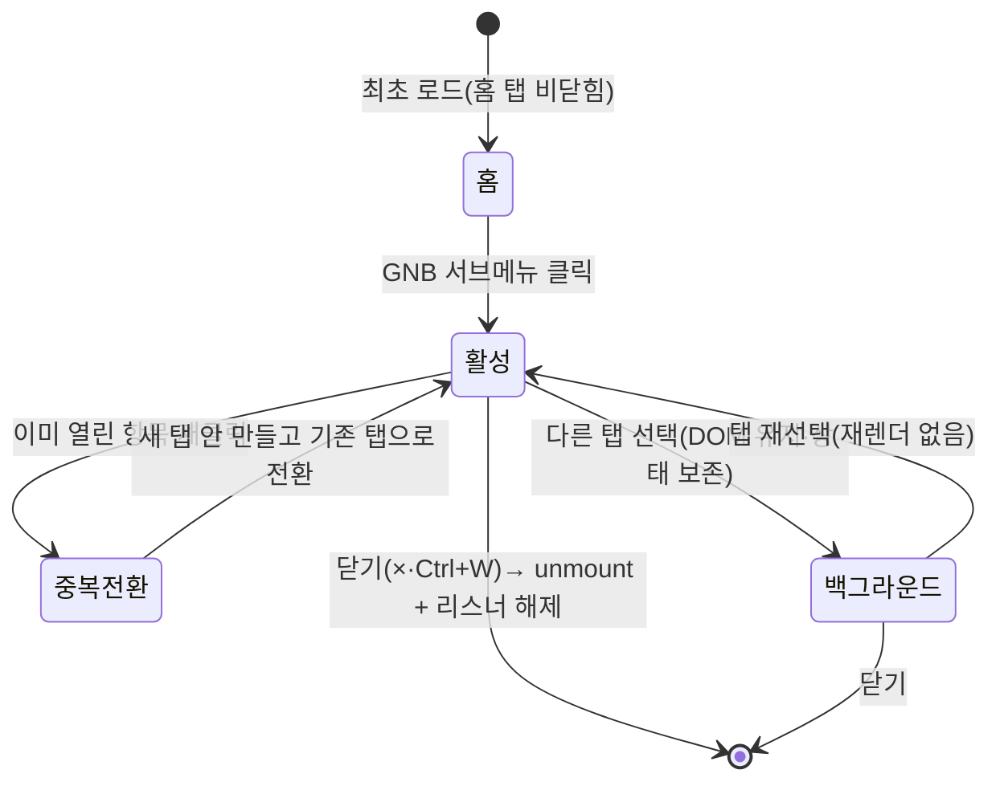
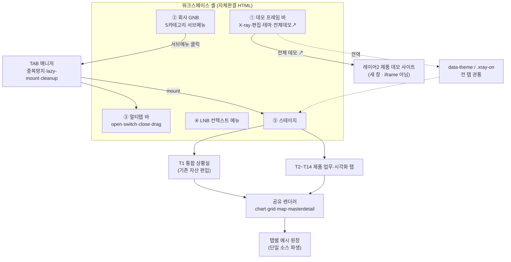

# NOVA 통합 데모 — 멀티탭 워크스페이스 (Integrated Workspace) 재설계

> **작성**: 2026-07-29 · architect · **상태**: 확정 설계(구현 착수 기준)
> **대체 관계**: 본 문서는 `nova-integrated-demo-design.md`(2026-07-29 ui-designer)의 **범위(scope) 결정을 대체(supersede)** 한다. 이전 문서의 "가상 기업 상황실 1개 시나리오 = 대시보드 3뷰로 **압축**" 선언(§0 범위 가드)은 home.sb의 **33화면 breadth + 멀티탭 워크스페이스 UX**를 잃은 오설계였다(main 압축 지시 → 벤치마크 핵심 상실 사고). ⛔ 이전 문서의 **위젯 카탈로그·크로스필터 6경로·단일 원장·실경계 지도·토큰·정직 장치는 전부 유효** — 그것들은 본 워크스페이스의 **한 탭("통합 상황실")** 안에서 그대로 살아있다. 대체되는 것은 오직 **최상위 구조(단일 대시보드 → 멀티탭 워크스페이스)** 뿐이다.
> **근거(참조 우선)**: `../01-plan/nova-integrated-demo-analysis.md`(home.sb 소스 실측 — §0-2 멀티탭 메커니즘·§1-1 셸·§1-2 GNB 5그룹 33항목·§1-4 위젯·§3 refine 매트릭스 "멀티탭 워크스페이스 추가" 권고) · **`../01-plan/nova-viz-asset-inventory.md`(⭐ Track C 하베스트 카탈로그 — NOVA Chart 코어=Canvas `CanvasChartWrapper` §1-8·차별화 시각화 3종 §4-D·손코딩 SVG 부채 실파일:라인 §4-B)** · `project_nova_platform.md`(NOVA 2레이어·6제품·확정 아키텍처) · `nova-integrated-demo-design.md`(상황실 탭 상세 — 재선언 없이 참조) · `nova-showcase-design.md` 부록 A(--nova-* 토큰 원장) · 어제 프로토타입 `nova-integrated-demo.html`(상황실 3뷰·지도·크로스필터 구현 자산)
> **결정 박제**: `adr/README.md` (ADR-001 멀티탭 · ADR-002 카테고리 매핑 · ADR-003 탭 렌더 방식 · ADR-004 실경계 지도 · **ADR-005 탭 워크스페이스=NOVA UX 간판 TabWorkspace**)
> **소비자**: frontend — 자체완결 단일 HTML(외부 CDN 0)

---

## 0. 방향 선언 — 무엇이 틀렸고 무엇을 되돌리는가

### 0-1. 사고 복기 (구조를 즉흥 압축한 것)

| 축 | home.sb (벤치마크 실측) | main이 만든 것(`nova-integrated-demo.html`) | 잃은 것 |
|---|---|---|---|
| 최상위 형태 | 그룹웨어 셸 안 **멀티탭 워크스페이스** — 탭을 열고/닫고/드래그 | 한올정밀 **단일 대시보드**(뷰 전환 탭 3개 고정) | 멀티탭 UX 자체 |
| breadth | GNB 5카테고리 **33항목** → 클릭 시 탭으로 열림 | 대시보드 위젯 14개 (1화면) | **33화면 breadth** |
| 탭의 의미 | 탭 = 독립 화면(제품 데모·업무화면·시각화) | "탭" = 같은 대시보드의 뷰 전환 | 화면 다양성 |

> **결론**: main의 산출물은 home.sb 멀티탭 워크스페이스 안의 **"메인 대시보드 1탭"에 해당하는 것**을 워크스페이스 전체인 양 만든 것이다. 우수하되(크로스필터·실지도·테마) **한 조각**이었다. 이번 재설계는 그 조각을 워크스페이스의 **플래그십 탭**으로 편입하고, 잃었던 **멀티탭 워크스페이스 + 33항목 breadth**를 복원한다.

### 0-2. 이 화면이 답해야 하는 질문 (불변)

> 방문자(고객사 의사결정자·SI 실무자)가 알아야 하는 것:
> **"NOVA 제품들(UX·UI·Grid·Chart·Dashboard·Doc)로 조립한 실제 업무 워크스페이스는 이렇게 생겼고, 우리 업무도 이 안에 탭으로 들어온다."**

- home.sb 본질(분석 §0-1): 제품 나열이 아니라 **가상 회사 그룹웨어 셸 안에 제품을 심은 멀티탭 업무포털**. 이 문법은 옳다 — **셸 + 멀티탭을 온전히 차용**한다(압축하지 않는다).
- home.sb 한계(분석 §0 판정 3~7): 위젯 편집 0 · 위젯 간 연동 0 · 테마 미구현 · 데이터 전부 mock 위장 · 1920 고정 · iframe 탭(테마·상태 단절). 이 지점들이 우리의 상회 축이다(§6).

### 0-3. 확정 분석 정합 (spec-integrity 게이트 대비)

본 설계의 각 결정이 분석 문서·하베스트 카탈로그의 어느 실측에 대응하는지 — 임의 재해석 0을 자기증명한다.

| 본 설계 요소 | 분석·하베스트 근거 | 정합 |
|---|---|---|
| 그룹웨어 셸(GNB+LNB+페르소나+RNB생략) | §1-1 셸 실측 | ✅ 차용 |
| GNB 5카테고리 → 서브메뉴 → 탭 오픈 | §0 판정 2 · §1-2 33항목 전수 | ✅ 복원 |
| 멀티탭 바(drag·close·마지막탭 close숨김) | §1-1 메인 "sbux-tabs is-draggable" | ✅ 차용 |
| 통합 상황실 = 기본 탭(3 서브뷰) | §1-4 메인 대시보드 3탭(자동 로테이션) | ✅ 편입 |
| 카테고리↔NOVA 제품 매핑(§4) | §1-2 그리드활용/시각화/활용방안/연계 구분 | ✅ 재분류 |
| 실경계 대한민국 지도 | §1-4 탭B "SIGUNGU.json drillDown 센터피스" | ✅ 상회(실경계) |
| 크로스필터·편집·테마·반응형 | §3 refine 매트릭스 "상회 축" 열 | ✅ 상회 |
| **탭 워크스페이스 = NOVA UX 간판(TabWorkspace)** (§3-4·§5-6) | §1-6 "sbux-tabs = SBUx UX 제품 컴포넌트 → NOVA UX 핵심 기능" 재분류 + #10~17 상회 여지 ⭐ | ✅ 재귀속 |
| **데이터 시각화 = NOVA Chart(ECharts 6.0) 채움** (§3-5-B) | §2-c 차트타입별 native/custom 커버리지(custom 3종) | ✅ 채움 근거 |
| **NOVA Chart 코어 = Canvas `CanvasChartWrapper` 하베스트** (§3-5-A) | 하베스트 §1-8·§2 #1(테마 자동동기화·dispose 안전·등록형 레지스트리) | ✅ 차용(새로짜기 X) |
| **실운영 차별화 시각화 3종 탭** (§4 T15~T17·§3-5-D) | 하베스트 §4-D(softbowl 없는 3축: Nexus·Stock·Sentinel) | ✅ 실자산 노출 |
| **손코딩 SVG 부채 = NOVA Chart 커버 요구** (§3-5-C) | 하베스트 §4-B(Nexus/Sentinel/API-On SVG 4처 실파일:라인) | ✅ 커버 요구 |
| 미준비 탭 비노출 | §2 sbux "준비중" 주석 반면교사 | ✅ 정직 |

---

## 1. 워크스페이스 IA — 셸 5층 구조

**핵심 설계 원칙**: 허구(가상사)와 사실(데모 컨트롤·정직 배지)을 **층으로 분리** 수용한다(배지 수프 없이 정직 유지). home.sb 대비 추가된 **③ 멀티탭 바**가 이번 재설계의 골격이다.

```
┌ ① 데모 프레임 바 40px (--nova-bg-gnb · NOVA 크롬 = 사실 층) ──────────────────────────┐
│ ◆ SEbit NOVA 통합 워크스페이스  [예시 데이터]     [X-ray] [편집] [</>] [테마]  [전체 데모 ↗] │
├ ② 회사 GNB 56px (--nova-bg-card = 허구 층: 가상사 "한올정밀") ──────────────────────────┤
│ ⬡ 한올정밀 · 통합 업무 포털   |상황실▾|데이터그리드▾|데이터시각화▾|업무시나리오▾|컴포넌트·연계▾|  🔔3 (서)김서연 │
│                                └ hover → 서브메뉴 slideDown → 항목 클릭 = 탭 오픈           │
├ ③ 멀티탭 바 = NOVA UX **TabWorkspace** 40px (--nova-bg-surface) ⭐간판 기능 ───────────┤
│ [⬡ 홈] [📌통합 상황실 ×] [▤ 기본 편집·CRUD ×] [◔ 차트 갤러리 ×] … ‹ 오버플로 › [＋]      │
│   ↑비닫힘 기본   ↑드래그 재배치·닫기·활성 언더라인·중복오픈 방지·우클릭 컨텍스트·핀 고정·세션 지속  │
├ ④ LNB 232px ──┬ ⑤ 탭 콘텐츠 스테이지 (--nova-bg-page) ──────────────────────────────────┤
│ 프로필 블록     │  활성 탭의 콘텐츠 (탭별 §5 · lazy-mount·keep-alive)                        │
│ (페르소나)      │  · 홈 탭 = 카테고리 런처 카드                                              │
│ 컨텍스트 메뉴   │  · 상황실 탭 = 12col 위젯 그리드 + 서브뷰 3 + 크로스필터(기존 자산)          │
│ 바로가기        │  · 제품/업무 탭 = 해당 데모 렌더                                            │
├ ⑥ 푸터 32px ──┴───────────────────────────────────────────────────────────────────────┤
│ 한올정밀·인명·수치는 모두 예시입니다 · 정식판은 각 위젯이 실데이터에 연결 · NOVA v0.9 prototype │
└──────────────────────────────────────────────────────────────────────────────────────┘
```

| 층 | 스펙 | home.sb 대비 |
|---|---|---|
| ① 데모 프레임 바 | 좌: 4점 성좌 마크 + 워드마크(오로라 클립) + `예시 데이터` 배지(전역 유일 · 클릭=데이터 소스 패널). 우: X-ray·편집·조립코드·테마 + **`전체 데모 ↗`**(레이어2 제품 데모 사이트로 새 창 — §5-5). ⛔ **시연/투어 컨트롤은 상황실 탭 로컬 툴바로 이동**(§5-2) — 워크스페이스 전역 아님(탭마다 시연 대상이 다름) | home.sb에 없음(우리 크롬) |
| ② 회사 GNB | 좌: 가상사 로고 글리프(육각 ⬡ 스트로크) + "한올정밀 · 통합 업무 포털". 중앙: **GNB 카테고리 5**(hover → 서브메뉴 slideDown 200ms → 항목 클릭 = 탭 오픈, §3). 우: 알림 벨(배지 3, 드롭다운) + 사용자 칩 | §1-1 GNB(100px→56px 모던화) + §1-2 카테고리 구조 차용 |
| ③ **멀티탭 바 = NOVA UX `TabWorkspace`** ⭐ (간판 기능 · X-ray 태그 `data-nova="ux:TabWorkspace"`) | 활성 탭 = 하단 2px 오로라 언더라인. 탭 = `[아이콘][제목][×]`. **드래그 재배치 · 닫기 · 홈 탭 비닫힘 · 오버플로 가로스크롤+‹› · 우클릭 컨텍스트(닫기 외/전부/오른쪽) · 핀 고정 · 세션 지속(§5-6)**. `[＋]` = 홈(런처)로 이동. `role="tablist"` roving tabindex. ⛔ 셸 골격인 동시에 **NOVA UX 제품의 핵심(간판) 기능**(분석 §1-6, 본 설계 §3-4) | §1-1 "sbux-tabs is-draggable·close·마지막탭 close숨김" **1:1 차용(동등) + §1-6 상회 기능 보강(차별화)** |
| ④ LNB | 프로필 블록(페르소나 아바타+인사말) → **컨텍스트 메뉴**(활성 탭에 따라 내용 전환: 상황실=서브뷰 트리·그리드탭=기능 목록·업무탭=시나리오 단계) → 바로가기. **전 항목 실동작**(G14) | §1-1 LNB 차용, "나의메뉴 전부 장식(onclick 0)"(§1-3) 반면교사 → 전 항목 실동작 |
| ⑤ 스테이지 | 활성 탭 콘텐츠. 탭 전환 = display 토글(상태 유지). 탭별 렌더는 §5 | §1-1 "탭 콘텐츠=iframe" → **in-page 컴포넌트 렌더**(ADR-003) |
| ⑥ 푸터 | T5 muted 1줄 정직 문구 | §1-1 "vershion 오타·IP info 가짜라벨" 반면교사 |

- ⛔ home.sb의 **RNB**(TO DO·알람 88·메세지 89 슬라이드 패널)는 채용하지 않는다 — 알림은 GNB 벨 드롭다운으로 소화(범위 압축). 단 이 압축은 **셸 부속 장식의 압축**이지, 멀티탭/breadth의 압축이 아니다(0-1 사고와 구별).

---

## 2. 페르소나 (가상 회사 1개 고정)

| 항목 | 값 | 정직 |
|---|---|---|
| 가상 회사 | **한올정밀(주)** — 전국 13개 사업장 정밀부품 제조사 | 명백한 허구(푸터 명시, G11) |
| 워크스페이스 | **통합 업무 포털** — 멀티탭 워크스페이스 | home.sb "SBWS" 대응 |
| 사용자 | **생산운영팀 김서연 팀장** | home.sb "자산운용 관리팀 김남길" 대응 |
| 인사말 | 실제 시각 기반("좋은 아침입니다") | 장식 아닌 실동작(G14) |

---

## 3. GNB 카테고리 ↔ NOVA 제품 매핑 (핵심 결정 · ADR-002)

home.sb의 5카테고리 33항목을 **NOVA 제품 택소노미**로 재분류한다. 벤치마크의 breadth는 유지하되, 항목 나열이 아니라 **NOVA 제품이 어디에 쓰이는지**로 구조화한다.

### 3-1. 매핑 원칙

home.sb의 카테고리 구분(그리드활용·연계·퍼포먼스·활용방안·데이터시각화)은 **제품(SBGrid/SBChart)과 응용(활용방안)이 섞여 있다**. NOVA는 이를 **①제품 기능 데모 ②조립 업무화면**의 두 축으로 정돈해 5카테고리로 재편한다.

### 3-2. 매핑표 (home.sb 33항목 → NOVA 5카테고리)

| NOVA GNB 카테고리 | 주력 NOVA 제품 | home.sb 대응 카테고리·항목 | 성격 |
|---|---|---|---|
| **① 통합 상황실** | NOVA Dashboard | home.sb 메인 대시보드 3탭(자산운용/지방재정/메인조회, §1-4) | 조립 대시보드(기본 탭) |
| **② 데이터 그리드** | NOVA Grid | 그리드활용 11(rowheader·crud·grouping·fixframe·theme·excel·filter·personalize·merge·subtotal·sbgrid_v3) + 퍼포먼스 1(bigdata-binding) = **12항목** | 제품 기능 데모 |
| **③ 데이터 시각화** | NOVA Chart | 데이터시각화 8(business_analysis·covid19·areaRange·plot·wing·orgchart·datarange·kape) = **8항목** | 제품 기능 데모 |
| **④ 업무 시나리오** | NOVA UX+Grid+Chart 조립 | 활용방안 11(insa·pay·retirement·uxex03~07·schedule·wondollar·tax) = **11항목** | 조립 실무화면 |
| **⑤ 컴포넌트·연계** | NOVA UX + UI | 연계 2(grid-detaildata·control-component) = **2항목** | 폼/레이아웃/리포트 |

> **커버리지**: home.sb 33항목 = 3(대시보드 탭) + 12 + 8 + 11 + 2 → **NOVA 5카테고리에 100% 흡수**. 매핑 손실 0.
> **⭐ 차별화 추가(home.sb 밖 · 상회 축)**: ③ 데이터 시각화 카테고리는 home.sb 8항목 흡수에 더해 **softbowl에 없는 우리 실운영 시각화 3종(§4 T15~T17)**을 추가 전시한다(하베스트 §4-D). 이는 33항목 매핑 흡수가 아니라 **우리 실자산 상회 축**(§6)이며, 실자산이므로 breadth 정직 원칙(§4-2)과 충돌하지 않는다.

### 3-3. NOVA 제품 라인업 정합 (project_nova_platform 6제품)

| NOVA 제품 | 워크스페이스 노출 | 카테고리 |
|---|---|---|
| NOVA Dashboard | 통합 상황실 탭 | ① |
| NOVA Grid | 데이터 그리드 탭군 | ② |
| NOVA Chart | 데이터 시각화 탭군(**코어 래퍼 = Canvas `CanvasChartWrapper` 하베스트 §3-5-A** · ECharts 6.0 커버리지 §3-5-B · **실운영 차별화 3종 T15~T17 §3-5-D**) | ③ |
| NOVA UX | 업무 시나리오·컴포넌트 탭 + **⭐ 멀티탭 워크스페이스(`TabWorkspace`) = 셸 층③**(제품 간판 기능, X-ray 태그 `ux:TabWorkspace`, §3-4) | ④⑤ + **셸 층③** |
| NOVA UI | 컴포넌트·연계 탭 + **셸 크롬**(층① 프레임 바·층② GNB·층④ LNB·층⑥ 푸터 = NOVA UI 업무포털 템플릿, X-ray 태그) — ⛔ **층③ 멀티탭 바는 NOVA UI 아님 = NOVA UX `TabWorkspace`**(§3-4) | ⑤ + 셸 크롬(①②④⑥) |
| NOVA Doc | **워크스페이스 내 데모 없음**(SBWrapDoc 동일, 구매만) — 단 상황실 탭 "보고서 내보내기"로 **접점만** 노출 | (링크만) |

### 3-4. 탭 워크스페이스 = NOVA UX 간판 기능 (`TabWorkspace`) · ADR-005

**재귀속 근거**: 벤치마크 home.sb 메인 영역은 `<sbux-tabs>` 커스텀 엘리먼트로 인스턴스화되며(분석 §1-6, home.sb L1001-1004), `sbux-tabs` = **SBUx(소프트보울 UX 제품) 컴포넌트**다. 즉 이 멀티탭 시스템 자체가 **UX 제품의 간판 기능**이다. NOVA UX = SBUx 대응 제품([[project_nova_platform]] D4 라인업 1번). 따라서 워크스페이스 셸 층③(멀티탭 바 + 탭 라이프사이클)은 **NOVA UI(셸 크롬)가 아니라 NOVA UX 제품의 핵심 기능 `TabWorkspace`**로 명시 귀속한다. 기존 설계가 층③을 "셸 신규 골격"으로만 두고 제품 귀속을 NOVA UI로 느슨히 둔 것을 정정.

**X-ray 태깅**: 멀티탭 바 루트 = `data-nova="ux:TabWorkspace"`. X-ray 켜면 "이 탭 매니저 = NOVA UX TabWorkspace" 라벨이 층③에 뜬다(셸 크롬 GNB/LNB = `ui:*` 태그와 구분).

**① 동등 기능(softbowl 대비 1:1 · 간판의 하한선)** — 분석 §1-6 #1~9:

| 기능 | softbowl(sbux-tabs) | NOVA UX TabWorkspace | 분석 근거 |
|---|---|---|---|
| GNB/즐겨찾기 클릭 → 탭 오픈 | ✅ addTab | ✅ `openTab` | §1-6 #1·2 |
| 활성·전환 | ✅ | ✅ `.active` + keep-alive | §1-6 #3 |
| 중복 오픈 방지 | ✅(early return) | ✅ 중복 시 전환(+재활성 확실 처리 — softbowl `selectTab` 미정의 의심 지점 보완) | §1-6 #4 |
| 닫기 / 마지막 탭 보호 | ✅ | ✅ (홈 탭 비닫힘) | §1-6 #5·6 |
| 드래그 재배치 | ✅ jQuery UI | ✅ HTML5 DnD | §1-6 #7 |
| 탭 콘텐츠 렌더 | iframe | in-page 컴포넌트(ADR-003) | §1-6 #9 |

**② 차별화 기능(softbowl 미탑재/미사용 = NOVA UX 상회)** — 분석 §1-6 #10~17, 상세 = §5-6:

| 차별화 | softbowl 상태(분석 §1-6) | NOVA UX TabWorkspace |
|---|---|---|
| 우클릭 컨텍스트(닫기 외/전부/오른쪽) | ❌ 탭바 부재(#12, `closeAll`=winpopup 전용) | ✅ 실장 |
| keep-alive 캐시(전환 시 재렌더 X·입력/스크롤 보존) | ⚠️ 전환·로테이션마다 차트 재렌더(#10) | ✅ 상태 보존(ADR-003) |
| 오버플로 스크롤/드롭다운 | ⚠️ 표준 SBUxScrollTabs 보유하나 메인탭 `is-scrollable=false`로 미적용(#11) | ✅ 가로 스크롤+‹›(+오버플로 탭리스트) |
| 핀/고정 탭·탭 관리 | ❌ 없음(#17, `maxTab` 0건) | ✅ 핀 고정(핀 탭 좌측 정렬·닫기 잠금) |
| 세션 지속(새로고침 복원) | ❌ 지속 로직 0건 | ✅ localStorage 탭 세트 복원 |
| 배지·탭별 드롭다운 | ⚠️ 표준 보유하나 home.sb 미사용(#13·14) | ✅ 실사용(알림 배지·탭 메뉴) |

> ⛔ **임의 확장 아님**: 위 차별화 6종은 전부 분석 §1-6 "NOVA 상회 여지" 열에 ⭐로 명시된 것만 채택(발명 0). softbowl 표준 `sbux-tabs`가 보유하나 home.sb가 안 켠 것(오버플로·배지·드롭다운) + 표준에도 없는 것(컨텍스트 메뉴·핀·세션 지속)을 NOVA UX가 실장해 "동등을 넘어 간판"으로 세운다.

### 3-5. 데이터 시각화 = NOVA Chart 채움 근거 (코어 하베스트 + 커버리지 + 부채 흡수 + 차별화)

③ 데이터 시각화 탭군(T6 차트 갤러리·T7 지도·T8 통계 시각화 + 실운영 차별화 T15~T17)이 시연하는 제품 = **NOVA Chart**([[project_nova_platform]] D5). 네 축으로 박제한다: **(A)** 코어 래퍼 = 우리 완성 자산 하베스트, **(B)** softbowl SBChart 커버리지 = ECharts 6.0(분석 §2-c), **(C)** 손코딩 SVG 부채 커버 요구, **(D)** 실운영 차별화 3종(§4 T15~T17). ⛔ 근거는 전부 Track C 하베스트 카탈로그(`../01-plan/nova-viz-asset-inventory.md`) 실코드(파일:라인) — 발명 0.

#### 3-5-A. NOVA Chart Wrapper 코어 = Canvas 자산 하베스트 (⛔ 새로짜기 금지 = 완성 자산 채택)

NOVA Chart의 **Wrapper 코어는 처음부터 새로 짜지 않는다.** 우리가 이미 완성한 실코드 자산을 하베스트해 채택한다(SEbit 메타룰 `c:\SEbit\CLAUDE.md §0` "1:1 차용·새로짜기 금지" · 하베스트 카탈로그 §1-8·§2 #1).

| 코어 요소 | 차용원(실파일:라인) | 하베스트 내용 |
|---|---|---|
| **Chart Wrapper 코어** | **Canvas `CanvasChartWrapper.vue`** (`SEbit-Canvas/app/components/canvas/data/CanvasChartWrapper.vue:21,29,47-85`) | **테마 자동 동기화**(watch isDark → setOption 재적용) + **dispose 안전 처리**(resize 핸들러 해제·정리) + **등록형 레지스트리**(`echarts.use` Line·Bar·Pie·Scatter 등록 + EChartsOption 주입 + 위젯 레지스트리 `useCanvasRegistry`) — NOVA Chart Wrapper 아키텍처의 사실상 프로토타입 |
| **버전 정본** | Origin/PROVE 래퍼 (`echarts ^6.0.0` / `vue-echarts ^8.0.1`, 하베스트 §1-1·§1-2) | ECharts **6계열**을 정본 채택([[project_nova_platform]] D5). Canvas/Stock의 5.6 계열은 옵션만 이식(API 호환 확인 필요, §5 리스크) |
| **금융 인터랙션 라인** | Stock `SkEquityChart.vue`(dataZoom·markLine·손익툴팁·그라디언트, 하베스트 §1-4) | §4 T16 트레이딩 라인으로 흡수(차별화 = §3-5-D) |
| **도메인 프리셋** | PROVE `LineChart`(area)·`DonutChart`(링) (하베스트 §1-2) | 차트 갤러리(T6) 프리셋으로 승격 |

⛔ **선언(박제)**: **NOVA Chart Wrapper 코어 = `CanvasChartWrapper.vue` 차용**(테마 자동동기화 + dispose 안전 + 등록형 레지스트리). **버전 정본 = ECharts 6계열(Origin/PROVE 래퍼)**. 재구현이 아니라 우리 완성 자산의 승격이다.

#### 3-5-B. softbowl SBChart 커버리지 (ECharts 6.0) · 분석 §2-c

softbowl SBChart 차트 타입 전종을 ECharts 6.0으로 채우는 근거(분석 §2-c 실측)를 여기 박제한다. X-ray 태그 = `chart:ECharts6/<type>` + native/custom 표기.

| softbowl 차트타입 | ECharts 6.0 구현 | 커버리지 | 채움 탭 |
|---|---|---|---|
| map(SIGUNGU choropleth+gradation) | `registerMap` + `series:'map'` + `visualMap` | ✅ native | T7(데모는 실경계 SVG, 정식판 Chart는 map series) |
| donut / pie | `series:'pie'`(radius 도넛) | ✅ native | T6 |
| bar / stackbar / stackbar.100 | `series:'bar'`(+`stack`·정규화) | ✅ native | T6 |
| line / step / fill(area) | `series:'line'`(+`step`·`areaStyle`) | ✅ native | T6·T8 |
| bubble / plot(scatter) | `series:'scatter'`(symbolSize) | ✅ native | T8 |
| gauge / gaugeNew | `series:'gauge'`(겹침=2 series) | ✅ native | T6 |
| radar | `series:'radar'` | ✅ native | T6 |
| treemap | `series:'treemap'` | ✅ native | T8 |
| combi(bar+line) | 다중 series(2 yAxis) | ✅ native | T6 |
| datarange(area+슬라이더) | `line`+`areaStyle`+`dataZoom` | ✅ native | T8 |
| wing(양방향) | bar 2 series(한쪽 음수축) = 인구피라미드 패턴 | ✅ native | T8 |
| **barrange**(floating/range bar) | ⚠️ 네이티브 부재 → 투명 base bar+`stack` 또는 v6.0 **custom series** renderItem | ⚠️ **custom** | T8 |
| **areaRange**(min-max 밴드) | ⚠️ 네이티브 부재 → 2-line 밴드(하한 투명+`stack` areaStyle) 또는 `@echarts-x/custom-line-range` **custom** | ⚠️ **custom** | T8 |
| **orgchart**(리치 프로필 노드) | ⚠️ 계층 구조=`series:'tree'` native, 프로필 이미지 카드 노드=`label.rich`/custom 렌더 | ⚠️ **custom(노드)** | (로드맵 §4-3) |

> **판정**(분석 §2-c 정합): ❌(완전 불가) 0종. 대다수 ECharts 6.0 **native ✅**, **⚠️ custom 3종(barrange·areaRange·orgchart 리치노드)**만 v6.0 등록형 custom series/조합으로 재현. → NOVA Chart로 softbowl 데이터 시각화 **100% 커버**(발명 0·전부 공식/공개 custom 패턴). 추가 상회축 = v6.0 **동적 테마 전환**(dispose 불요)로 §6 테마 관통을 차트까지 확장.
> ⛔ **데모 vs 제품 구분**: 자체완결 데모 HTML(`nova-integrated-workspace.html`)은 외부 CDN 0 원칙상 **인라인 SVG 드로어**(§7-2 자산)로 렌더하되, 각 차트에 X-ray 태그로 **"정식판 = NOVA Chart(ECharts 6.0) native/custom"**을 표기해 제품 귀속을 명시한다(ECharts 번들 임베드는 예산·CDN 규칙상 데모에 미포함, 레이어2 제품 데모 사이트에서 실 ECharts 구동).

#### 3-5-C. 손코딩 SVG 부채 흡수 = NOVA Chart 컴포넌트 커버리지 요구 (⛔ 지금 착수 · 사용자 결정)

Nexus·Sentinel·API-On 3개 플래그십은 echarts를 `package.json`에 **선언만 하고 실제 대시보드 시각화는 손으로 짠 인라인 SVG**(애니 도넛·시계열·임계선 라인)로 우회했다(하베스트 §1-5~§1-7·§4-B, grep echarts app 렌더 0건). → **NOVA Chart 컴포넌트는 이 손코딩 SVG 패턴들을 대체 가능하게(=커버) 설계돼야 한다.** 이것을 NOVA Chart의 **컴포넌트 커버리지 요구**로 여기 박제한다.

| 현 손코딩 SVG(부채) | 실파일:라인 | NOVA Chart가 커버해야 할 옵션 |
|---|---|---|
| SVG 애니메이션 도넛(원인분석) | Sentinel `dashboard/index.vue:485-497` | `series:'pie'`(radius 도넛) + `animationDelay`(순차 cubic-bezier) |
| SVG 라인 + 임계선 | Sentinel `cases/trends.vue:245-274` | `series:'line'` + `markLine`(threshold dashed) |
| SVG 시계열(req/err 2계열) | API-On `sla.vue:344-385` | `series:'line'` 2계열(+ grid·애니 심볼) |
| SVG 라인 | Nexus `monitor/index.vue` | `series:'line'` |

- ⛔ **여기서 명시하는 것(요구 범위)**: NOVA Chart 컴포넌트가 위 **4개 패턴(애니 도넛·임계선 라인·2계열 시계열·단순 라인)을 커버하는 옵션을 제공**하도록 하는 **컴포넌트 커버리지 요구**.
- ⛔ **여기서 하지 않는 것**: 실제 3개 서비스 SVG를 NOVA Chart로 교체하는 **WBS/스케줄은 planner 별도 과제**(부채 정리·§4-3 로드맵). 본 설계는 "컴포넌트가 그 패턴들을 커버"하도록 하는 요구까지만.
> **효과**: 3개 플래그십이 손코딩 SVG를 각자 유지보수하는 부채를 NOVA Chart 단일 엔진(ECharts 6.0)으로 흡수 가능(메타룰 §0 "공통으로 관리" 실현).

#### 3-5-D. 실운영 시각화 차별화 3종 (softbowl SBChart에 없음 · 상세 = §4 T15~T17)

하베스트 §4-D "softbowl엔 없고 우리가 가진 것" 3축을 NOVA Chart 차별화 탭으로 편입(사용자 결정: 3종 모두 전시). 상세 탭 정의 = §4-1, 상회축 = §6.

| 차별화 축 | 실자산 출처(파일) | X-ray 태그 | NOVA 제품 귀속 |
|---|---|---|---|
| AI 워크플로우 노드 그래프(19종) | Nexus `flow-builder/index.vue` + `server/engine/ai/nodes/*.ts`(19) | `chart:graph/ai-workflow`(실자산 엔진 = Vue Flow) | NOVA Chart(그래프 계열) |
| 금융 인터랙션 라인 | Stock `SkEquityChart.vue`(dataZoom·markLine·손익툴팁·그라디언트) | `chart:ECharts6/line-equity` | NOVA Chart(라인 계열) |
| 온톨로지 인과 그래프 | Sentinel `admin/ontology.vue`(animated edge·fit-view·zoom 0.2~2.5) | `chart:graph/ontology`(실자산 엔진 = Vue Flow) | NOVA Chart(그래프 계열) |

> ⛔ **엔진 정직**: Nexus·Sentinel 2종은 실자산이 **Vue Flow(@vue-flow/core)** 기반(ECharts 아님) — X-ray 태그에 실자산 엔진을 명시한다. NOVA Chart 정식판은 그래프 계열을 ECharts 6.0 `series:'graph'`(관계형·Origin 이미 등록, 하베스트 §1-1) 또는 Vue Flow 통합으로 제공(수렴은 planner 로드맵). Stock 라인은 ECharts native.

---

## 4. 채울 탭 목록 (범위 현실화 · ADR-002 후반)

### 4-1. 탭 카탈로그 (즉시 채움 + 신규)

⛔ **미준비 항목은 GNB에 노출하지 않는다**(sbux "준비중 alert" 반면교사, 분석 §2). GNB 서브메뉴에는 **아래 "채움" 탭만** 나타난다. "추후" 항목은 본 문서 §4-3 로드맵에만 기록.

| 탭 ID | 탭 제목 | 카테고리 | NOVA 제품(X-ray) | 채움 단계 | 자산 재사용 |
|---|---|---|---|---|---|
| **홈** | 워크스페이스 홈(런처) | — (기본) | NOVA UI | 1차 | 신규(카드 그리드) |
| **T1** | 통합 운영 상황실 | ① 상황실 | Dashboard | 1차 | ⭐ `nova-integrated-demo.html` 전체(3서브뷰·지도·크로스필터·14위젯) **그대로 편입** |
| T2 | 기본 편집·CRUD | ② 그리드 | Grid | 1차 | `nova-product-demo-prototype.html` grid 엔진(정렬/필터/편집/행추가) |
| T3 | 조건부서식·틀고정 | ② 그리드 | Grid | 1차 | 상황실 W9(▲적/▼청·셀편집·재착색) 자산 확대 |
| T4 | 그룹핑·서브토탈 | ② 그리드 | Grid | 2차 | grid 파이프 확장(신규) |
| T5 | 대용량 가상스크롤 | ② 그리드 | Grid | 2차 | 신규(1만/5만/10만 행 @tanstack/virtual 발상, 데모는 자체 가상스크롤) |
| T6 | 차트 갤러리 | ③ 시각화 | Chart | 1차 | product-demo chart SVG 8종(line/bar/donut/stackbar/gauge/radar/area/bubble) |
| T7 | 대한민국 지도 드릴다운 | ③ 시각화 | Chart | 1차 | 상황실 W8 지도 자산 → **실경계로 승격**(ADR-004) |
| T8 | 통계 시각화 | ③ 시각화 | Chart | 2차 | 신규(레인지/스텝/버블 — areaRange·plot 대응) |
| T9 | 급여관리(마스터-디테일) | ④ 업무 | UX+Grid | 1차 | 상황실 W14 마스터-디테일 자산 확대(pay 대응) |
| T10 | 정형 조회화면 | ④ 업무 | UX+Grid+Chart | 2차 | 신규(검색조건→그리드→목표차트 서브탭 3, uxex 조회 패턴) |
| T11 | 사원관리 | ④ 업무 | UX+Grid | 2차 | 신규(검색폼+그리드 2, insa 대응) |
| T12 | 컴포넌트 팔레트 | ⑤ 컴포넌트 | UX | 1차 | product-demo UX 16유닛(라이브+옵션+코드복사) |
| T13 | 리포트형 레이아웃 | ⑤ 컴포넌트 | UX+Grid | 2차 | 신규(폼+그리드 장표, grid-detaildata 대응) |
| T14 | UI 템플릿 갤러리 | ⑤ 컴포넌트 | UI | 1차 | product-demo UI 템플릿 4 |
| **T15** ⭐ | AI 워크플로우 노드 그래프 | ③ 시각화(차별화) | Chart(`chart:graph/ai-workflow`·엔진 Vue Flow) | 1차(실자산) | ⭐ Nexus `flow-builder/index.vue` + `server/engine/ai/nodes/*`(19) 이식 — softbowl 없음(하베스트 §4-D) |
| **T16** ⭐ | 트레이딩 실시간 라인 | ③ 시각화(차별화) | Chart(`chart:ECharts6/line-equity`) | 1차(실자산) | ⭐ Stock `SkEquityChart.vue`(dataZoom·원금 markLine·손익툴팁·그라디언트) 이식 — softbowl 없음(하베스트 §4-D) |
| **T17** ⭐ | 온톨로지 인과 그래프 | ③ 시각화(차별화) | Chart(`chart:graph/ontology`·엔진 Vue Flow) | 1차(실자산) | ⭐ Sentinel `admin/ontology.vue`(animated edge·fit-view) 이식 — softbowl 없음(하베스트 §4-D) |

> **1차 채움 11탭**(홈 + T1·T2·T3·T6·T7·T9·T12·T14 + **차별화 실자산 T15·T16·T17** — 전부 기존 자산 재사용) + **2차 채움 6탭**(신규 소량). breadth = **5카테고리 × 다항목**으로 증명(항목당 실화면). home.sb 33 스텁 나열이 아니라 **17 실화면**으로 "여러 화면이 탭으로 열린다"를 증명.
> ⛔ **T15~T17 = softbowl에 없는 우리 실운영 시각화 3종**(하베스트 §4-D). GNB ③ 데이터 시각화 서브메뉴에 노출 — 이 3종은 **실자산이므로 노출 정당**(§4-2 미준비 비노출 원칙과 충돌 없음). 상세 = §3-5-D, 상회축 = §6.

### 4-2. breadth 정직 원칙

- GNB 서브메뉴 = **완성된 탭만** 표시. 미완성 항목은 아예 없음(회색·alert·"준비중" 배지 전부 금지).
- "이 워크스페이스에 더 많은 업무화면이 들어올 수 있다"는 서사는 **홈 탭 런처의 "추가 예정" 섹션**으로 정직하게 표현하되, **클릭 불가능한 카탈로그 카드**로(alert 없이, "정식판에서 제공" 캡션). ⛔ sbux처럼 "클릭 → 준비중 alert" 금지.

### 4-3. 추후 로드맵 (GNB 미노출 · 카탈로그 기록만)

home.sb 나머지 항목 중 NOVA가 **아직 안 채운 것**(정식판/후속 스프린트): 퇴직연금·청구조회/마감·수금현황·상품조회·보험설계·학기별시간표·원달러현물환거래·세금계산서발행대장(활용방안 잔여) · 조직도·축산물통합정보(시각화 잔여). → **문서에만 존재, 화면 미노출**.

---

## 5. 탭 메커니즘 (핵심 결정 · ADR-003)

### 5-1. 탭 라이프사이클



| 동작 | 스펙 |
|---|---|
| **추가(open)** | GNB 서브메뉴 항목 클릭 → 멀티탭 바에 탭 추가 + 활성화 + lazy-mount. **중복 방지**: 이미 열린 항목 재클릭 = 새 탭 생성 없이 해당 탭으로 전환(home.sb `fnAddTab` 중복 체크 차용) |
| **전환(switch)** | 탭 클릭/←→키 → 이전 활성 탭 `hidden`(DOM·상태 유지) + 대상 탭 표시. **재렌더 0**(keep-alive) — 상황실 크로스필터 상태·그리드 정렬·편집 배치가 탭 전환에도 보존 |
| **닫기(close)** | 탭 `×`/Delete/Ctrl+W → DOM 제거 + 이벤트 리스너·타이머 해제(메모리 누수 차단). 활성 탭 닫으면 좌측 인접 탭 활성화. **홈 탭은 `×` 없음**(비닫힘). 홈 외 탭 전부 닫히면 홈으로 |
| **드래그(reorder)** | HTML5 DnD — 드래그 중 placeholder(점선) + 드롭 인디케이터(2px 오로라). 순서만 교환. home.sb `is-draggable=true` 차용 |
| **오버플로** | 탭 폭 합 > 바 폭 → 가로 스크롤 + 좌우 `‹›` 버튼(스크롤). 탭 제목 max 14ch ellipsis |

### 5-2. 탭별 로컬 툴바 (시연·투어 = 탭 로컬)

⛔ 이전 설계는 시연/투어를 **전역 프레임 바**에 뒀으나, 멀티탭에서는 **탭마다 시연 대상이 다르다**(상황실=크로스필터 시연, 그리드=편집 시연). → **시연·투어·기간세그 등 탭 특화 컨트롤은 활성 탭 상단 로컬 툴바**로 이동. 전역 프레임 바에는 워크스페이스 전역 컨트롤(X-ray·편집·조립코드·테마)만.

| 탭 | 로컬 툴바 |
|---|---|
| T1 통합 상황실 | `[▷ 시연]`(3서브뷰 자동 로테이션+크로스필터 스크립트) · `[투어]`(7단계) · 서브뷰 탭 3 — **이전 문서 §6 그대로** |
| T2·T3·T4·T5 그리드 | `[가이드 투어]`(정렬→필터→편집→그룹 단계) · 행수 셀렉트(T5) |
| T6·T7·T8 시각화 | 차트 옵션 토글 · `[표로 보기]` · 지도 `[전국]` 복귀(T7) |
| **T15·T17 그래프(차별화)** | 줌 · `[fit-view]` · 노드 hover 하이라이트 · (T17 animated edge 토글) |
| **T16 트레이딩 라인(차별화)** | `dataZoom` 슬라이더 · `[원금 기준선]` 토글 · 손익 툴팁 |
| T9·T10·T11 업무 | 시나리오 안내 배너("좌측 선택 → 우측 표시") |
| T12·T13·T14 컴포넌트 | 옵션 토글 + `[코드 복사]` |

### 5-3. 제품별 데모와의 관계 (ADR-003 핵심)

**결정: in-page 컴포넌트 렌더(iframe·별도 링크 아님).**

| | iframe(home.sb 방식) | **in-page 컴포넌트 렌더(채택)** | 외부 링크만 |
|---|---|---|---|
| 테마 토큰 전파 | ✗ 단절(iframe 경계 — home.sb 테마 미구현의 구조적 원인) | ✅ 전 탭에 `data-theme` 캐스케이드 | N/A |
| X-ray 태깅 | ✗ iframe 내부 DOM 접근 불가 | ✅ 전 탭 DOM `data-xray` 계수 | N/A |
| 크로스필터/상태 | ✗ postMessage 필요(복잡·취약) | ✅ 단일 JS 런타임 공유 | N/A |
| 자체완결 HTML | ✗ 다파일 | ✅ 단일 HTML 원칙 유지 | N/A |
| 성능 | 탭마다 문서 파싱 | lazy-mount로 최초 오픈 시만 렌더 | 최소 |

- 워크스페이스 탭은 **product-demo와 동일한 렌더러 함수**(drawDashLine·renderDashGrid·chart 드로어)를 **탭 패널에 마운트**해 재사용. 코드 중복 0(§7 자산 맵).
- **레이어2(제품별 독립 데모 사이트, sbux.co.kr 대응)로의 깊이**는 프레임 바 `[전체 데모 ↗]` + 각 제품 탭 우상단 `[이 제품 전체 데모 ↗]` = **새 창 링크**(iframe 아님)로 제공. 워크스페이스는 "맛보기+조립 증명", 레이어2는 "제품 전수 데모". (project_nova_platform 2레이어 정합)

### 5-4. 상태·메모리 관리

- 열린 탭 상태: `TABS = [{id, title, catId, mounted, el}]`. 활성 = `activeTabId`.
- lazy-mount: `openTab(id)` → 없으면 `mount(id)`(콘텐츠 DOM 생성+렌더러 호출), 있으면 전환.
- close: `mount` 시 등록한 리스너/타이머를 탭별 `cleanup[]`에 모아 `closeTab`에서 일괄 해제. ⛔ 상황실 로테이션 `setTimeout`은 탭 닫힘·비활성 시 반드시 정지(비활성 탭 타이머 0 원칙).

### 5-5. 홈(런처) 탭

- 기본 비닫힘 탭. 5카테고리 카드 그리드(카테고리명 + 해당 탭 미리보기 썸네일 + "열기" 목록).
- 카드 클릭 = 해당 탭 오픈(GNB 서브메뉴와 동일 경로). "추가 예정" 섹션 = 클릭 불가 카탈로그 카드(§4-2).

### 5-6. TabWorkspace 차별화 기능 (NOVA UX 상회 · 분석 §1-6 채택 · ADR-005)

⛔ 아래 6종은 §3-4 ②표의 구현 스펙이다. **분석 §1-6 "NOVA 상회 여지" ⭐ 항목만 채택**(임의 확장 0). §5-1 동등 기능(open/switch/close/drag)에 얹는다.

| # | 기능 | 스펙 | 상태 API | softbowl 대비 |
|---|---|---|---|---|
| D1 | **우클릭 컨텍스트 메뉴** | 탭 우클릭 → `[닫기 · 다른 탭 닫기 · 오른쪽 탭 닫기 · 모두 닫기(홈 제외) · 핀 고정/해제]`. 홈 탭은 닫기류 비활성 | `closeOthers(id)`·`closeRight(id)`·`closeAll()` — 각 탭 `cleanup` 일괄 호출 | ❌ 부재(#12: `closeAll`=winpopup 전용) |
| D2 | **keep-alive 캐시** | 전환 시 재렌더 0(§5-1 채택 완료) — 여기선 **명시적 캐시 정책**: 마운트된 탭 DOM·상태(크로스필터·정렬·편집·스크롤) 보존, close 시에만 해제 | ADR-003 lazy-mount + `hidden` 토글 | ⚠️ 전환/로테이션마다 차트 재렌더(#10) |
| D3 | **오버플로 스크롤/드롭다운** | 탭 폭 합 > 바 폭 → 가로 스크롤+`‹›`(§5-1) **+ 우측 `▾` 오버플로 탭리스트 드롭다운**(넘친 탭 목록 → 클릭 시 스크롤+활성) | `overflowList()` = 가시성 밖 탭 계산 | ⚠️ 표준 SBUxScrollTabs 보유·메인탭 미적용(#11) |
| D4 | **핀/고정 탭** | 핀 탭 = 좌측(홈 다음) 정렬·닫기 잠금(× 숨김)·드래그로 핀 영역 밖 이동 불가. 핀 토글 = 컨텍스트 메뉴(D1) | `TABS[i].pinned` + 정렬 규칙 | ❌ 없음(#17: `maxTab` 0건) |
| D5 | **세션 지속** | 새로고침 시 열린 탭 세트·순서·활성·핀 복원 | `localStorage['nova-ws-tabs']` = `[{id,pinned,order}]` + `activeTabId`. 복원 실패 시 홈만(폴백 금지—손상 시 홈 초기화) | ❌ 지속 로직 0건 |
| D6 | **배지·탭별 드롭다운** | 탭 제목 우측 알림 배지(상황실 = 미확인 알림 수) + 탭 `▾` = 탭 액션(새로고침/복제/이 제품 전체 데모↗) | `TABS[i].badge` + 탭 로컬 메뉴 | ⚠️ 표준 보유·home.sb 미사용(#13·14) |

- ⛔ **접근성**: 컨텍스트 메뉴 = 키보드(Shift+F10/ContextMenu 키)로도 오픈, `role="menu"`. 핀/닫기 상태는 `aria-label`에 반영("통합 상황실, 고정됨").
- ⛔ **타이머 규율 재확인**(§5-4): keep-alive라도 비활성 탭 타이머 0. 세션 복원(D5) 시 각 탭은 **lazy** — 복원 = 탭 헤더만, 콘텐츠는 활성화 시 최초 마운트.

---

## 6. 상회 축 유지 (home.sb 대비 — 압축돼선 안 되는 것)

| 축 | home.sb (실측) | NOVA 워크스페이스 | 근거 |
|---|---|---|---|
| **멀티탭** | iframe 탭(테마·상태 단절) | in-page 컴포넌트 탭(테마·상태·X-ray 관통) | ADR-003 |
| **TabWorkspace 차별화**(NOVA UX 간판) ⭐ | 컨텍스트 메뉴·핀·세션 지속 0, 오버플로/배지/드롭다운 미사용 | 우클릭 컨텍스트(닫기 외/전부/오른쪽)·핀 고정·세션 지속·오버플로 드롭다운·배지·탭 메뉴 **6종 실장** | 분석 §1-6 #10~17 · §3-4 · §5-6 · ADR-005 |
| **우리만의 실운영 시각화 3종**(NOVA Chart 차별화) ⭐ | softbowl SBChart 카탈로그에 **없음** | **AI 워크플로우 그래프**(Nexus 19노드)·**트레이딩 라인**(Stock `SkEquityChart` dataZoom·markLine·손익툴팁)·**온톨로지 그래프**(Sentinel animated edge) = §4 T15~T17 **실장** | 하베스트 §4-D · §3-5-D · §4-1 · ADR-006 |
| **live 크로스필터** | 0건 | 상황실 탭 6경로(편집→지도색·KPI·인사이트 재계산) — 이전 문서 §5 유지 | 분석 §3 |
| **실경계 대한민국 지도** ⭐ | 저해상 SIGUNGU.json(벤치마크 수준) | **실경계 시도 17 SVG**(저폴리곤·헥스 금지 — ADR-004) | 사용자 지적("실경계로") |
| **테마 실전환** | 미구현(셀렉트 장식·핸들러 0) | 다크 기본 + 라이트 실전환, **전 탭 관통**(iframe 아니어서 가능) | 분석 §0 판정 4 |
| **위젯 편집** | 없음 | 상황실 탭 드래그 재배치+숨김/복원+localStorage | 분석 §3 |
| **반응형** | 1920 고정 + 별도 모바일 버전 | 4단 반응형 1벌(1280/1024/768/375) | 분석 §3 |
| **X-ray** | 없음 | 전 탭·셸 `data-xray` 태그 + 실계수 스트립 | 우리 고유 |
| **정직 데이터** | mock + 가짜 라벨(IP info) | 예시 배지 1곳 + 단일 원장 파생 + 라이브 배선 자리 명시 | G11·G12 |

⛔ **실경계 지도 재확인**(ADR-004): 이전 `nova-integrated-demo-design.md` §1 결정 C-1은 "저해상 단순화 path" + C-2(헥스) 폴백을 허용했으나, **사용자가 저폴리곤/헥스를 명시 기각**했다. → 본 설계는 **실경계(공개 시도 경계 데이터 mapshaper 단순화 ~2%, 시각적으로 "대한민국"으로 즉시 인지되는 해상도) 확정, 헥스 폴백 삭제**.

---

## 7. frontend 구현 가이드 (자체완결 단일 HTML)

### 7-1. 파일 구조

```
nova-integrated-workspace.html  (예산 ≤ 480KB · 외부 요청 0 · 실경계 지도 path ≤ 30KB)
├─ <head>  FOUC 방지 테마 복원 1줄(localStorage 'sebit-theme' → data-theme, 기본 dark)
├─ <style> ① 토큰: nova-showcase-design 부록 A 전문 + 지도 램프(부록 A) + 코드패널 토큰
│          ② 베이스(리셋·t1~t5·tabular-nums·플래시 keyframe)
│          ③ 셸 5층(프레임바·GNB+서브메뉴·⭐멀티탭 바·LNB·푸터)
│          ④ 탭 콘텐츠 공통(.tabpane[hidden]·.widget·.xray-on·.edit-on)
│          ⑤ 탭별 레이아웃(상황실 12col·그리드탭·시각화탭·업무탭·컴포넌트탭)
├─ <body>  셸 정적 마크업 + GNB 서브메뉴 + 멀티탭 바(홈 탭만 초기) + 스테이지(빈 컨테이너)
│          + 데이터 소스 패널 + 조립 코드 패널 + aria-live 영역 + 인라인 실경계 지도 SVG(숨김 템플릿)
└─ <script> IIFE 1개
            · CATALOG(카테고리→탭 정의 배열)  · TAB 매니저 = NOVA UX **TabWorkspace**
              (open/switch/close/drag·중복방지·lazy-mount·cleanup + ⭐차별화 §5-6:
               컨텍스트 메뉴 closeOthers/closeRight/closeAll·핀 pinned·세션 localStorage 복원·오버플로 드롭다운·배지)
            · 탭 렌더러: renderSituationRoom(T1=기존 자산 이식) · renderGridDemo · renderChartGallery
              · renderKoreaMap(실경계) · renderMasterDetail · renderComponentPalette · renderUITemplates
              · **차별화 3종(§3-5-D·§4 T15~T17)**: renderAiWorkflowGraph(T15=Nexus 19노드 이식·인라인 SVG 노드그래프) · renderEquityLine(T16=Stock `SkEquityChart` 이식·dataZoom/markLine/손익툴팁) · renderOntologyGraph(T17=Sentinel 온톨로지 이식·animated edge CSS)
            · 상황실 로컬: LEDGER(원장5)·derive·크로스필터·로테이션·투어  (이전 문서 §5·§6 로직 그대로)
            · 전역: 테마 토글 · X-ray · 편집모드 · 클립보드
```

### 7-2. 어제 자산 재사용 맵 (신규 최소화)

원본 2개: `nova-integrated-demo.html`(상황실 전체) + `nova-product-demo-prototype.html`(제품 데모 렌더러). **함수 단위 이식**.

| 자산 | 원본 | 워크스페이스 재사용처 |
|---|---|---|
| 셸 3층(프레임바·GNB·LNB) CSS·마크업 | `nova-integrated-demo.html` | 셸 5층으로 **확장**(멀티탭 바 신규 삽입, `.vtabs` 3고정뷰 → 상황실 탭 내부 서브뷰로 강등) |
| 상황실 3뷰·14위젯·지도·크로스필터·로테이션·투어·편집 | `nova-integrated-demo.html` 전체 | **T1 탭 콘텐츠로 통째 이식**(스테이지 안 한 패널로) |
| --nova-* 토큰 전문 | 양 원본 동일 | 그대로 |
| 차트 SVG 8종·그리드 엔진·셀편집·조립코드 패널·X-ray·플래시·aria-live | `nova-product-demo-prototype.html` | T2~T14 탭 렌더러 |
| 지도 SVG | `nova-integrated-demo.html` W8 | **실경계 path로 교체**(ADR-004) 후 T1·T7 공용 |
| **NOVA Chart Wrapper 코어**(§3-5-A) | Canvas `CanvasChartWrapper.vue` | 정식판 코어 차용원(테마동기화·dispose·등록형). 데모(CDN 0)는 인라인 SVG 드로어이나 **정식판 코어 = CanvasChartWrapper**로 X-ray 표기 |
| **차별화 T15 AI 워크플로우 그래프** | Nexus `flow-builder/index.vue`+`nodes/*`(19) | 데모 = 인라인 SVG 노드그래프(대표) + X-ray `chart:graph/ai-workflow`(실자산=Vue Flow) · 레이어2 = 실 Vue Flow |
| **차별화 T16 트레이딩 라인** | Stock `SkEquityChart.vue` | 데모 = 인라인 SVG 라인(그라디언트+markLine+손익툴팁) + X-ray `chart:ECharts6/line-equity` · 레이어2 = 실 ECharts |
| **차별화 T17 온톨로지 그래프** | Sentinel `admin/ontology.vue` | 데모 = 인라인 SVG 그래프(animated edge CSS) + X-ray `chart:graph/ontology`(실자산=Vue Flow) · 레이어2 = 실 Vue Flow |

**신규 작성**: 멀티탭 바 = **TabWorkspace**(open/switch/close/drag/중복방지/lazy-mount/cleanup **+ §5-6 차별화 6종: 컨텍스트 메뉴·핀·세션 지속·오버플로 드롭다운·배지·탭 메뉴**) · GNB 서브메뉴 slideDown · 홈 런처 · 실경계 지도 path · 그룹핑/서브토탈·대용량 가상스크롤·통계시각화·정형조회·사원관리·리포트레이아웃 탭 렌더러.

### 7-3. 구현 규칙 (신규·핵심만 — 공통 규칙은 이전 문서 §9-3 승계)

1. **탭 매니저 단일 진입**(= NOVA UX TabWorkspace): `openTab(catId, tabId)` — 중복 시 전환. 상태 `TABS[]`(`{id,title,catId,mounted,el,pinned,badge,order}`)·`activeTabId`. 렌더러는 `RENDERERS[tabId](paneEl)`로 디스패치. 멀티탭 바 루트에 `data-nova="ux:TabWorkspace"` 태그.
2. **lazy + keep-alive**: 최초 오픈에만 렌더. 전환 = `hidden` 토글(재렌더 금지 — 상태 보존). 닫기 = `cleanup[tabId]()` 호출 후 DOM 제거.
2b. **TabWorkspace 차별화**(§5-6): 우클릭 컨텍스트 `closeOthers/closeRight/closeAll`(각 대상 `cleanup` 일괄) · 핀(`pinned` 좌측 정렬·닫기 잠금) · 세션 지속(`localStorage['nova-ws-tabs']` 저장/복원, 복원은 헤더만 lazy) · 오버플로 `▾` 드롭다운 · 탭 배지. ⛔ 분석 §1-6 ⭐ 항목만(발명 금지).
3. **타이머 규율**: 비활성/닫힌 탭 타이머 0. 상황실 로테이션은 T1 활성일 때만. `setInterval` 상시 0(setTimeout 체인만).
4. **테마·X-ray 전역**: `data-theme`/`.xray-on`은 워크스페이스 루트에 걸어 **마운트된 전 탭 관통**(iframe 아님 → 자동). 신규 마운트 탭도 즉시 상속.
5. **GNB 서브메뉴**: hover/focus 시 slideDown(200ms), 키보드 접근(카테고리 버튼 `aria-haspopup`+↓로 진입·Esc 닫기). 항목 = `role="menuitem"` → 클릭 `openTab`.
6. **실경계 지도**: §7-4. 상태 {level, sido}. T1·T7 공용 렌더러, 인자로 데이터/드릴다운 여부만 다르게.
7. **접근성**: 멀티탭 바 `role="tablist"`·탭 `role="tab"`+roving tabindex·←→ 이동·Delete 닫기·활성 `aria-selected`. 탭 전환 시 `aria-live` "탭 전환: 통합 상황실"(과다 통지 금지 — 수동 전환만).
8. **반응형**: 1280 기본 / 1024 LNB 접힘 / 768 GNB 카테고리 → 햄버거 오버레이·멀티탭 가로스크롤 / 375 탭 제목 축약. 터치 44px. (이전 문서 §9-3.11 승계)
9. **금지**: iframe(ADR-003) · 외부 CDN · 프레임워크 · 저폴리곤/헥스 지도(ADR-004) · 토큰 외 HEX · 준비중 alert.

### 7-4. 실경계 지도 데이터 (ADR-004)

- **1회 생성**: 공개 라이선스 시도 경계(southkorea-maps 등) → mapshaper `simplify ~2%`(저폴리곤 아님 — 해안선·반도 형상 인지 가능한 해상도) → 시도 17 SVG path export → 인라인(≤ 30KB). ⛔ 헥스 타일·저폴리곤 폴백 **삭제**(사용자 기각).
- choropleth 5단 램프 = 부록 A `--nova-map-1~5`. 드릴다운 = viewBox 확대 + 사업장 마커 + [전국] 복귀.
- 색약 대응: 색 단독 금지 — 툴팁 + 범례 + T3 그리드가 동일 데이터의 표 채널.

---

## 8. 아키텍처 구조도



---

## 9. ADR 요약 (전문 = adr/)

| ADR | 제목 | 결정 | 상태 |
|---|---|---|---|
| **001** | 멀티탭 워크스페이스 vs 단일 대시보드 | **멀티탭 워크스페이스** 채택. main 단일 대시보드 압축을 supersede | accepted |
| **002** | GNB 카테고리 ↔ NOVA 제품 매핑 & 범위 | home.sb 33항목 → NOVA 5카테고리 100% 흡수. 채움 14탭·미준비 비노출 | accepted |
| **003** | 탭 렌더 방식 (iframe vs 컴포넌트 vs 링크) | **in-page 컴포넌트 렌더** + 레이어2는 새창 링크. iframe 기각 | accepted |
| **004** | 대한민국 지도 (실경계 vs 저폴리곤/헥스) | **실경계 SVG** 확정. 저폴리곤·헥스 폴백 삭제(사용자 기각) | accepted |
| **005** | 탭 워크스페이스 제품 귀속 (셸 골격 vs NOVA UX 간판) | 층③ = **NOVA UX `TabWorkspace`**(간판 기능) 명시 귀속 + §1-6 상회 6종 실장. ADR-002 셸 귀속 부분 정밀화(refine) | accepted |
| **006** | NOVA Chart 코어 하베스트 + 차별화 시각화 3종 + 손코딩 SVG 부채 커버 | 코어 = Canvas `CanvasChartWrapper` 차용(새로짜기 X·ECharts 6계열 정본) · 차별화 3종(T15~T17) 탭 편입 · 손코딩 SVG 4처 = NOVA Chart 컴포넌트 커버리지 요구. ADR-005 §3-5 Chart 채움 refine | accepted |

---

## 10. 검증 체크리스트 (frontend 완료 조건)

- [ ] **멀티탭**: GNB 서브메뉴 클릭 → 탭 오픈 / 중복 클릭 → 전환(새 탭 X) / 닫기 → cleanup / 드래그 재배치 / 홈 비닫힘 / 오버플로 스크롤 — 전수
- [ ] **탭 상태 보존**: 상황실 크로스필터·그리드 정렬·편집 배치가 탭 전환 후에도 유지(keep-alive 증명)
- [ ] **TabWorkspace 차별화(NOVA UX 간판·§5-6)**: 우클릭 컨텍스트(닫기 외/전부/오른쪽) · 핀 고정(좌측 정렬·닫기 잠금) · 세션 지속(새로고침 후 탭 세트/순서/활성/핀 복원) · 오버플로 `▾` 드롭다운 · 탭 배지 — 전수. ⛔ 분석 §1-6 ⭐ 6종만(임의 추가 0)
- [ ] **제품 귀속 X-ray**: 층③ 멀티탭 바 = `ux:TabWorkspace` / 셸 크롬 = `ui:*` / 시각화 차트 = `chart:ECharts6/<type>`(native·custom 표기, custom 3종 = barrange·areaRange·orgchart 리치노드) 태그 노출(§3-4·§3-5)
- [ ] **breadth**: 5카테고리 × 채움 **17탭**(차별화 T15~T17 포함) 전부 실화면 렌더(빈 탭·스텁·준비중 alert 0)
- [ ] **NOVA Chart 코어 하베스트(§3-5-A)**: Wrapper = Canvas `CanvasChartWrapper` 차용(테마 자동동기화·dispose 안전·등록형 레지스트리) · 버전 정본 ECharts 6계열(Origin/PROVE) 명시 · 재구현 0
- [ ] **차별화 3종 탭(§4 T15~T17·§3-5-D)**: AI 워크플로우 그래프(Nexus)·트레이딩 라인(Stock)·온톨로지 그래프(Sentinel) 실화면 렌더 · 각 X-ray 태그(`chart:graph/ai-workflow`·`chart:ECharts6/line-equity`·`chart:graph/ontology`)·자산출처 표기 · softbowl 없음(하베스트 §4-D)
- [ ] **손코딩 SVG 부채 커버 요구(§3-5-C)**: NOVA Chart 컴포넌트가 애니 도넛·임계선 라인·2계열 시계열·단순 라인 4패턴 커버 옵션 제공(⛔ 실교체 WBS = planner 별도, 본 데모 범위 아님)
- [ ] **테마 관통**: 다크/라이트 전환이 마운트된 전 탭에 즉시 반영(iframe 단절 없음 증명) — 양 모드 대비 계측(눈대중 금지)
- [ ] **X-ray 관통**: 전 탭·셸 `data-xray` 태그 + 실계수 스트립(DOM 계수, 발명 숫자 0)
- [ ] **실경계 지도**: 시도 17 실경계 렌더(저폴리곤·헥스 0) · 드릴다운 · 색약 대응(툴팁+범례+표 채널) · 양 모드 램프 대비
- [ ] **상황실 탭(T1)**: 이전 문서 §10 체크리스트 전수(크로스필터 6·셀편집 파급·로테이션·투어·편집·정직 3점) 통과
- [ ] **타이머 규율**: 비활성/닫힌 탭 타이머 0 · 상시 setInterval 0
- [ ] **접근성**: 멀티탭 바 키보드(←→·Delete·roving) · GNB 서브메뉴 키보드 진입 · 탭 전환 aria-live(과다통지 0) · 키보드만으로 전 탭 순회
- [ ] **반응형 4단**(1280/1024/768/375) 가로 스크롤 0(그리드 내부 제외) · 터치 44px
- [ ] **정직**: 예시 배지 1곳 · 준비중 alert 0 · 실서비스명/실URL 0 · 미준비 항목 GNB 비노출
- [ ] **성능**: 파일 ≤ 480KB · 외부 요청 0
- [ ] **grep**: 토큰 외 HEX 0 · `iframe` 0 · 정적 인사이트 문장 상수 0

---

## 11. 게이트 판정

| 게이트 항목 | 판정 | 비고 |
|---|---|---|
| 기존 컨벤션·자산 확인 | ✅ | `nova-integrated-demo.html`·`nova-product-demo-prototype.html`·토큰 원장 + **Track C 하베스트 카탈로그(`nova-viz-asset-inventory.md`) 실독** — Chart 코어=`CanvasChartWrapper`·차별화 3종·부채 SVG 실파일:라인 근거로 §3-5·§4·§6 구체화(새로짜기 X) |
| 유사 구현 차용 | ✅ | home.sb 멀티탭 셸 1:1 차용(iframe만 컴포넌트로 대체) + 어제 자산 편입 |
| 모듈 경계 한 문장 | ✅ | "셸(5층) = 크롬+GNB+멀티탭 바+LNB / 탭 매니저 = 라이프사이클 / 렌더러 = 탭별 콘텐츠(공유 함수) / 원장 = 탭별 예시 데이터" |
| 이름 유사 모듈 중복 | ✅ 없음 | `openTab`/`renderXxx` 단일 네임스페이스 |
| 데이터 흐름 규칙 | ✅ | 자체완결 데모(실서비스 호출 0) · 정식판 라이브 배선 자리만 명시 |
| 설계=분석 정합(spec-integrity) | ✅ | §0-3 정합표 — main 압축 반전, 분석 §0-2·§1-2·§3 복원 |
| ADR 존재 | ✅ | 001~006 (adr/) — 005 = TabWorkspace 제품 귀속 · 006 = NOVA Chart 코어 하베스트+차별화 3종+부채 커버 |
| 산출물 파일 | ✅ | 본 문서 + adr 6건 |

**✅ 개발 착수 가능** — frontend는 본 문서 §7 + ADR 4건 기준으로 `nova-integrated-workspace.html` 구현. ⛔ 상황실 탭(T1)은 신규 작성이 아니라 `nova-integrated-demo.html` **이식**이 원칙(중복 작성 금지).

---

## 부록 A. 신규 토큰 델타

지도 램프 = `nova-integrated-demo-design.md` 부록 A 그대로 승계(재선언 없음). 멀티탭 바 전용 토큰 신규:

```css
:root {
  --nova-tab-h: 40px;
  --nova-tab-active-bd: var(--nova-primary);      /* 활성 탭 오로라 언더라인 */
  --nova-tab-bg: var(--nova-bg-surface);
  --nova-tab-hover: var(--nova-bg-card);
}
```

## 부록 B. 산출물 관계도

```
nova-integrated-demo-design.md      ── (상황실 탭 상세) ──→ T1 탭
nova-integrated-workspace-design.md ── (워크스페이스 골격·본 문서) ──→ nova-integrated-workspace.html
adr/001~004                         ── (결정 박제)
nova-product-demo-design.md         ── (제품 데모 렌더러 원천) ──→ T2~T14 렌더러 재사용
토큰 원장 = nova-showcase-design.md 부록 A
레이어2(제품별 독립 데모 사이트)     ←── [전체 데모 ↗] 새 창 링크
```
