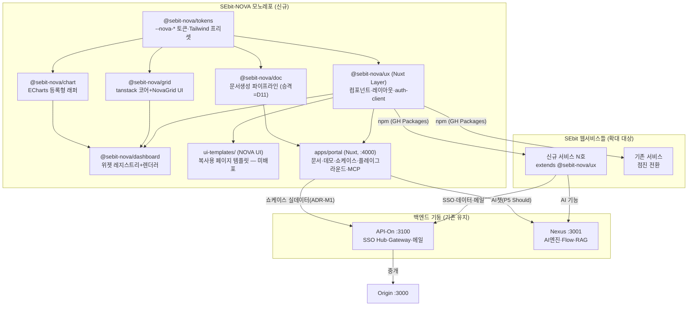
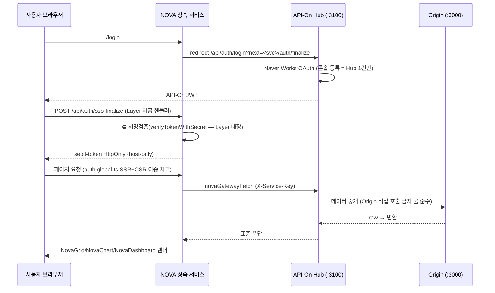

# SEbit NOVA — 웹서비스 표준 플랫폼 아키텍처 설계서

> 작성: 2026-07-27 · architect (SEbit-Creator 개발조직)
> 상위 문서: `docs/01-plan/nova-platform-spec.md` (planner, 2026-07-27)
> **개정 2026-07-27 (2차 — research 반영 증보)**: research ①(`docs/01-plan/nova-superiority-benchmark.md` 성능·확장성 벤치마크)·②(`docs/01-plan/nova-feature-coverage-checklist.md` 전수 기능 인벤토리) 반영 — **ADR-G~M(§8~§14) 증보**, 근거 원장 E18~E25 추가, 디렉토리 트리에 grid/features 증설·chart/renderer·doc 패키지·benchmarks/ 반영(§15), 성능 실측 게이트 신설(ADR-L), 통합 쇼케이스 플래그십(ADR-M). **기존 ADR-A~F·결정 D1~D9 불변**(신규 사용자 결정 = D10·D11, §17).
> ⛔ **전제 전환 반영 (사용자 확정 2026-07-27)**: planner 기획서의 "Canvas 편입/상속" 전제는 **폐기**됐다.
> ① Canvas는 다른 팀이 개편 중 → NOVA는 Canvas에 의존/편입/상속하지 않는다(선행 사례 참조만). Canvas 부채(ISS-252/256/257)는 NOVA 범위 밖.
> ② NOVA는 **독립 표준 Layer/디자인시스템을 신규 수립**하고 SEbit 웹서비스들이 이를 상속한다.
> ③ 백엔드 기둥 = **Nexus · API-On** (NOVA 하위, 우리 소유 — 유지·활용).
> 따라서 planner 문서의 P1(Canvas 부채 해소)·성공판정 Q1/Q7(Canvas 상속/감사게이트)은 본 설계에서 **재정의**된다(§7).

---

## 0. 근거 원장 (본 설계의 모든 결정 근거 — 2026-07-27 architect 직접 실측)

| # | 실측 항목 | 결과 | 측정 방법 |
|---|---|---|---|
| E1 | ECharts 버전 이원화 | **^5.6.0×5**(API-On·Canvas·Nexus·Sentinel·Stock) / **^6.0.0×3**(Origin·PROVE·PROVES/frontend) | 전 레포 package.json grep |
| E2 | @tanstack/vue-table | **4레포**: Origin ^8.21.3 · PROVE ^8.21.3 · Sentinel ^8.21.0 · PROVES 8.21.3 (전부 v8 정합) | package.json grep |
| E3 | **Nuxt UI 이원화 (신규 발견)** | **^4.5.1×3**(Canvas·Origin·PROVE) / **^3.x×7**(API-On 3.0·Nexus 3.0·Unity 3.0·EHS 3.0·Cure 3.1·Sentinel 3.1·Tick 3.1) / ^2.21×1(Agen-D frontend) | package.json grep — CLAUDE.md 표준("Nuxt UI v3")과 실물이 이미 상충. §17 D7 |
| E4 | Canvas Layer-safe 패턴 (참조) | `nuxt.config.ts`에서 `resolve(__dirname, ...)` 절대경로로 css·components 등록("소비 프로젝트에서도 정확히 참조" 주석). colorMode `storageKey: 'sebit-theme'` 전사 공통 | `SEbit-Canvas/nuxt.config.ts` 직접 확인 |
| E5 | Canvas 상속 실태 (참조) | Origin·PROVE `nuxt.config.ts:8` `// extends: ['../SEbit-Canvas']` **주석 상태 — 상속 0** (ISS-257) | 소스 직접 확인 |
| E6 | CanvasChartWrapper 패턴 (참조) | `echarts/core` 트리셰이킹 + `ClientOnly` + 다크테마 주입 + 4종 하드 등록(Line/Bar/Pie/Scatter) | `app/components/canvas/data/CanvasChartWrapper.vue` 직접 확인 |
| E7 | Nexus 실물 구조 | `server/engine/ai/`(BaseNode·node-registry 19종·flow-executor·vector-store·providers) + `server/api/` 15모듈 + Nitro `externals.inline`(LangChain, ISS-65/66 표준) | find + nuxt.config.ts 직접 확인 |
| E8 | API-On 실물 구조 | `server/engine/`{ai·connectors·crypto·gateway·observability·transform} + `server/api/` 29모듈(auth-gateway·api-keys·gateway·sla·openapi 등) | find 직접 확인 |
| E9 | Excel 라이브러리 | xlsx/exceljs **전 레포 0** (planner §A-2 일치) | planner 실사 승계 |
| E10 | 포트 현황 | 3000~3900 사용 중(100단위 룰) → **다음 빈 자리 = 4000** | `project_sebit_port_rule.md` + CLAUDE.md 프로젝트 맵 |
| E11 | `file:../` CI 함정 | @sebit/eslint-config `file:../sebit-eslint-config` — 로컬만 동작, **CI ubuntu runner에서 ERR_MODULE_NOT_FOUND**(2026-04-23 Stock 롤백). GH Packages publish 미완 부채 | CLAUDE.md §4 명시 |
| E12 | SSO canonical | 자체 OAuth 금지·API-On Hub 경유·`sebit-token` HttpOnly·**인바운드 토큰 서명검증 필수**(ISS-195/206/220/235/244/252 — 6연속)·role 어휘 단일 사다리 | `feedback_sebit_auth_canonical.md` |
| E13 | RBAC 전사 표준 | guest < viewer < editor < **manager** < admin (ISS-256 = Canvas의 builder 이중화가 결함) | `project_agend_rbac_common_module` + MEMORY.md |
| E14 | 브랜드 정본 | NOVA = 딥 퍼플 · 오로라 모티브. 라인업 = **UX·UI·Grid·Chart·Dashboard 5제품 + Portal(채널)** (사용자 D4 확정) | `project_sebit_brand_universe.md` |
| E15 | Micro 제약 | 순수 HTML/CSS/JS·프레임워크 금지 → **NOVA Portal은 Micro 안에 살 수 없다** (별도 Nuxt 앱 필수) | CLAUDE.md §3 프로젝트별 특이 규칙 |
| E16 | 신규 서비스 템플릿 | `SEbit-Creator/templates/new-project/` = CLAUDE.md·eslint.config.mjs·pre-commit·vitest.config.ts (nuxt.config 템플릿 없음 — F에서 추가) | find 직접 확인 |
| E17 | 벤치마크 MCP | softbowl `mcp/sbgrid3.do`·`mcp/sbchart2.do` HTTP 노출 실운영 | planner §A-1 (research 실측) 승계 |
| E18 | 상회 벤치마크 정본 (research ① 승계) | 소프트보울 성능 주장 = 전부 원리 서술·**절대 수치 0**(표1 #3·4·7·15·21) / 공식 Lazy 데모 = **"총 데이터 건: 100"**(표1 #11) → "정량 명시 공개 벤치 데모" 자체가 상회 서사(표1 관찰 2). ⛔ 본 문서의 상회 목표수치는 **업계 인용값 — NOVA 실측 아님**(R4 — ADR-L 게이트 전제) | `docs/01-plan/nova-superiority-benchmark.md` 실 fetch(2026-07-27) |
| E19 | ECharts 렌더러·대용량·접근성 팩트 | svg=무손실 확대·저메모리, >1k는 canvas 권장[EH] · line `sampling:'lttb'` 10,000+·`progressive` 3,000+[ES][EO] · WebGL 수백만 포인트[WS] · aria+decal(색각이상)[EA] · ⚠️ **키보드 접근성 미흡 = 공식 이슈 #18585**[EA2] | 벤치 표2 (ECharts 공식 문서·이슈 인용) |
| E20 | Grid 업계 기준선 | ag-grid 100k+행·보이는 ~40행만 렌더·SSRM 블록캐시(cacheBlockSize·maxBlocksInCache)·서버 그룹핑/집계[AG] · TanStack Virtual 60FPS[TV] · RealGrid 50만건 공개 데모(로드 ms 미기재 — U3)[RG] | 벤치 표2 |
| E21 | exceljs 우위 (외부 실측) | 50k행×20열 read: **exceljs 1.24s / SheetJS 1.56s**[SK] · SheetJS 커뮤니티판 셀 스타일 미지원·50MB→힙 300~400MB, exceljs는 스트리밍 API로 50MB+[XL] | 벤치 표2 |
| E22 | @tanstack/virtual·exceljs 사내 도입 | **전 레포 0** — NOVA Grid 상회 목표는 신규 도입이 전제 | 벤치 R2 (spec §36 승계) |
| E23 | 기능 인벤토리 정본 (research ② 승계) | SBUx **29종/56유형·속성 2,561** · SBGrid **데모 38항목+API 문서화 287**(메서드 126·12셀타입·개인화 API 7종·detailTemplate·virtualColumn·서버바인딩 3방식(Ajax/**WebSocket**/Http)·doCommand·setResource) · SBChart **42종·문서화 1,336항목**(접근성 9속성·extend 35그룹) · SBWrapDoc(Pubdoc·HWPX·Automation·DRM성 배포문서) · SBDashBoard=통합 시연물(정적 샘플·빌더 여부 미확인) | `docs/01-plan/nova-feature-coverage-checklist.md` 원시 데이터 직접 파싱(2026-07-27) |
| E24 | 소프트보울 프레임워크·AI 선점 실측 | Angular/React/Vue 데모 3종 HTTP 200 실확인(npm 래퍼 여부 미확인) · **MCP 2종 JSON-RPC initialize 200 실호출 확인** · SB-Chat BYOK 4프로바이더 · Monaco 플레이그라운드 내장 · v2.5 Code Generator | 체크 §2-5·§2-7·§3-5·§6 |
| E25 | 사내 문서 자산 실물 | pptxgenjs=F1 보고서 3샘플 완료(클라 생성 확정) · Playwright web→PDF 벡터 표준 · docx 스킬 보유 · **HWP/HWPX/Pubdoc/DRM 자산 0** | 메모리 `project_f1_report_ppt_samples`·`reference_proposal_web_to_pdf` + 벤치 §SBWrapDoc |

**[실측 필요]로 표기한 항목은 P1 착수 전 해당 담당이 측정 후 확정한다. 근거 없는 수치는 본 문서에 없다.**

---

## 1. 개요 — 전체 구조 한 장

**NOVA = 신규 모노레포 1개(SEbit-NOVA) + 기존 백엔드 기둥 2개(Nexus·API-On)의 3각 구조.**
모노레포가 프론트 표준(UX/UI/Grid/Chart/Dashboard + Portal)을 소유하고, 백엔드는 기존 API-On(Gateway·SSO Hub·메일)·Nexus(AI엔진·Flow)를 **그대로 소비**한다(코드 편입 아님 — 브랜드·Portal 문서 차원의 편입).



**모듈 경계 한 문장 요약** (게이트 체크 대응):

| 모듈 | 경계 한 문장 |
|---|---|
| tokens | "값(디자인 결정)만 있고 코드(컴포넌트·로직)는 없다" |
| **ux** | "`extends`로 상속되어 **런타임에 존재**하는 재사용 컴포넌트·토큰·레이아웃·auth-client" |
| **ui-templates** | "상속되지 않고 **개발 시점에 복사**되는 페이지 소스 — 복사한 순간 소유권은 서비스" |
| grid | "테이블 상태(정렬·필터·편집)를 다루는 유일한 곳 — tanstack 코어는 어댑터 뒤에 격리" |
| chart | "ECharts를 직접 만지는 유일한 곳 — 서비스는 NovaChart 계약(prop)만 안다" |
| dashboard | "위젯 계약과 배치 렌더러만 — 위젯 구현·저장 DB는 각 서비스 몫" |
| **doc** | "템플릿→데이터 바인딩→문서 파일(PPTX/DOCX/XLSX/PDF) 생성기만 — 무거운 실행 호스트(Playwright)·저장·발송은 서비스 몫" (ADR-J1 · 라인업 승격은 D11) |
| portal | "5제품의 전시·문서·플레이그라운드 채널 — 제품 코드를 소유하지 않고 소비만 한다" |
| **showcase** (portal 내) | "NOVA 계약으로 Portal이 조립한 6제품 결합 **전시물** — 배포물·제품이 아니며, 위젯 구현·데이터 연결은 Portal 소유" (ADR-M1 — Dashboard 제품=패키지 / 쇼케이스=그 1호 소비자) |

UX와 UI가 이름이 비슷하지만 경계가 상반된다(상속 vs 복사·런타임 vs 개발시점·NOVA 소유 vs 서비스 소유) — 사용자 D4 확정 명명이며, 위 한 문장 경계로 혼동을 차단한다. 패키지 디렉토리명은 혼동 방지를 위해 `ux/`와 `ui-templates/`로 물리적으로도 구분한다.

---

## 2. ADR-A — NOVA 표준 Layer / 디자인시스템 신규 수립 ⭐최우선

### ADR-A1: 저장소 = 신규 모노레포 `SEbit-NOVA` (npm workspaces)

- **날짜**: 2026-07-27 · **상태**: 제안
- **맥락**: 5제품+Portal이 강한 내부 의존(tokens→전 제품, ux→ui-templates/portal)을 갖고, 버전을 함께 릴리즈해야 한다. SEbit은 이미 15+ 레포로 sync.sh 관리 부담이 크다(CLAUDE.md 프로젝트 맵 실측).
- **결정**: **신규 레포 1개 `SEbit-NOVA`** = npm workspaces 모노레포. `packages/*`(배포물) + `apps/portal`(전시 채널) + `ui-templates/`(복사 소스). GitHub: Sebit-AI-Infra/SEbit-NOVA.
- **대안과 기각 사유**:
  - (b) 제품별 레포 분리(SEbit-NOVA-UX·-Grid…) — 레포 6개 추가·버전 동기 릴리즈 수작업·sync.sh 부담 폭증. 기각.
  - (c) 기존 레포(Canvas) 내 구축 — ⛔ 전제 위반(다른 팀 개편 중). 기각.
  - (d) SEbit-Creator 내 구축 — Creator는 control plane(기획·검증·거버넌스)이지 제품 코드 레포가 아님(`project_sebit_creator` 정본). 기각.
- **결과**: 레포 1개 추가로 억제. 내부 의존은 workspace 프로토콜(동일 레포)이라 E11의 `file:../` CI 함정이 **모노레포 내부에서는 발생하지 않는다**. 외부 소비(서비스→NOVA)의 함정 해소는 ADR-F2.

### ADR-A2: NOVA UX 컴포넌트 기반 = Nuxt UI 직접활용 + NOVA 토큰 래핑 (스냅샷 포크·풀 신규 기각)

- **날짜**: 2026-07-27 · **상태**: 제안 (버전 v3/v4는 D7 — §17)
- **맥락**: NOVA UX가 자체 컴포넌트 기반을 세워야 한다. 후보 3개.
- **결정**: **(a) Nuxt UI 직접활용 + NOVA 토큰/래핑.**
  - 전략 = 3계층: ① Nuxt UI 원자 컴포넌트를 그대로 노출(재래핑 금지 — 래퍼 유지비·prop 프록시 지옥 회피) ② NOVA 토큰(`--nova-*`)을 Nuxt UI 테마 변수·`app.config.ts`(ui.colors)에 바인딩해 브랜드를 입힘 ③ Nuxt UI에 없는 것만 `Nova*` 접두 자체 컴포넌트로 신규(NovaShell·NovaGnb·NovaLnb·NovaKpiCard·NovaEmptyState 등 — 최초 목록은 P1에서 8서비스 공통 UI 패턴 실사로 확정 **[실측 필요]**).
- **대안과 기각 사유**:
  - (b) Canvas 41컴포넌트 스냅샷 포크 — ① 다른 팀이 지금 개편 중인 코드의 스냅샷은 포크 즉시 진부화 ② Canvas 감사 부채(ISS-252~259)가 코드에 배어 있어 부채까지 복사할 위험 ③ "우리가 새로 개편한 것"과 "다른 팀이 새로 개편한 것"이 이중 표준이 되어 조직 문제 재생산. **기각. 단 배울 것은 가져온다**: Layer-safe 절대경로 등록(E4)·`sebit-theme` storageKey 승계(E4)·ChartWrapper 패턴(E6)·카테고리 11분류 체계(참조).
  - (c) 풀 신규(headless 직접 조립) — SBUx 30종급 원자 컴포넌트를 접근성 포함 자체 구축 = 다년 과투자. Nuxt UI는 이미 CLAUDE.md 전사 표준이고 접근성(Reka UI 기반)이 확보돼 있다. 기각.
- **결과**: 컴포넌트 유지비 최소·전사 스택 정합·접근성 기본선 확보. 트레이드오프 = Nuxt UI 메이저 업그레이드에 종속(현재 v3/v4 이원화 실측 E3 — D7에서 버전 확정 필수, NOVA가 이 이원화를 **끝내는 계기**가 되어야지 3번째 축이 되면 안 된다).

### ADR-A3: 디자인 토큰 네임스페이스 = `--nova-*`

- **날짜**: 2026-07-27 · **상태**: 제안
- **맥락**: 기존 네임스페이스 실측 — Canvas `--cv-*`(75회, E4)·Nexus/API-On `--nx-*`(38개, CLAUDE.md). 충돌 없는 신규 네임스페이스 필요.
- **결정**: **`--nova-*`**. 브랜드 정본(E14) 기반 팔레트: primary = 딥 퍼플 계열, accent = 오로라(퍼플→시안 그라데이션 보조 변수 `--nova-aurora-from/to`). 정확한 HEX 팔레트는 ui-designer 산출로 확정 **[ui-designer 위임]** — architect는 변수 계약(이름·단계 수: 50~950 스케일 + semantic 계층 bg/surface/card/border/text/primary/success/warning/danger + radius/shadow/font)만 확정한다. 토큰은 `@sebit-nova/tokens` 패키지 단일 소유 — ux/grid/chart/dashboard 모두 이 변수만 참조하고 HEX 직접 사용 금지(eslint 룰 후보).
- **대안과 기각 사유**: `--nv-*` — 기존 `--nx-*`(Nexus·API-On 38개)와 두 글자 접두가 시각적으로 오독되기 쉽다(nv≈nx). 변수명 길이 비용은 무시 가능하므로 명시성 우선. 기각.
- **결과**: 3개 네임스페이스(cv/nx/nova)가 공존해도 grep 한 번으로 소속이 갈린다. 서비스가 Canvas→NOVA로 갈아탈 때 치환 대상이 기계적으로 식별된다.

### ADR-A4: Layer 제공/오버라이드 경계 — "stateless만 Layer, stateful은 서비스·Hub"

- **날짜**: 2026-07-27 · **상태**: 제안
- **맥락**: Canvas 상속이 0이 된 구조적 원인 = UI Layer에 server/auth/db/cron이 혼재해 상속 부담이 컸다(ISS-257, E5 — 선행 사례에서 배운 것 중 가장 중요한 교훈).
- **결정**: NOVA UX Layer는 **stateless 계층만** 제공한다. DB 연결·cron·도메인 API·토큰 발급은 Layer에 **절대 금지**.

| 구분 | Layer(@sebit-nova/ux)가 제공 | 서비스가 소유/오버라이드 |
|---|---|---|
| 스타일 | `--nova-*` 토큰 CSS·Tailwind 프리셋·다크모드(`sebit-theme` storageKey 승계, E4) | `app.config.ts`에서 토큰 오버라이드(서비스 고유 primary 허용 범위는 토큰 계약에 명시) |
| 컴포넌트 | Nuxt UI 노출 + `Nova*` 자체 컴포넌트 | 도메인 컴포넌트(서비스 접두) |
| 레이아웃 | `NovaShell`(GNB/LNB 기본 레이아웃) | 페이지·메뉴 정의(`app.config.ts` navigation 스키마로 주입) |
| 인증 | **auth-client만**: `sso-finalize` 핸들러 팩토리(서명검증 내장, E12)·jwt verify util·`auth.global.ts`(SSR+CSR 이중 체크, CLAUDE.md 표준)·RBAC guard(E13 어휘) | 토큰 발급 = API-On Hub(서비스 소유 아님)·역할별 메뉴 구성 |
| server | stateless utils만(`server/utils/nova/*`) | `server/api/*` 전부·DB·cron·큐 |
| 데이터 | `useNovaGateway()` composable(API-On 호출 헬퍼) | 실제 엔드포인트·스키마 |

- **대안과 기각 사유**: "풀스택 Layer"(auth 발급·DB까지 포함) — Canvas가 실증한 실패 경로(상속 0). 상속 문턱이 높아지고 서비스별 DB 격리 룰(`feedback_schema_isolation`)과 충돌. 기각.
- **결과**: 상속 = "UI·인증클라이언트 표준을 공짜로 얻는 것"으로 가벼워진다. 트레이드오프 = 서비스가 server를 직접 세워야 하나, 이는 ui-templates(NOVA UI)의 서버 포함 템플릿과 F의 부트스트랩 템플릿이 메운다.

---

## 3. ADR-B — 라인업별 모듈 구조

### ADR-B1: NOVA UX vs NOVA UI 경계 = "상속 vs 복사"

- **날짜**: 2026-07-27 · **상태**: 제안
- **맥락**: 두 제품의 이름이 비슷해 경계 불명확 위험(아키텍트 절대 규칙 3). 사용자 D4가 명명을 확정했으므로 경계를 구조로 강제해야 한다.
- **결정**:
  - **NOVA UX** = npm 배포되는 Nuxt Layer. 서비스는 `extends`로 상속하며 **업데이트를 계속 받는다**(버전업 = 전 서비스 반영).
  - **NOVA UI** = `ui-templates/` 디렉토리의 페이지 레벨 완성 템플릿(로그인·리스트/상세·폼·설정·GNB/LNB 변형 등). **npm 배포하지 않는다.** 서비스는 소스를 복사해 시작하고, 복사한 순간 소유권·수정권은 서비스로 넘어간다(업데이트 미전파가 **의도된 동작** — 페이지는 서비스마다 갈라지는 게 정상).
  - 복사 수단: 1차 = Portal에서 소스 보기+복사(SBUx "소스는 예제탭" 패턴 차용, planner §4-④). 2차(Could) = `npx sebit-nova add <template>` CLI **[P4 이후 수요 확인 후]**.
  - 템플릿 규약: 각 템플릿 = `ui-templates/<name>/`{`pages/`·`components/`(필요시)·`server/`(필요시 최소 API 스텁)·`README.md`(어떤 UX 컴포넌트를 조립했는지 명세)}. 템플릿은 **UX 컴포넌트와 토큰만 사용**해야 한다(자체 스타일 하드코딩 금지 — 이것이 "UX로 조립한 샘플"의 정의이자 CI 검증 항목).
- **대안과 기각 사유**: UI도 npm 패키지 배포 — 페이지 템플릿을 버전 종속시키면 서비스가 페이지를 수정할 때마다 diverge 충돌. 페이지는 라이브러리가 아니다. 기각.
- **결과**: "왜 UI는 업데이트가 안 오나요"라는 미래 질문에 구조가 답한다(README·Portal에 명문화).

### ADR-B2: NOVA Grid = tanstack v8 헤드리스 코어 + NovaGrid UI 레이어 (어댑터 격리)

- **날짜**: 2026-07-27 · **상태**: 제안 (**최종 경로 = 사용자 D1** — 본 ADR은 planner 추천 (a) 전제의 구조 설계 + 경로 교체 대비 구조만 확정)
- **맥락**: 실측 — tanstack/vue-table v8이 이미 4레포(E2), Excel 라이브러리 0(E9), 자체 그리드는 CanvasDataTable(검색·정렬·페이지네이션) 수준. 요구 기능군 = Sticky·Grouping·Excel·트리·편집·Undo/Redo·대용량(SBGrid 관찰 기능군).
- **결정**: 패키지 내부를 3층으로 나눠 **코어 교체 가능성**을 구조로 보존한다.

```
packages/grid/
├─ src/
│  ├─ core/                 # 어댑터 계층 — tanstack API가 새는 유일한 곳
│  │  ├─ adapter.ts         # NovaGridCore 인터페이스(행모델·정렬·필터·그룹핑·확장 상태 계약)
│  │  └─ tanstack.ts        # tanstack v8 구현체 (D1이 상용으로 바뀌면 이 파일만 교체)
│  ├─ components/
│  │  ├─ NovaGrid.vue       # 단일 진입 컴포넌트 — 서비스는 이것만 안다
│  │  └─ internal/          # 헤더·셀·풋터·그룹행 등 내부 조각
│  ├─ features/             # 기능군 = 독립 모듈 (Must/Should/Could 단계 투입 단위)
│  │  ├─ sticky.ts          # 컬럼 고정(CSS sticky + 그림자)
│  │  ├─ resize.ts          # 컬럼 리사이즈
│  │  ├─ virtual.ts         # 가상 스크롤 — @tanstack/vue-virtual 신규 도입 [실측 필요: 도입 레포 0]
│  │  ├─ grouping.ts        # 그룹핑·트리뷰 (tanstack 내장 grouping/expanding 모델 활용)
│  │  ├─ excel.ts           # Excel 다운로드 — exceljs 신규 도입 (아래 근거)
│  │  ├─ edit.ts            # 셀 편집 (편집 상태 머신)
│  │  ├─ clipboard.ts       # Copy&Paste (TSV 직렬화)
│  │  └─ undo.ts            # Undo/Redo — 명령(Command) 스택, edit/clipboard의 변이만 기록
│  └─ index.ts
└─ package.json             # @sebit-nova/grid
```

  - **Excel 라이브러리 = exceljs 권고**: 요구가 "스타일 포함 다운로드"(planner Must)인데, xlsx(SheetJS) 커뮤니티판은 셀 스타일 미지원(스타일은 유료 Pro)으로 알려져 있다 **[실측 필요 — P3 착수 시 최신 라이선스·기능 재확인]**. exceljs는 스타일·수식 지원 오픈소스. 클라이언트 다운로드 기준(서버 생성은 서비스 몫).
  - **대용량 경계**: 가상 스크롤(클라 10만행급)까지가 Grid 패키지 책임. 그 이상(100만+, Sentinel 케이스)은 서버 페이지네이션 = 서비스+API-On 책임으로 경계 명시(N+1 금지·페이지네이션 필수 — CLAUDE.md Phase 3).
- **대안과 기각 사유** (D1 판단 재료):
  - (b) 상용(ag-grid Enterprise / RealGrid) — 기능 완성도는 즉시 확보되나 ① 라이선스 비용 연 단위 지속 ② `--nova-*` 토큰·다크모드 테마 통제 제한 ③ 4레포 기존 tanstack 자산과 이중화 ④ 대외 상품화(D2) 시 서드파티 라이선스가 판매 조건을 오염. 단 **D2가 그리드 중심 상품화로 확정되면 재검토**(planner D1 트리거 승계) — 그 경우에도 `core/adapter.ts` 뒤에 넣으면 NovaGrid 계약은 불변.
  - (c) 풀 자체개발(행모델부터) — SBGrid 680 API급 재현에 다년. 기각(planner 판정 승계).
- **결과**: 기존 4레포의 tanstack 지식·코드가 그대로 자산화. 트레이드오프 = Sticky·가상스크롤·편집 UI는 자체 구현 비용이 실재하며 P3 기간의 대부분을 차지한다(기능군별 독립 모듈이라 Must부터 단계 투입 가능).

### ADR-B3: NOVA Chart = ECharts 등록형 래퍼 + 접근성 계약 내장 (버전 통일 = D5)

- **날짜**: 2026-07-27 · **상태**: 제안 (**버전 확정 = 사용자 D5**)
- **맥락**: 실측 E1 — 5.6×5 / 6.0×3. 신규 NOVA Chart는 어차피 신규 코드라 기준 버전을 정해야 한다.
- **결정**:
  - **버전 ADR 초안 — 6.0 통일 권고**: ① 3레포(Origin·PROVE·PROVES)가 이미 6.0 — 이들을 5.6으로 **다운그레이드**하면 이미 사용 중일 수 있는 6.0 API 상실 위험이 업그레이드 위험보다 방향이 나쁘다 ② 신규 플랫폼을 구버전에 앵커하면 수명이 짧다. ⛔ 단 5.6→6.0 breaking change 목록과 5개 레포(API-On·Canvas·Nexus·Sentinel·Stock) 실사용 영향은 **[실측 필요 — P2-1 실사와 함께, 레포별 before/after 회귀 필수(`feedback_optimize_no_regression`)]**. Canvas는 다른 팀 소관이므로 통일 대상에서 **제외 통보만**(강제 불가 — 분모 8→7 재정의, §7).
  - **래퍼 구조 — CanvasChartWrapper 패턴 차용(E6) + 하드 등록을 레지스트리로 교체**:

```
packages/chart/
├─ src/
│  ├─ NovaChart.vue          # 단일 진입 — ClientOnly + echarts/core + 테마 주입 (E6 패턴 차용)
│  ├─ registry.ts            # defineChartPreset(name, {charts:[], components:[], buildOption})
│  │                         #   — Canvas의 "4종 하드 use()"를 등록형으로: 프리셋이 자신의
│  │                         #     echarts 모듈만 lazy 등록 → 트리셰이킹 유지 + 무한 확장
│  ├─ presets/               # line·bar·pie·scatter (Canvas 4종 승계) + P2-1 실사로 확장
│  ├─ theme.ts               # --nova-* 토큰 → ECharts 테마 객체 (다크모드 반응형)
│  └─ a11y.ts                # 접근성 1단계
└─ package.json              # @sebit-nova/chart
```

  - **접근성 계약 내장(SA 1단계, planner D3 선반영 승계)**: `NovaChart`의 prop 계약에 `alt`(대체텍스트, **required** — 누락 시 dev 경고) + `#data-table` 슬롯(데이터 테이블 토글 기본 구현 제공)을 처음부터 넣는다. 나중에 덧대면 전 사용처 재작업이므로 v1 계약에 포함(비가역 방향 — planner D3 추천 논리와 동일).
- **대안과 기각 사유**: 차트 라이브러리 교체(Chart.js 등) — ECharts가 8레포 실측 표준이고 41종 커버 가능(research). 교체는 발명. 기각. / 래퍼 없이 ECharts 직사용 표준화 — 테마·다크모드·접근성·트리셰이킹을 서비스마다 반복(현재 문제의 존속). 기각.
- **결과**: 서비스는 `<NovaChart preset="line" :option :alt>`만 안다. ECharts 메이저 교체 시에도 접점은 chart 패키지 1곳.

### ADR-B4: NOVA Dashboard = 위젯 계약 + 배치 렌더러만 (저장은 서비스 DB)

- **날짜**: 2026-07-27 · **상태**: 제안 (제품 승격 여부는 planner D6 결과 승계 — 구조는 양쪽 모두 대응)
- **맥락**: NOVA UI의 일반 레이아웃과 구분되는 "대시보드 특화" = 위젯 단위 조립·배치·저장. Nexus 대시보드(고정형)와 Canvas PresetDashboard(참조)가 선행 사례.
- **결정**: dashboard 패키지는 **3가지만** 소유한다 — ① `NovaWidget` 계약(TS 인터페이스: id·title·size(w×h 그리드 단위)·component·dataSource?) ② `NovaDashboardGrid` 배치 렌더러(12컬럼 그리드·드래그/리사이즈) ③ 레이아웃 직렬화 스키마(JSON: 위젯 인스턴스 배열+좌표 — 버전 필드 포함). **저장/불러오기 API와 DB 테이블은 서비스 몫**(Layer stateless 원칙 ADR-A4 일관). 실데이터 바인딩은 `dataSource`에 `useNovaGateway()` 어댑터를 꽂는 규약(ADR-E2) — SBUx에 없는 수직결합 차별화가 여기서 실현된다.
  - 드래그/리사이즈 구현 라이브러리(grid-layout-plus 등 Vue3 호환 후보) 선정 **[실측 필요 — P4/D6 시점, 후보 비교표로]**. 1차(D6 기본안=데모)는 프리셋 고정 배치로 충분해 라이브러리 결정을 미룰 수 있다.
- **대안과 기각 사유**: 저장까지 패키지가 소유(내장 DB 스키마 강제) — 서비스별 DB 격리 룰과 충돌, Layer에 stateful 침투(Canvas 실패 경로). 기각.
- **결과**: D6이 (b) 데모로 남아도 (a) 제품 승격돼도 계약·렌더러·스키마는 재사용된다.

### 참고: 레이아웃 직렬화 스키마 (dashboard 저장 — 서비스 DB 구현 시 표준)

```sql
-- 서비스 측 구현 예시 (테이블 소유 = 각 서비스, 스키마 형태만 NOVA 표준)
CREATE TABLE nova_dashboard_layouts (
  id          UUID PRIMARY KEY DEFAULT gen_random_uuid(),
  owner_id    TEXT NOT NULL,             -- sebit-token sub
  name        TEXT NOT NULL,
  layout      JSONB NOT NULL,            -- NovaDashboardLayout v1 (패키지가 zod 스키마 제공)
  is_shared   BOOLEAN NOT NULL DEFAULT false,
  created_at  TIMESTAMPTZ NOT NULL DEFAULT now(),
  updated_at  TIMESTAMPTZ NOT NULL DEFAULT now()
);
CREATE INDEX idx_nova_dash_owner ON nova_dashboard_layouts(owner_id);
```

---

## 4. ADR-C — NOVA Portal 아키텍처

### ADR-C1: Portal = 모노레포 내 Nuxt 앱, NOVA UX **1호 상속자** (dogfooding)

- **날짜**: 2026-07-27 · **상태**: 제안
- **맥락**: Micro는 순수 HTML/CSS/JS 제약(E15)이라 Portal을 담을 수 없다. Canvas Explorer는 참조만(전제 1). 성공판정 "상속 서비스 ≥1"의 가장 빠른 실증 경로가 필요하다.
- **결정**: `apps/portal` = Nuxt 앱, `extends: ['@sebit-nova/ux']`. **Portal 자신이 상속 파일럿 1호** — Layer가 상속 불가능하면 Portal 빌드가 즉시 깨지므로 상속 가능성이 CI에서 상시 검증된다(Canvas "상속 0" 사태의 구조적 재발 차단). dev 포트 **4000**(100단위 룰 다음 빈 자리, E10 — §17 D9 확정 요청). 도메인 `nova.sebit.co.kr` [추정 — devops+사용자 확정]. 역할 분담: Micro `/nova` = 브랜드 소개(딥퍼플·오로라) → Portal 링크 / Portal = 개발자 실사용(문서·데모·플레이그라운드).
- **대안과 기각 사유**: Portal을 별도 레포로 — 문서·데모가 컴포넌트 소스와 레포가 갈라지면 "데모=문서" 동기가 프로세스(사람)에 의존하게 된다. 같은 레포·같은 PR에서 컴포넌트와 문서가 함께 바뀌는 구조가 동기 강제의 전제. 기각.
- **결과**: 상속 실증·문서 동기·전시가 한 레포에서 해결.

### ADR-C2: "데모=문서" 파이프라인 = Nuxt Content + vue-component-meta (Storybook 기각)

- **날짜**: 2026-07-27 · **상태**: 제안
- **맥락**: 벤치마크 표준(Telerik 코드/문서 동기 강제·Storybook 스토리=데모=문서, planner §4). 어긋남을 도구가 아니라 **구조로** 차단해야 한다.
- **결정**: 3단 파이프라인, 전부 Portal 빌드 안에서:
  1. **API 레퍼런스 자동 추출**: `vue-component-meta`(Volar 공식 — props/events/slots/exposed 타입 추출)를 빌드 스텝으로 실행 → `packages/ux(외 전 제품)` 컴포넌트 → `component-meta.json` 생성. 손으로 쓰는 API 표 금지(어긋남의 근원 차단). **[실측 필요 — Nuxt Layer 컴포넌트 대상 추출 동작을 P1에서 PoC 3종으로 검증(planner P1-6 "샘플 3종" 판정 승계)]**
  2. **데모 = 실파일 단일 소스**: 데모는 `apps/portal/demos/<component>/<demo>.vue` 실 SFC 1개. 문서 페이지의 `<NovaDemo>` 컴포넌트가 같은 파일을 ① 컴포넌트로 렌더 ② `?raw` import로 소스 표시 — 렌더와 소스가 물리적으로 같은 파일이므로 어긋남이 불가능.
  3. **가이드 산문**: Nuxt Content(markdown) — 튜토리얼 5단계(planner §4-②: 상속→적용→생성→데이터연결→테마)·릴리즈노트(CHANGELOG.md 소스).
- **대안과 기각 사유**:
  - Storybook — 장점: 스토리 생태계·애드온. 단점: ① Nuxt Layer 컴포넌트(auto-import·Nuxt 컨텍스트) 구동에 `@storybook-vue/nuxt` 의존 — 성숙도 **[실측 필요]** ② 빌드 체인 2벌(Portal Nuxt + Storybook) 관리 ③ Portal 서사(제품홈·튜토리얼·구매 등 비컴포넌트 페이지)를 Storybook이 못 담아 결국 이중 사이트. 기각 — 단 "스토리=데모=문서" **원칙**은 위 2번 구조로 차용.
  - 자체 문서 시스템 풀신규 — 과투자. 기각.
- **결과**: `component-meta.json`이 **P5 MCP 서버의 데이터 소스로 그대로 재사용**된다(ADR-D1) — 이 재사용이 Nuxt Content 경로를 고른 결정적 근거다(파이프라인 1개로 문서+MCP 2개 소비처).

### ADR-C3: 라이브 플레이그라운드 = 2단계 (iframe srcdoc → @vue/repl)

- **날짜**: 2026-07-27 · **상태**: 제안
- **맥락**: 벤치마크 관찰 = "JS/HTML 편집기 + Run/Reset + Result"(SBUx API가이드 예제탭). planner는 Should(P4 후반).
- **결정**:
  - **1단계(P4, 벤치마크 동등)**: 코드 에디터(monaco 또는 CodeMirror 6 — 번들 크기 실측 비교 후 선정 **[실측 필요]**) + **sandbox iframe `srcdoc`** 실행(`sandbox="allow-scripts"` — 부모 컨텍스트 격리, 토큰·쿠키 접근 차단). NOVA UX 컴포넌트는 iframe 내 사전 번들 런타임(UMD/ESM 빌드 1개)으로 주입.
  - **2단계(Could)**: `@vue/repl`(Vue 공식 SFC Playground 실물 패키지)로 SFC 편집·컴파일 승격. Nuxt auto-import 없는 명시 import 방식으로 NOVA 컴포넌트 import map 제공 **[실측 필요 — @vue/repl에 커스텀 라이브러리 주입 PoC]**.
- **대안과 기각 사유**: StackBlitz WebContainers 임베드 — 외부 SaaS 종속+대내망(IDC) 이용 제약 가능성. 기각. / 1단계 없이 바로 @vue/repl — 벤치마크 동등(1단계)이 먼저, 승격은 수요 확인 후. 기각.
- **결과**: 보안 경계(iframe sandbox)가 처음부터 구조에 있다. Portal이 사내 인증 뒤에 있어도 플레이그라운드 실행 코드가 세션에 접근 불가.

---

## 5. ADR-D — MCP·AI 지원 아키텍처 (P5)

### ADR-D1: NOVA MCP 서버 = Portal Nitro 내 Streamable HTTP 라우트 (별도 서비스 아님)

- **날짜**: 2026-07-27 · **상태**: 제안
- **맥락**: 벤치마크 실운영(E17: softbowl `mcp/sbgrid3.do`·`sbchart2.do` = 제품 사이트 경로 아래 HTTP 노출). 우리 데이터 소스는 ADR-C2의 `component-meta.json`+데모 SFC+ui-templates — 전부 Portal 빌드 산출물이다.
- **결정**: MCP 서버를 **Portal의 Nitro `server/routes/mcp/`** 로 구현(Streamable HTTP 트랜스포트). 별도 컨테이너·레포 없음 — 데이터 소스와 같은 배포 단위이므로 버전 불일치(문서는 v1.2인데 MCP는 v1.1)가 구조적으로 불가능. 벤치마크의 "제품 사이트 경로 아래 /mcp" 형태와도 일치.
  - **노출 tools** (컴포넌트 API·예제 범위 한정):
    | tool | 입력 | 출력 | 데이터 소스 |
    |---|---|---|---|
    | `list_components` | category? | 컴포넌트 목록+한줄 설명 | component-meta.json |
    | `get_component_api` | name | props/events/slots 표 | component-meta.json |
    | `get_examples` | name | 데모 SFC 소스들 | demos/*.vue (?raw) |
    | `get_template` | template name | NOVA UI 템플릿 전체 소스 | ui-templates/ |
    | `get_tokens` | — | --nova-* 토큰 계약 | @sebit-nova/tokens |
  - ⛔ 노출 금지: 서비스 소스·인증정보·내부 API 스키마. 인증: 1차 대내 = `X-Service-Key`(API-On 게이트웨이 키 체계 재사용) 또는 CF Access **[devops 결정]**. 대외(D2 확정 시)엔 공개 읽기전용으로 전환 가능한 구조.
  - 배포: Portal 컨테이너에 포함 → IDC Docker + CF Tunnel → `nova.sebit.co.kr/mcp` [도메인 추정 — D9].
- **대안과 기각 사유**: 별도 MCP 마이크로서비스 — 컨테이너+레포+버전 동기 부담 추가, 데이터 소스가 Portal 산출물이라 결합이 자연스러운데 분리는 인위적. 기각. / Nexus engine/ai에 편입 — Nexus는 Flow 실행 엔진이지 정적 카탈로그 서버가 아님(모듈 경계 침범). 기각.
- **결과**: "MCP 실동작 ≥1건 실트래픽"(planner Q6) 검증이 Portal 배포 1회로 가능.

### ADR-D2: AI 생성·챗은 Nexus/API-On 경유 (Portal 자체 LLM 호출 금지)

- **날짜**: 2026-07-27 · **상태**: 제안
- **맥락**: Nexus에 AI엔진 실물(E7: providers·vector-store·RAG), API-On에 engine/ai 실물(E8). 포털 AI챗은 planner Should.
- **결정**: Portal은 LLM SDK를 직접 들지 않는다. AI챗(P5 Should) = **Nexus AI엔진 API 호출**(RAG 소재 = component-meta.json+가이드 markdown을 Nexus knowledge에 주입). "NOVA 컴포넌트 코드 생성"은 MCP(ADR-D1)를 통해 사용자의 AI 어시스턴트(Claude 등)가 수행하는 것이 1차 형태 — 우리가 생성 LLM을 또 세우지 않는다.
- **대안과 기각 사유**: Portal에 LangChain 직접 탑재 — Nexus와 중복 구현(CLAUDE.md §0 "왜 매번 새로 짜냐" 정면 위반)+Nitro inline 빌드 부담(E7의 ISS-65/66) 중복. 기각.
- **결과**: LLM 키·프롬프트·모델 교체가 Nexus 단일 지점. NOVA⊃Nexus 세계관과 실구조 일치.

---

## 6. ADR-E — 백엔드 수직결합 (SBUx에 없는 차별화)

### ADR-E1: 인증 = Layer의 auth-client + API-On Hub (자체 인증 금지)

- **날짜**: 2026-07-27 · **상태**: 제안
- **맥락**: E12 canonical(자체 OAuth 금지·Hub 경유·서명검증 6연속 ISS)·E13 role 표준. Canvas RBAC는 참조만 — 단 Canvas의 실패(ISS-256 builder 이중화)를 어휘 표준으로 회피.
- **결정**: NOVA UX Layer에 **auth-client 계층**을 내장해 신규 서비스의 SSO 도입 = "상속 + 콜백 URL 등록 0건"으로 만든다:
  - `server/utils/nova/auth.ts` — `createSsoFinalizeHandler()` 팩토리: **인바운드 토큰 서명검증 내장**(`verifyTokenWithSecret` — ⛔ decodeToken 금지 주석 박제, E12 절대금지 7 준수) + `sebit-token` HttpOnly·host-only 쿠키 발급(절대금지 2·3 준수).
  - `app/middleware/auth.global.ts` — SSR(`useCookie`)+CSR(`localStorage`) 이중 체크(CLAUDE.md 인증 미들웨어 필수 규칙 1:1).
  - RBAC guard — 어휘 = **guest < viewer < editor < manager < admin 단일 사다리**(E13). `requireRole(event, 'manager')` server util + `<NovaRoleGate min-role>` 클라 컴포넌트. 별칭(operator·builder) 금지 — eslint 룰 후보.
  - 토큰 **발급·OAuth·콘솔 등록은 API-On Hub 단일 책임**(기존 그대로) — Layer는 검증·소비만.
- **대안과 기각 사유**: NOVA 자체 인증 서버 신설 — canonical 정면 위반(자체 OAuth 금지)+Hub와 이중화. 기각. / Canvas RBAC 코드 차용 — ISS-256 어휘 결함 코드를 참조원으로 삼을 수 없음, 어휘는 표준(E13)에서 가져온다. 기각.
- **결과**: 신규 서비스 SSO = PROVES 패턴(sso-finalize 50줄)이 0줄(상속)로 준다. 서명검증이 Layer에 있으므로 **7번째 ISS-195류 재발이 구조적으로 차단**된다 — 이것이 본 설계의 최대 보안 가치.

### ADR-E2: 데이터·메일 = `useNovaGateway()` — API-On 경유 표준화 (Origin 직접 호출 차단)

- **날짜**: 2026-07-27 · **상태**: 제안
- **맥락**: 생태계 데이터 흐름 = Origin→API-On→서비스(CLAUDE.md §2·eslint `no-direct-origin-call`). 메일 = API-On `/gateway/mail/send`(`reference_sebit_mail_smtp_infra`).
- **결정**: Layer가 `useNovaGateway()` composable(+server util `novaGatewayFetch`)을 제공 — base URL(환경변수 `NOVA_GATEWAY_URL`, 하드코딩 금지: eslint `no-hardcoded-service-url` 정합)·`X-Service-Key` 주입·에러 표준(createError, 폴백 금지)을 일원화. Dashboard `dataSource`(ADR-B4)·NOVA UI 템플릿의 데이터 호출이 전부 이 헬퍼를 쓴다. 승인메일 헬퍼(`sendApprovalMail`)는 Should [P 후순위 — 수요 서비스 확인 후].
- **대안과 기각 사유**: Gateway/Flow 코드를 NOVA 모노레포로 이관 — Nexus·API-On은 독립 운영 중인 실서비스(포트·배포·DB 보유)로, 이관은 "NOVA ⊃ Nexus·API-On = 브랜드 계층"을 "코드 병합"으로 오독하는 것. 편입은 Portal 문서·서사 차원(planner §2-2 승계). 기각.
- **결과**: "UI 컴포넌트가 실데이터 API와 바로 연결되는 플랫폼" 포지셔닝(planner)이 composable 하나로 체감된다.

---

## 7. ADR-F — "다양한 웹서비스로 확대" 아키텍처

### ADR-F1: 상속 규약 (서비스 ↔ NOVA 계약)

- **날짜**: 2026-07-27 · **상태**: 제안
- **결정**: 신규 SEbit 웹서비스의 표준 시작 형태:

```ts
// nuxt.config.ts (신규 서비스)
export default defineNuxtConfig({
  extends: ['@sebit-nova/ux'],        // ← NOVA 표준 상속 (ADR-F2 의존 방식)
  devServer: { port: <100단위 신규> },
  // 서비스 몫: pages/, server/api/, DB, 도메인 컴포넌트
})
```

  - Layer 보장(ADR-A4 표) vs 서비스 몫의 계약을 `@sebit-nova/ux` README에 표로 박제. Layer 버전업 정책 = semver: **minor/patch는 무해 보장**(컴포넌트 prop 계약 불변), major만 마이그레이션 가이드 필수(Portal 릴리즈노트 연동).
  - 기존 서비스 전환은 **강제하지 않는다** — 신규부터 기본 경로, 기존은 개편 시점에 자발 전환(Canvas 사태의 교훈: 상속은 강요가 아니라 이득이어야 일어난다).

### ADR-F2: 의존 방식 = GitHub Packages npm 배포 (`file:../`·원격 git extends 기각) ⭐확대의 성패

- **날짜**: 2026-07-27 · **상태**: 제안 (§17 D8 — publish 부채 해소 포함이므로 사용자 확정 필요)
- **맥락**: **E11 실증 함정** — `file:../sebit-eslint-config`가 CI ubuntu runner에서 `ERR_MODULE_NOT_FOUND`(sibling 부재+private repo)로 실패, 2026-04-23 Stock 롤백. NOVA를 같은 방식으로 배포하면 **상속 서비스 전부의 CI가 깨진다** — 확대 아키텍처의 단일 최대 리스크.
- **결정**: `@sebit-nova/*`를 **GitHub Packages(npm)** 로 배포하고 서비스는 버전 명시 의존(`"@sebit-nova/ux": "^1.0.0"` + `.npmrc` 스코프 레지스트리 + CI `NODE_AUTH_TOKEN`). 모노레포 CI가 태그 push 시 일괄 publish. **버전 트레인 = fixed**(전 패키지 동일 버전 — 1차엔 조합 폭발 방지 우선, 독립 버전은 수요 발생 시 전환) **[도구(changesets 등) 선정 = devops]**.
  - 로컬 개발(SEbit-NOVA 자체 수정 시)은 모노레포 내부 workspace로 해결되므로 `file:../`가 필요 없다. 소비 서비스의 로컬 개발도 published 버전 사용이 기본(디버깅 시에만 `npm link`).
- **대안과 기각 사유**:
  - `extends: 'github:Sebit-AI-Infra/SEbit-NOVA/packages/ux#v1'`(Nuxt 원격 Layer/giget) — private repo에 `GIGET_AUTH` 토큰 필요·lockfile 무결성 밖(감사 추적 약함)·모노레포 서브디렉토리 extends 동작 **[실측 미확인]**. npm이 표준적이고 검증 가능. 기각.
  - `file:../SEbit-NOVA/packages/ux` — E11 실증 실패 경로의 반복. **기각(⛔)**.
  - git submodule — 15+ 레포에 서브모듈 운영 부담·버전 반자동. 기각.
- **결과**: **선결조건 = GH Packages publish 파이프라인**(조직 최초 — sebit-eslint-config 부채와 동일 뿌리). NOVA P1에서 이 파이프라인을 뚫으면 sebit-eslint-config publish 부채(CLAUDE.md §4 "정식 해결 미완")도 같은 방법으로 해소된다 — 1타 2피, devops 담당.

### ADR-F3: 부트스트랩 = SEbit-Creator new-project 템플릿에 NOVA 상속 반영

- **날짜**: 2026-07-27 · **상태**: 제안
- **맥락**: E16 실측 — 현 템플릿에 nuxt.config 템플릿 자체가 없다. planner Q8(신규 서비스 기본 경로=NOVA)의 실현 지점.
- **결정**: `SEbit-Creator/templates/new-project/`에 추가: `nuxt.config.ts`(ADR-F1 형태)·`package.json`(@sebit-nova/ux 의존+.npmrc)·`app/pages/index.vue`(NovaShell 확인 페이지)·CLAUDE.md 템플릿에 "UI는 NOVA 표준, 커스텀 전 Portal 확인" 절 추가. 시작 페이지들은 **NOVA UI 템플릿 복사**로 채우는 절차를 README에 명시(UX=상속·UI=복사 규약의 부트스트랩 반영).
- **결과**: 신규 서비스 1호가 NOVA 상속으로 시작하는 것이 판정 기준(아래 성공판정 재정의 Q8').

### 성공판정 재정의 (planner §8을 전제 전환에 맞게 — planner 정본 개정은 planner 몫, 여기선 아키텍처 관점 재해석만)

| planner | 재정의 | 사유 |
|---|---|---|
| Q1 "Canvas를 Layer로 상속 ≥1" | **Q1' `@sebit-nova/ux` 상속 ≥1 (1호=Portal 자신) → P4 시점 ≥3** | Canvas 의존 폐기 |
| Q2 "41/41 문서" | **Q2' NOVA 전 공개 컴포넌트 API 문서 100%(자동 추출) — 분모=NOVA 컴포넌트 수(P1 확정)** | 41은 Canvas 분모 |
| Q3 "ECharts 8/8 단일" | **Q3' 7/7**(Canvas 제외 — 타 팀 소관, 통보만) | 전제 1 |
| Q7 "Canvas 감사게이트 ✅" | **삭제 — NOVA 범위 밖.** 대신 **Q7' NOVA 레포 자체가 sebit-eslint-config+CI 게이트로 시작**(부채 0 출발) | 전제 1 |
| Q8 신규 서비스 기본 경로 | **Q8' 유지** + ADR-F3 템플릿 반영을 판정에 포함 | — |

---

## 8. ADR-G — NOVA Chart 이중 렌더러·접근성·전수 커버 (최우선 상회축 🟢)

> **인용 표기(§8~§14 공통)**: [벤치 표N·#N·UN·RN] = `docs/01-plan/nova-superiority-benchmark.md`(research ①) / [체크 §N] = `docs/01-plan/nova-feature-coverage-checklist.md`(research ②) / [AG][TV][RG][XL][SK][EH][ES][EO][WS][EA][EA2][WC][NX] = 벤치 문서의 외부 출처 태그를 그대로 승계. 확인 못한 것은 전부 **[실측 필요]** 로 표기 — 근거 없는 수치·구조 발명 0.

### ADR-G1: 이중 렌더러 = `renderer: 'auto' | 'svg' | 'canvas'` 런타임 선택 (SBChart 장점 흡수 + 대용량 구조적 상회)

- **날짜**: 2026-07-27 · **상태**: 제안 (ADR-B3 계약 확장 — B3 불변, 렌더러 축 추가)
- **맥락**: SBChart는 **SVG 전용** — "확대해도 깨지지 않는 화질"이 유일한 렌더 축이고 대용량 규모 수치는 어디에도 없다(E18·벤치 표1 #15). ECharts는 `renderer` 옵션으로 svg/canvas 양쪽을 지원(E19[EH]) — 우리는 이미 단일 진입 래퍼(NovaChart, ADR-B3)가 있어 렌더러 선택을 **계약에 넣을 자리**가 있다. 벤치 판정: "SVG 무손실 + Canvas 대용량 둘 다 = SBChart가 구조적으로 못 따라오는 핵심 차별화"(표2 Chart 행 🟢).
- **결정**: NovaChart prop에 `renderer: 'auto' | 'svg' | 'canvas'`(기본 `'auto'`) 추가. 구현은 `chart/src/renderer/` 단일 소유.
  - **자동 선택 정책** (임계값은 ECharts 공식 가이드 인용 — L 게이트 실측 후 조정):
    | 데이터 규모(시리즈 합산 포인트) | 렌더러 | 자동 보강 |
    |---|---|---|
    | ≤ 1,000 | **svg** — 무손실 확대·저메모리[EH] = SBChart 장점 흡수 | — |
    | > 1,000 | **canvas**(">1k는 canvas 권장"[EH]) | line 계열 ≥10,000 포인트 → `sampling:'lttb'`[ES] · ≥3,000 요소 → `progressive`[EO] 자동 주입 |
    | 수백만 포인트 | **WebGL**(echarts-gl[WS]) | 별도 프리셋(`scatter-gl` 등)으로만 — registry(B3)가 lazy 등록, 기본 번들 포함 ⛔ [실측 필요 — echarts-gl의 ECharts 6.0 호환성, D5 연동] |
  - `renderer` 명시 지정 시 자동 정책 오버라이드(무손실 인쇄용 대시보드 = svg 강제 등).
  - **구현 주의**: ECharts 렌더러는 `init` 시점 고정 — `'auto'`에서 데이터가 임계를 넘나들면 래퍼가 **dispose + re-init**하고 줌/툴팁 상태를 보존·복원한다. re-init 비용은 L 게이트 항목(L-5)으로 실측 **[실측 필요]**.
- **대안과 기각 사유**:
  - canvas 단일(ECharts 기본) — "무손실 확대" 상회 서사(SBChart 유일 강점 흡수)를 스스로 버림. 기각.
  - svg 단일 — SBChart와 같은 대용량 약점 복제(>1k 성능 저하[EH]). 기각.
  - 수동 선택만(자동 정책 없음) — 서비스 개발자가 임계값 지식 없이 잘못 고르는 실수가 서비스 수만큼 반복(래퍼 존재 이유 부정). 기각 — 수동 오버라이드는 남긴다.
- **결과**: "SVG 무손실 + Canvas/GL 대용량 둘 다"가 계약 1개(prop)로 실현 — SBChart(SVG 전용)의 구조적 한계 대비 상회축. ⛔ fps·포인트수 등 수치 주장은 ADR-L 게이트 통과 전 금지.

### ADR-G2: 접근성 = aria+decal 기본 계약 + 키보드 보강 레이어 (ECharts 갭의 정직한 처리)

- **날짜**: 2026-07-27 · **상태**: 제안 (ADR-B3 a11y 1단계의 확장)
- **맥락**: SBChart는 SA 인증 실체로 **접근성 9속성**(use·title·description·useContainer·replaceH3/H4·legendDataType·**useRoving**·rovingContentsFormat — 체크 §3-4)과 배경패턴·대체텍스트·TTS(체크 §3-1)를 보유. ECharts는 `aria.enabled`+`aria.decal`(색각이상 무늬)·설명 자동생성은 있으나 **키보드 접근성 미흡이 공식 이슈(#18585)로 확인된 갭**(E19[EA][EA2]·벤치 R1).
- **결정**: `chart/src/a11y/`를 2층으로 설계:
  - **1층 (ECharts 내장 활용)**: `aria.enabled` 기본 on + `aria.decal.show`(SBChart "배경 패턴" 등가) + `alt` required(B3 기존 계약 유지) + `#data-table` 슬롯(B3 기존).
  - **2층 (보강 레이어 — ECharts 밖에서 래퍼가 소유)**: `useChartKeyboardNav` — 컨테이너 tabindex + 화살표 키 데이터 포인트 포커스 이동 + `aria-live` 값 낭독. SBChart `useRoving`(roving tabindex) 등가 목표. **1차 범위 = 데이터 테이블 토글로 "완전 키보드 접근 대체 UI" 확보(동급 대체)** → 2차 = 포인트 단위 roving 구현으로 동급 [실측 필요 — NVDA 등 스크린리더 실검증은 qa].
  - TTS 연동·SA **인증 획득**은 D3(보류) 시점 과제 — 구조는 2층 레이어가 자리만 잡아둔다.
- **대안과 기각 사유**: ECharts 이슈 해결 대기 — 공식 이슈 장기 미해결[EA2], 대기는 계획이 아니다. 기각. / 접근성 전면 유보 — SA는 조달시장의 실체 요건(체크 §2-1·§6 인증 자산)이라 대응 부재 = 비교표 열위 고정. 기각.
- **결과**: SA "구성요소"(패턴·대체텍스트·데이터테이블) 대응 완결. SBChart 대비 판정은 **1차 = 동급 대체 / 2차 roving 구현 시 동급** — 우위 주장은 하지 않는다(벤치 표2 접근성 행 🟡 판정의 정직한 승계).

### ADR-G3: SBChart 42종·extend 35그룹 커버 매핑 — 프리셋 레지스트리로 전수 흡수

- **날짜**: 2026-07-27 · **상태**: 제안
- **맥락**: research ② 실측 — SBChart 42종(데모 41 + waterfall)·차트별 extend 옵션 35그룹·API 문서화 1,336항목(E23·체크 §3-2·§3-4). ADR-B3의 registry(`defineChartPreset`)가 이미 "프리셋이 자기 모듈만 lazy 등록 → 무한 확장" 구조라 **신규 구조 없이 매핑만** 하면 된다.
- **결정**: 42종을 4계급으로 분류해 `presets/`에 단계 투입(전 계급이 registry 한 구조 안 — 체크 §3-2 판정 승계):
  | 계급 | 대상 | 구현 방식 |
  |---|---|---|
  | 내장 직결 | line·spline·step / area 4종 / bar·stackbar·boxplot·candlestick / pie·donut·gauge / scatter·bubble·heatmap·treemap·sunburst·wordcloud류 제외 분포형 / radar·sankey·tree·treeRadial·graph(온톨로지)·pictorial | ECharts 시리즈 옵션 프리셋 |
  | 기법 조합 | waterfall(bar stack 기법)·wing(양방향 bar)·broken(축 커스텀)·histogram·bell(수식 시리즈)·stackarea100 | `buildOption` 내 데이터 변환 포함 |
  | 플러그인/데이터 | wordcloud(echarts-wordcloud 플러그인)·map(geoJSON — 시군구·북한지도는 **데이터 소재**일 뿐 코드 아님)·심전도(실시간 스트리밍 라인 프리셋 — appendData) | 프리셋이 자기 플러그인·데이터 로더 lazy 등록 |
  | custom series | gantt | ECharts custom series — 최후순위 [실측 필요] |
  - extend 35그룹 → 각 프리셋의 **옵션 시트**로 대응 — 프리셋 옵션 TS 타입이 ADR-C2 자동 추출 파이프라인에 포함되어 Portal 문서·MCP로 흐른다(손으로 쓰는 옵션표 금지 — C2 원칙 동일).
  - 투입 순서: Must = Canvas 4종 승계 + P2-1 사내 실사 상위 수요 → **42종 전수는 "SBChart 대응 매핑표"(Portal 공개)로 로드맵 관리** — 하나도 누락하지 않되(체크 문서의 목적) 전부를 1차에 만들지 않는다.
- **대안과 기각 사유**: 42종 1차 전수 구현 — Portal도 문서도 없는 시점의 과투자·수요 무관 순서. 기각. / 미대응 종 은폐 — 매핑표 공개가 커버리지 검증 가능성(신뢰 자산)의 전제. 기각.
- **결과**: "SBChart 42종 대응표"가 Portal에 공개돼 커버리지가 **검증 가능한 주장**이 된다.

---

## 9. ADR-H — NOVA Grid 대용량·서버바인딩 (최대 난제 🔴)

### ADR-H1: 클라이언트 가상화 = `@tanstack/vue-virtual` 신규 도입 (행 + 열)

- **날짜**: 2026-07-27 · **상태**: 제안 (ADR-B2 features/virtual.ts의 확정·확장)
- **맥락**: SBGrid의 대용량 주장은 "가상 공간·무한 스크롤링" **원리 서술뿐, 행수·ms가 어디에도 없다**(E18·벤치 표1 #3·#4). 업계 기준선 = ag-grid "100k+ rows, 보이는 ~40행만 렌더"[AG]·TanStack Virtual "60FPS·보이는 DOM만 마운트"[TV](E20). 사내 `@tanstack/virtual` 도입 0(E22 — 벤치 R2가 "신규 도입 전제" 명시). SBGrid는 **열 가상화(virtualColumn)도 보유**(체크 §2-3 Scrolling[5]).
- **결정**: `features/virtual.ts` = `@tanstack/vue-virtual` 채택 확정. **행 가상화(Must) + 열 가상화(Should — SBGrid virtualColumn 대응)**.
  - 목표선 = **10만행×20열 클라 렌더 + 스크롤 60fps(16.6ms 프레임 예산)** — ⛔ 이는 업계 인용 목표선[AG][TV]이며 NOVA 실측이 아니다. 공표는 ADR-L 게이트 통과 후에만.
  - 코어 격리 유지: 가상화는 rowModel 산출물(정렬·필터 후) 위의 **뷰 계층** — `core/adapter.ts` 계약을 오염시키지 않고 `components/internal/`에서 소비(B2 어댑터 격리 원칙 그대로 — D1 경로 교체 시에도 가상화 계층 불변).
- **대안과 기각 사유**: 자체 가상 스크롤 — 60fps 실증된 헤드리스 구현[TV]이 있는데 재발명(CLAUDE.md §0 위반 방향). 기각. / vue-virtual-scroller 등 타 라이브러리 — 가변 행높이+열 가상화+sticky 조합에서 table과 동일 생태계(tanstack)가 통합 비용 최소·기존 4레포(E2) 지식 연장. 기각.
- **결과**: table+virtual 단일 생태계 — 기존 tanstack 자산이 대용량까지 연장된다.

### ADR-H2: 서버사이드 블록 lazy-load 모델 — 50만행+ 공개 데모가 상회 증거

- **날짜**: 2026-07-27 · **상태**: 제안 (ADR-B2 "대용량 경계"의 정밀화)
- **맥락**: **결정적 실측**(E18) — SBGrid의 공식 서버·Lazy 샘플은 "총 데이터 건: 100" 데모 + scrollmax 단순 재요청이 전부이고 블록캐시·서버 그룹핑 개념이 없다(벤치 표1 #10·#11). 업계 기준 = ag-grid SSRM(블록 단위 lazy-load·블록캐시 cacheBlockSize/maxBlocksInCache·서버 그룹핑/집계)[AG]·RealGrid 50만건 공개 데모[RG]. 벤치 관찰 2: "**정량 목표를 명시한 공개 벤치마크 데모를 세우는 것만으로 실증 우위**".
- **결정**: `features/server-source/` 신설. B2의 경계("클라 10만행까지 Grid 책임, 그 이상은 서버 페이지네이션=서비스 몫")를 다음과 같이 **정밀화**한다: **클라측 블록 요청·캐시 오케스트레이션 = Grid 패키지 책임 / 블록을 만들어 주는 쿼리·집계 = 서버(서비스+API-On) 몫**.
  - 클라 계약(패키지 소유):

```ts
// features/server-source/types.ts
interface NovaGridServerSource {
  getBlock(req: {
    startRow: number; endRow: number
    sort: SortModel[]; filter: FilterModel
    groupKeys?: string[]              // 서버 그룹핑(Should — 1차는 flat 블록)
  }): Promise<{ rows: unknown[]; totalCount: number }>
}
```

  - **블록캐시**: `blockSize`(기본값 [실측 필요 — L 하네스로 100/500/1,000 비교 후 확정])·`maxBlocksInCache`(LRU 축출) — ag-grid SSRM 개념 차용[AG], 코드 차용 아님(Enterprise 라이선스).
  - **서버 레퍼런스 구현 = API-On Gateway 페이지네이션**(벤치 표2 "레버리지" 명시·CLAUDE.md Phase 3 페이지네이션 필수 정합) — `useNovaGateway()` 기반 어댑터 1개를 기본 제공(ADR-E2 정합, Origin 직접 호출 차단 유지).
  - **공개 벤치 데모**: Portal `/benchmark`에 50만행 서버소스 라이브 데모(RealGrid 동급선[RG] — SBGrid "100건 데모" 대비 정량 실증 상회). 수치 게시는 ADR-L 게이트 후.
- **대안과 기각 사유**: scrollmax 단순 재요청(SBGrid 방식) — 정렬/필터 변경 시 전체 재로드·캐시 없음. **벤치마크가 실증한 열위 방식의 복제**. 기각. / ag-grid SSRM 채택 — Enterprise 라이선스(ADR-B2 대안(b) 기각 사유 동일 — 단 D2 트리거 시 재검토 조항도 동일 승계). 기각.
- **결과**: SBGrid가 어디에도 못 보여준 "정량 공개 데모"를 구조로 확보 — 상회 서사의 물적 증거.

### ADR-H3: WebSocket 서버바인딩 = 트랜스포트 어댑터 분리 (research ② 신규 발견 대응)

- **날짜**: 2026-07-27 · **상태**: 제안 · 우선순위 Should
- **맥락**: SBGrid v2.5 서버 바인딩 3방식(Ajax/**WebSocket**/Http — 체크 §2-4, research ② 신규 발견·E23). 사내 실시간 선행 사례 = Stock 실시간체결 패턴(`feedback_stock_realtime_settlement_pattern` — CLAUDE.md §0 차용 원칙).
- **결정**: `server-source/`의 **트랜스포트를 어댑터로 분리** — `fetch`(기본) · `ws`(옵션). ws 어댑터 = 블록 요청/응답(동일 계약) + **서버 push 행 갱신**(체결·센서류) → 가상화 뷰포트 내 해당 행만 patch(전체 재렌더 ⛔).
  - 투입은 수요 서비스(Stock 체결·Origin 센서) 확인 후 [실측 필요 — Stock 패턴의 재사용 가능 범위 실사].
- **대안과 기각 사유**: WS 전용 별도 그리드 컴포넌트 — 같은 그리드에 이름 비슷한 모듈 2개(아키텍트 절대 규칙 3 위반 방향). 기각. / 미대응 — SBGrid가 이미 보유한 축(체크 §2-4)의 공백 방치. 기각(Should로 시점만 조절).
- **결과**: SBGrid 3방식 대응 + **push 갱신은 SBGrid 샘플(요청/응답만)에 없는 확장** — 실시간 서비스 보유(Stock·Origin)라는 우리 조건에서만 나오는 차별화.

### ADR-H4: Excel = exceljs 스트리밍 채택 확정 (SheetJS 기각 확정 — B2 [실측 필요] 해소)

- **날짜**: 2026-07-27 · **상태**: 제안 (ADR-B2 excel.ts "권고 [실측 필요]" → research ①로 근거 확보·확정)
- **맥락**: E21 — 50k행×20열 read: **exceljs 1.24s / SheetJS 1.56s**[SK] · SheetJS 커뮤니티판 셀 스타일 미지원(스타일=유료 Pro)·50MB 파일 힙 300~400MB, **exceljs는 스트리밍 API로 50MB+ 처리**[XL]. SBGrid 대응 범위 = csvExport·excelExport·excelImport 3종(체크 §2-3 Excel[3]) + export 전후 콘텐츠 삽입·행 높이 지정(체크 §2-6).
- **결정**: **exceljs 채택 확정**(P3 착수 시 라이선스·기능 최신 재확인 1회만 유지). `features/excel.ts`:
  - **export**: 스타일·수식 포함(SBGrid "수식·스타일 저장" 대응) + prepend/append 콘텐츠 옵션 + 브라우저 **스트리밍 writer**(대용량 export 메모리 절감) [실측 필요 — exceljs 브라우저 스트리밍의 Node 대비 제약 범위].
  - **import**: 파싱 후 편집 상태머신(features/edit.ts)에 insert 상태 행으로 주입 — SBGrid excelImport·"행의 상태정보" 데모(체크 §2-2 편집) 대응.
  - **csv**: 경량 경로(의존 최소 자체 직렬화 우선).
  - 목표선 = 50k행 read 1.2s대(외부 실측[SK] 준거) — NOVA 환경 실측은 L 게이트(L-6).
  - 수십만행 파일의 서버 생성은 서비스 서버 몫 — 단 생성 코어는 doc 패키지 xlsx 생성기와 **공유**(ADR-J1 — 중복 구현 금지).
- **대안과 기각 사유**: SheetJS — 스타일 미지원·스트리밍 취약이 외부 실측으로 확인(E21). **기각 확정**.
- **결과**: 벤치 표2 Excel 축이 "조건부" → "구조 확정"으로 승격.

### ADR-H5: research ② 신규 기능군의 features/ 편입 (피봇·스파크라인·마스터-디테일·개인화·12셀타입 등)

- **날짜**: 2026-07-27 · **상태**: 제안
- **맥락**: research ②가 spec 미반영 신규 기능을 실측 발굴(체크 §7 신규 발견분): 피봇·스파크라인·캘린더·패널레이아웃(6패널)·**개인화 API 7종**(get/set/save/merge/list/remove/resetPersonalization — 체크 §2-3 메서드)·마스터-디테일(detailTemplate — 체크 §2-3 Template[7])·**12셀타입**(text·number·date·check·radio·combo·multitext·password·button·tree·sparkline·설정 — 체크 §2-3 Columns type[12])·doCommand/canCommand 인터셉트·다국어 setResource.
- **결정**: ADR-B2 `features/` 구조(독립 모듈 = 단계 투입)에 다음을 증설:
  | 신규 모듈 | 내용 | 구조 결정 | 우선순위 |
  |---|---|---|---|
  | `cell-types/` | 12셀타입 = **edit.ts의 에디터 레지스트리**로 구현(타입별 렌더러+에디터 쌍 등록) | 셀타입 추가 = 레지스트리 등록 1건(본체 수정 0) | Must |
  | `master-detail.ts` | detailTemplate 행 확장 — slot 기반(`#detail`) + detailHeight·autoOpen 옵션(체크 §2-3 Sizing·Template 대응) | 가상화(H1)와 조합 시 상세행 높이 가변 처리 [실측 필요] | Should |
  | `personalization.ts` | 개인화 7 API 등가 — ⛔ **직렬화 스키마(zod)+인터페이스만 패키지 소유, 저장은 서비스 DB**(ADR-B4 대시보드 레이아웃과 동일 패턴 — ADR-A4 stateless 정합) | 컬럼 순서/너비/고정/숨김+필터 프리셋을 스키마 v1 범위로 | Should |
  | `pivot.ts` | 피봇 — tanstack grouping/aggregation 모델 위의 2차 가공(행→열 전치) | 코어 어댑터 뒤(B2) — 상용 전환 시에도 계약 불변 | Could→Should [P2-1 수요 실사 후] |
  | `sparkline.ts` | 셀 내 미니차트 — ⛔ **chart 패키지 의존 금지**(순환·번들 결합 방지): 경량 인라인 SVG 자체 렌더(line/bar 2종부터) | 풍부한 버전이 필요한 서비스는 cellTemplate에 NovaChart를 꽂는 **조합 경로**(패키지 그래프는 tokens→{ux·grid·chart}→dashboard 단방향 유지) | Should |
  | `command.ts` | doCommand/canCommand 인터셉트(실행 전 승인/후처리 훅) — edit·clipboard·행이동의 공통 커맨드 버스. **undo.ts의 Command 스택과 단일 모델로 통합**(같은 개념 모듈 2개 금지 — 절대 규칙 3) | 훅 시그니처 = `canCommand(cmd) → boolean \| Promise` | Should |
  | `i18n.ts` | setResource 등가 — 그리드 라벨 리소스 주입(기본 ko/en) | Nuxt i18n에 결합하지 않음(패키지 Nuxt 비의존 — ADR-I1) | Should |
  - **패널레이아웃(6패널: toolBar·groupBar·titleBar·pagerBar·statusBar·captionLayout)**: 별도 feature가 아니라 **NovaGrid 컴포넌트의 슬롯 계약**(`#toolbar`·`#statusbar`…)으로 대응 — 레이아웃은 상태가 아니라 조립이다(components/internal 소관). [Should]
  - **캘린더뷰**: 그리드 범위 밖(달력 = ux 영역 판단)으로 **편입 보류** — 체크 §2-2 신규 3건 중 유일한 보류이며 사유를 여기 명시한다. 수요 발생 시 ux와 협의 재상정.
- **대안과 기각 사유**: 신규 기능을 NovaGrid 본체에 직결 — features/ 독립 모듈 원칙(B2) 붕괴·트리셰이킹 상실·Must/Should 단계 투입 불가. 기각. / 개인화 저장을 패키지가 소유 — Canvas 실패 경로(stateful Layer 침투, ADR-A4 위반). 기각.
- **결과**: SBGrid 문서화 287항목 대비 **커버 매핑표**(G3와 동일 방식으로 Portal 공개) 관리 가능 — "무엇을 안 만들었는지"까지 검증 가능한 상태.

---

## 10. ADR-I — 확장성: 프레임워크 중립·SSR 구조 우위 (🟡)

### ADR-I1: Web Components 배포 = "WC-ready 경계 지금 확보, WC 빌드는 D2 확정 시" (조건부 보류)

- **날짜**: 2026-07-27 · **상태**: 제안 (**채택/보류 확정 = 사용자 D10** — §17)
- **맥락**: 소프트보울은 Angular/React/Vue 3종 데모 실운영(E24 — HTTP 200 실확인, 단 npm 래퍼 제공 여부는 미확인·체크 §2-7). NOVA는 Nuxt(Vue) 단일 — 벤치 표3 판정 "**현재 열위 → WC 배포 시 동급 이상**". WC 채택 추세는 근거 확보(Chrome 페이지로드 10%→18%(2024)·Carbon/Spectrum/Shoelace가 framework-agnostic custom elements 배포[WC]). 그러나 **1차 고객 = SEbit 사내 서비스 전원이 Nuxt**(CLAUDE.md 공통 스택 실측) — 사내 수요 0인 축에 선투자할 근거가 없다.
- **결정**: 2단 구조.
  - **지금(P1~) — WC-ready 경계만 구조에 박는다**: `grid`·`chart` 패키지는 **Nuxt 비의존**(auto-import 미사용·Nuxt 컨텍스트 미사용·Vue 3 SFC + 명시 import)으로 작성한다. B2/B3의 "단일 진입 컴포넌트 + 어댑터" 구조가 이미 이 방향이므로 **규칙으로 명문화**만 추가(eslint 경계 룰 후보: packages/grid·chart 내 `#imports`·nuxt 모듈 import 금지). `ux`(Nuxt Layer)·`dashboard`(Layer 의존)는 WC 대상이 **아님**을 명시 — Nuxt UI 기반 컴포넌트는 Reka UI·Nuxt 컨텍스트 의존으로 WC로 나갈 수 없다.
  - **D2(대외 상품화) 확정 시 — WC 빌드 투입**: `@vue/defineCustomElement` 기반 빌드 타깃(`@sebit-nova/grid-wc`·`chart-wc`, vite lib mode·Vue 런타임 내장 번들) 추가. 트레이드오프는 그때 실측: ① 번들 크기(Vue 런타임 내장분) ② SSR 불가(WC=클라 전용 — I2의 SSR 우위와 상충하므로 WC는 "타 프레임워크 고객용 제2 배포형"이지 기본형이 아님) ③ 스타일: Shadow DOM에서도 `--nova-*`는 CSS 변수라 관통 가능 — **토큰 아키텍처(A3)의 부수 이득** [실측 필요 — WC 빌드 PoC 1종(L-8)].
- **대안과 기각 사유**:
  - (b) 즉시 React/Angular 네이티브 래퍼 3종 — 소프트보울 방식이나 유지비 3배·사내 수요 0·D2 미확정 상태의 선투자. 기각.
  - (c) WC 즉시 전면 전환 — ux는 구조적으로 WC 불가라 어차피 부분 적용이고, 부분 적용을 지금 할 수요가 없다. 기각(보류로 전환).
  - (d) 프레임워크 중립 포기 — 벤치 표3 "현재 열위" 고정 + D2 확정 시 재작업 비용 최대. 기각 — WC-ready 경계는 **오늘 비용 ~0**(어차피 B2/B3 방향)으로 미래 경로를 보존한다.
- **결과**: 비용 0으로 프레임워크 중립 경로 보존. 소프트보울 3종 데모 대비 현재 열위는 **정직하게 인정**하고(벤치 표3), 상쇄축은 I2(SSR — 소프트보울에 없는 축)로 명시.

### ADR-I2: SSR/아일랜드 구조 우위의 실현 규칙 (SBUx 순수 클라 lib 대비)

- **날짜**: 2026-07-27 · **상태**: 제안
- **맥락**: SBUx = 순수 클라이언트 lib(하이드레이션 전량 — 벤치 표1 #13·표3). Nuxt Islands = "정적 구간 JS 제거로 최대 83% 적은 JS 전송, INP/LCP 개선"[NX] — 벤치 표3 유일 🟢 프론트 구조축. 단 이 우위는 "Nuxt를 쓴다"만으로 실현되지 않고 **SSR-safe 규율**이 있어야 실현된다.
- **결정**:
  - ux Layer 전 컴포넌트 = **SSR-safe 필수** — 기존 eslint 룰 `sebit/no-unguarded-browser-api` 재사용(신규 발명 0·전사 7룰 정합).
  - 클라 경계의 명시화: NovaChart(E6 ClientOnly 승계)·NovaGrid 대용량 모드는 클라 경계를 컴포넌트가 내장하되, **`#ssr-fallback` 슬롯**(스켈레톤/요약 테이블)을 계약에 포함 — LCP에 빈 화면 대신 콘텐츠(접근성·SEO 부수 이득, G2 데이터 테이블과 구현 공유).
  - Portal = 실증 데모: 문서 페이지는 정적 구간 서버 렌더 + 데모만 아일랜드(`<NovaDemo>` island화) — **Portal 자체의 CWV가 "구조 우위" 증거**(L-7 게이트 항목 — 벤치 표2 "실측 CWV는 qa 검증" 승계).
- **대안과 기각 사유**: 전면 CSR(SBUx와 동일 구조) — 유일한 🟢 프론트 구조축 포기. 기각.
- **결과**: 벤치 표2 "초기 로드/CWV" 축이 규율 3개로 실현 — 수치 공표는 L 게이트 후.

---

## 11. ADR-J — NOVA Doc 아키텍처 (신규 제품 후보 · SBWrapDoc 대응)

### ADR-J1: @sebit-nova/doc = 템플릿→데이터 바인딩→생성기 파이프라인 (라인업 승격 = 사용자 D11)

- **날짜**: 2026-07-27 · **상태**: 제안 (**패키지 신설은 제안 / 6번째 제품 승격은 사용자 D11** — E14 라인업 정본이 사용자 D4 확정 사항이므로 architect가 라인업을 못 바꾼다)
- **맥락**: SBWrapDoc = 한글·MS워드·엑셀 데이터 연계 변환·생성·취합(체크 §5 — Pubdoc·HWPX·Automation·DRM성 배포문서·대량 병합). 우리 실물 자산(E25): **pptxgenjs**(F1 업무보고서 3샘플 완료·클라 생성 확정 — `project_f1_report_ppt_samples`)·**Playwright web→PDF 벡터**(제안서 표준 — `reference_proposal_web_to_pdf`)·**docx 스킬**·**exceljs**(H4). 벤치 판정 = **부분 상회(웹표준 리포팅 🟢) + 부분 열위(HWP/Pubdoc/DRM 자산 0 — 🔴)**, "전면 상회 주장 근거 없음·과대주장 금지"(벤치 §SBWrapDoc 그대로 승계).
- **결정**: `packages/doc` 신설 — D11 확정 전까지 지위는 **"공통 문서생성 패키지"(제품 아님)**.

```
packages/doc/
├─ src/
│  ├─ core/
│  │  ├─ template.ts        # 템플릿 계약: 선언 스키마(섹션·표·차트 슬롯·반복 블록) + 데이터 바인딩
│  │  └─ types.ts           # DocGenerator 인터페이스 — 포맷 어댑터 계약(출력 포맷별 구현체 교체점)
│  ├─ generators/
│  │  ├─ pptx.ts            # pptxgenjs — 클라 생성 기본 (F1 확정 경로 승계)
│  │  ├─ docx.ts            # docx 라이브러리 (스킬 자산 승계)
│  │  ├─ xlsx.ts            # exceljs — grid features/excel.ts와 생성 코어 공유 (H4 — 중복 구현 ⛔)
│  │  └─ pdf-web.ts         # web→PDF: "템플릿→HTML+인쇄 CSS" 산출까지만 패키지 책임
│  │                        #   ⛔ Playwright 실행은 패키지 밖 = 서비스 서버/CI 몫 (ADR-A4 stateless 정합
│  │                        #      — 브라우저 바이너리를 배포물에 넣으면 Canvas 실패 경로 재현)
│  └─ adapters/
│     └─ hwp.d.ts           # ⛔ 인터페이스 예약 슬롯만 — 구현 없음 (HWP/HWPX/Pubdoc 자산 0, E25)
│                           #   외부 엔진(한컴 SDK 등) 연동 여지. 착수 조건 = HWP 필수 수주 확정 시
└─ package.json             # @sebit-nova/doc
```

  - **포지셔닝(벤치 권장 그대로)**: "SBWrapDoc = 레거시 오피스(HWP/워드) 변환 / NOVA Doc = 웹표준·데이터연동 리포팅"의 **영역 분리**. HWP 필수 조달 건 열위는 인정하고 문서·Portal·제안서 문구에서 전면 대체 주장 ⛔(ADR-L 게이트가 성능 수치뿐 아니라 이 주장 범위도 관장).
  - **dashboard 수직결합(Should)**: NovaDashboardGrid 레이아웃(B4 직렬화 스키마) → doc 템플릿 변환(대시보드 정기 리포트) — SBWrapDoc에 없는 축(그들 라인업에 대시보드-문서 연결 없음).
- **대안과 기각 사유**:
  - HWP 자체 구현 — HWP 바이너리 파서 자체 개발은 다년·자산 0에서의 발명(⛔ 근거 없는 구조 발명 금지). 기각.
  - 문서 기능 각 서비스 개별 구현 지속(현상 유지) — F1 보고서·제안서 PDF·Daily가 이미 3곳에서 유사 파이프라인 반복(E25) — "왜 매번 새로 짜냐"(CLAUDE.md §0) 정면 위반. 기각.
  - 즉시 제품 승격 — E14 라인업은 사용자 확정 사항 + HWP 열위가 남은 제품을 서둘러 전면에 세울 근거 없음. 기각(D11로 상정).
- **결과**: 산재한 문서 자산이 1패키지로 수렴하고, 열위 영역이 문서에 정직하게 박제된다(과대주장 구조적 차단).

---

## 12. ADR-K — AI/MCP 아키텍처 심화 (선점 대응)

### ADR-K1: NOVA MCP 차별화 = "컴포넌트 + 백엔드 통합 컨텍스트" — tools 7종으로 증설

- **날짜**: 2026-07-27 · **상태**: 제안 (ADR-D1 tools 5종 유지 + 2종 증설·ADR-D2 불변)
- **맥락**: 소프트보울 MCP 2종은 **이미 운영 중**(JSON-RPC initialize 200 실호출 확인 — E24·벤치 R3 "우리가 후발" 명시). 부속 생태계도 실측: SB-Chat BYOK 4프로바이더·GPTs·API 가이드 Monaco 플레이그라운드 내장·v2.5 Code Generator·Claude MCP 등록 가이드 PDF(체크 §2-5·§3-5·§6). 후발이 같은 것을 만들면 영원히 후발이다 — 차별화 축은 **소프트보울이 구조적으로 못 하는 것** = 백엔드 수직결합(그들 라인업에 백엔드 부재 — 벤치 표3 유일 최대 🟢).
- **결정**: ADR-D1 tools 표에 2종 증설(계 7종):
  | tool | 입력 | 출력 | 데이터 소스 | 차별화 근거 |
  |---|---|---|---|---|
  | `get_integration_context` | topic(auth·gateway·mail·flow) | 통합 코드 컨텍스트 — `useNovaGateway()` 사용법·sso-finalize 상속 방법·Nexus Flow 노드 목록·메일 게이트웨이 계약 | ux 소스(auth-client·gateway util)+API-On/Nexus 공개 스펙 | 소프트보울 MCP는 컴포넌트 코드생성만 — 백엔드가 없어서 **복제 불가**(벤치 표3) |
  | `scaffold_page` | template명+치환 옵션(서비스명·라우트) | NOVA UI 템플릿 기반 페이지 전체 소스 | ui-templates/ (B1) | v2.5 "Code Generator"(체크 §2-5) 등가 이상 — 페이지 단위 스캐폴드 |
  - `tools/list` 응답 = 7 tools 전수(각 tool 설명 + JSON Schema 입력 계약) — MCP 스펙 표준 준수. 인증·노출 금지 항목은 D1 결정 그대로.
  - **후속 정찰 반영**: 소프트보울 MCP의 tools/list 실호출(체크 §8-#9 미확인)로 상대 tool 설계를 확인 후 누락 대조 [실측 필요 — research 후속 1건].
  - **Monaco 대응**: 소프트보울도 API 가이드에 Monaco 내장(체크 §2-3·§3-4) → ADR-C3 1단계(에디터+iframe sandbox)로 **동급**, 2단계 @vue/repl(SFC 컴파일)이 상회 여지 — C3 결정 불변, 경쟁 판정만 갱신.
  - **MCP 등록 가이드 문서**(Claude·기타 클라이언트 등록 절차)를 Portal 가이드에 포함 — 소프트보울 가이드 PDF 2종(체크 §6) 대응. [Must — 문서 1건]
  - **AI챗**: ADR-D2 불변(Nexus 경유·키 보유) — 사내는 BYOK 불필요. D2(대외) 확정 시 SB-Chat BYOK 패턴(체크 §3-5)을 옵션으로 재검토.
- **대안과 기각 사유**: tools 5종 유지(컴포넌트 카탈로그만) — 소프트보울 MCP와 동형의 후발(선점 대응 실패·벤치 R3 방치). 기각. / 코드생성 LLM 자체 운영 — ADR-D2 기각 사유 그대로(Nexus 중복·"MCP를 통해 사용자의 AI가 생성"이 1차 형태). 기각.
- **결과**: "AI 어시스턴트가 컴포넌트 API + 백엔드 연동 컨텍스트를 한 MCP에서 얻는" 구조 — 프론트 판매모델(소프트보울)이 복제할 수 없는 후발 역전축.

---

## 13. ADR-L — 성능·확장성 실측 게이트 (⛔ 발명 방지)

### ADR-L1: benchmarks/ 하네스 + qa 독립 게이트 — 통과 전 수치 공표 금지

- **날짜**: 2026-07-27 · **상태**: 제안
- **맥락**: §8~§10의 모든 목표수치(10만행·60fps·50만행·1.24s·83% 등)는 **업계 인용값이지 NOVA 실측이 아니다** — 벤치 R4가 "마케팅 확정 전 architect ADR + qa 실측 게이트 필수(발명 아닌 목표선)"를 조건으로 박았다. 기준선 자체도 불완전: RealGrid 50만 데모조차 로드 ms 미기재(벤치 U3) — **절대 기준선부터 자체 실측이 필요**하다. 소프트보울이 "수치 없는 원리 서술"로 일관하는 것(E18)과 정반대 전략 = 우리의 상회 서사이므로, 수치의 신뢰성이 곧 상품이다.
- **결정**:
  - **하네스 위치**: 모노레포 `benchmarks/` 워크스페이스(⛔ npm 미배포). Playwright 계측(CDP tracing 프레임 타임라인 + PerformanceObserver 렌더 ms) + **결정적 데이터셋**(시드 고정 — 실행 간 비교 가능·`feedback_llm_hallucination_ground_and_verify`류 그라운딩 원칙의 성능판).
  - **게이트 항목·목표선** (목표선 출처 전부 인용 — 실측치 기록 후 자체 기준 확정):
    | # | 항목 | 목표선(출처) | 측정 방법 |
    |---|---|---|---|
    | L-1 | Grid 클라 10만행×20열 초기 렌더 | 업계 공표 ms 부재 — **1차 실측으로 자체 기준 수립** | 렌더 완료 ms(PerformanceObserver) |
    | L-2 | Grid 클라 스크롤 프레임 | 60fps=16.6ms 예산[TV] — 드랍률 상한은 1차 실측 후 확정 | CDP tracing 프레임 타임라인 |
    | L-3 | Grid 서버소스 50만행 블록 로드 | RealGrid 데모 동급선[RG] — ms 기준 자체 수립(U3) | 블록 왕복 ms·블록캐시 히트율 |
    | L-4 | Chart canvas+LTTB 10만 포인트 인터랙션 | fps 기준 1차 실측 수립(임계값 근거는 [ES][EO]) | CDP tracing |
    | L-5 | Chart svg↔canvas re-init(G1 auto 비용) | 전환 ms — 1차 실측 수립 | 래퍼 계측 훅 |
    | L-6 | Excel 50k행×20열 export/import | exceljs 외부 실측 1.24s대[SK] 준거 | 처리 ms·힙 피크 |
    | L-7 | Portal CWV(I2 SSR/아일랜드 실증) | LCP·INP "양호" 구간(web.dev 기준) | Lighthouse CI |
    | L-8 | WC 빌드 PoC(D2/D10 확정 시) | 번들 크기·초기화 ms — 실측 수립 | 번들 분석+계측 |
  - **게이트 규칙 4개**:
    1. 실측 결과는 `benchmarks/RESULTS.md`에 기록(측정 환경·데이터셋 시드 명시) — 기록 없는 수치는 존재하지 않는 수치.
    2. 실행 주체 = **qa 독립**(만든 사람 자기검사 ⛔ — SEbit 개발조직 룰).
    3. **통과 항목만** Portal `/benchmark`·제안서·마케팅에 수치 게시 — 미실측·미통과 수치의 대외 표기 ⛔(`feedback_no_invented_numbers` 원칙의 성능판). ADR-J1의 "전면 상회 주장 금지"도 이 게이트가 관장.
    4. 버전업마다 회귀 벤치(before/after — `feedback_optimize_no_regression` 정합) — 성능 회귀 시 릴리즈 차단(quality CI에 벤치 스모크 포함, 풀 벤치는 태그 시점).
  - **공개 벤치 데모**: Portal `/benchmark` = 게이트 통과 수치 + **재현 가능한 라이브 데모**(50만행 서버·10만행 클라·10만 포인트 차트). SBGrid "총 데이터 건: 100" 데모 대비 **이 페이지의 존재 자체가 실증 우위**(벤치 표1 관찰 2 전략의 실행 지점).
- **대안과 기각 사유**: 목표수치 선게시(실측 후 정정) — 발명 금지 원칙 위반·정정 이력이 신뢰 자산 훼손. **기각(⛔)**. / 게이트 없이 출시 후 보완 — research ①이 이미 "실측 검증 필수"를 상회 주장의 조건으로 명시. 기각. / 하네스를 각 패키지에 분산 — 측정 환경·데이터셋이 갈라져 항목 간 비교 불능. 기각(단일 워크스페이스).
- **결과**: "정량 명시 공개 벤치"가 경쟁 서사이자 품질 게이트로 **이중 기능** — 수치가 늘어날수록 신뢰가 늘어나는 구조.

---

## 14. ADR-M — NOVA 통합 쇼케이스(Live Showcase) 아키텍처 (⭐ 플래그십 상회축)

### ADR-M1: Portal 플래그십 = 6제품 결합 통합 쇼케이스 — "정적 샘플 vs 실데이터 라이브"

- **날짜**: 2026-07-27 · **상태**: 제안 (ADR-C1 Portal 구조의 플래그십 확장 — C1·C2 불변)
- **맥락**: 소프트보울의 제일 핵심 무기 = **SBUxDemo/DashBoard 통합 쇼케이스**(체크 §4) — SBDashBoard는 독립 제품 사이트조차 없는 "SBUx+SBGrid+SBChart 조합 시연물"인데, 전 제품을 **한 대시보드·한 시나리오로 결합해 한 번에 체험**시키는 것이 판매 서사의 정점이다(업무화면 11종·데이터시각화 8종·그리드 활용 11항목 — 체크 §4 전수). 단 실측된 한계: **전부 정적 샘플 데이터**이고 위젯 빌더 동작 여부도 미확인(체크 §4 ❓). 체크 §4가 이미 방향을 명시: "NOVA는 SEbit 실서비스 화면(Origin·PROVE·Sentinel·Stock)으로 상회 가능".
- **결정**: `apps/portal`의 플래그십 = **`/showcase` 통합 쇼케이스** — NOVA 6제품(UX·UI·Grid·Chart·Dashboard·Doc)을 **한 업무 시나리오**로 결합 구동한다. Portal이 상속 1호(C1 dogfooding)인 것을 넘어, 쇼케이스가 **전 패키지 실소비 1곳**을 보장한다.
  - **시나리오 1호 = 설비 모니터링 대시보드** (`project_facility_viz_platform` 접점 — 도면→설비 시각화 플랫폼의 설비 mimic을 쇼케이스 시나리오로 겸용, 시연 자산 이중 활용):
    | 화면 요소 | 소비하는 NOVA 제품 | 결합 지점 |
    |---|---|---|
    | 셸·GNB/LNB·테마 전환 | **UX**(extends — 상속) | NovaShell·`--nova-*` 다크모드 |
    | 리스트/상세 페이지 골격 | **UI**(ui-templates 복사 — B1 규약의 실사용 실증) | list-detail 템플릿 |
    | 설비 이벤트 그리드 | **Grid** — 서버소스 블록 로드(H2)+WS push 행 갱신(H3)+Excel export(H4) | 대용량·실시간 축 실증 |
    | 센서 트렌드 차트 | **Chart** — 이중 렌더러(G1: 실시간 스트리밍=canvas·인쇄뷰=svg)+접근성(G2) | 상회축 실증 |
    | 위젯 배치·개인화 | **Dashboard** — NovaDashboardGrid+레이아웃 직렬화(B4, 저장=Portal server 몫) | 조립 계약 실증 |
    | "현황 리포트 생성" 버튼 | **Doc** — 대시보드 레이아웃→PPTX/PDF(J1 dashboard 수직결합) | SBWrapDoc에 없는 축 |
  - **데이터 파이프라인 (⭐ 구조적 상회축 — "정적 vs 라이브")**: 소프트보울 통합데모 = 정적 샘플. NOVA 쇼케이스 = **실데이터 바인딩 라이브**:
    - 경로: Origin(센서 raw) → **API-On Gateway**(중개·X-Service-Key) → Portal `server/routes/showcase/`(쇼케이스 전용 BFF — Portal은 앱이므로 server 소유 가능, ADR-A4의 stateless 제한은 ux **Layer**에만 적용) → 클라. `no-direct-origin-call` 준수 — 쇼케이스도 Origin 직접 호출 ⛔(§15 시퀀스와 동일 흐름).
    - 실시간: 1차 = **SSE/주기 갱신**(Gateway 표준 경로) → 2차 = WS(H3 어댑터와 공유) [실측 필요 — API-On Gateway의 WS/SSE 프록시 지원 실사, 미지원 시 1차 유지].
    - AI 위젯(이상 요약 등) = **Nexus Flow/AI 엔진 호출**(ADR-D2 준수 — Portal 자체 LLM ⛔) — "컴포넌트가 실데이터·AI와 바로 연결"(E 수직결합)의 전시 지점.
    - ⛔ **데이터 원천 정직 표기**: Origin은 2층 구조(시뮬 더미 = 자리표시자 / 실데이터 = 자사경영 — `project_origin_data_agent`). 쇼케이스가 시뮬 센서 축을 쓰면 화면에 "라이브 배선은 실제, 데이터 원천은 시뮬레이션" 명시(라이브 주장의 범위도 L 게이트 관장 — 발명 금지 원칙 동일). 원천 선정 [실측 필요 — Origin 데이터 축 실사].
  - **경계 명확화 (Dashboard 제품 vs 쇼케이스)** — §1 경계표에 행 추가:
    - **NOVA Dashboard(제품)** = "위젯 계약+배치 렌더러+직렬화 스키마를 배포하는 **패키지** — 조립은 각 서비스가".
    - **쇼케이스** = "그 계약으로 Portal이 조립한 **전시물(앱 페이지)** — 배포물 아님·제품 아님". 쇼케이스의 위젯 구현·데이터 연결·저장 테이블은 전부 Portal 소유(B4 "위젯 구현·저장 DB는 각 서비스 몫"에서 서비스=Portal인 사례 — 규약 위반이 아니라 규약의 1호 소비자).
  - **CI 이중 기능**: 쇼케이스 빌드 = 전 패키지(6종) 통합 회귀 테스트 — C1의 "상속 깨지면 Portal 빌드가 깨진다"가 "**어느 패키지든 계약이 깨지면 쇼케이스 빌드가 깨진다**"로 확장. 투입 시점 = P4(Portal 콘텐츠기) — 단 시나리오·파이프라인 설계는 본 ADR로 선확정.
  - 보조 전시(Should): SEbit 실서비스 화면 갤러리(Origin·PROVE·Sentinel·Stock 스크린샷+사례 서술 — 체크 §4 "업무화면 11종" 대응. 실서비스는 사내 인증 뒤라 링크 아닌 갤러리).
- **대안과 기각 사유**:
  - 제품별 개별 데모만(쇼케이스 없음) — 소프트보울도 통합데모를 보유(체크 §4·§6 통합데모 허브)한데 결합 전시 부재 = 그들의 핵심 무기에 무대응. 기각.
  - 쇼케이스를 별도 앱/레포로 — C1 기각 사유 동일(데모=문서=소스 동기가 사람 프로세스에 의존하게 됨) + 전 패키지 통합 회귀 CI 이득 상실. 기각.
  - 기존 실서비스(Origin 등)를 쇼케이스로 직접 링크 — 사내 인증 뒤 + 타 서비스 소유 코드라 **NOVA 패키지 소비의 실증이 아니다**. 기각(스크린샷 갤러리는 보조로 유지).
  - 정적 샘플 데이터로 구축(소프트보울 동형) — 유일하게 우리만 가능한 상회축(실데이터 백엔드 보유 — 벤치 표3 백엔드 수직결합 🟢)을 버리는 것. 기각.
- **결과**: 상속(UX)·복사(UI)·소비(Grid/Chart/Dashboard/Doc)·수직결합(Gateway/Nexus)·라이브 데이터가 **한 화면에서 동시 실증** — "NOVA 표준이 실제로 동작함"의 최종 증거이자, 설비 시각화 플랫폼 시연 자산과 겸용되는 이중 투자 효율.

---

## 15. 디렉토리 트리 (전체 확정안)

```
SEbit-NOVA/                              # 신규 레포 (Sebit-AI-Infra/SEbit-NOVA)
├─ packages/
│  ├─ tokens/                            # @sebit-nova/tokens — 값만, 코드 없음
│  │  ├─ css/nova.css                    #   --nova-* 변수 (light/dark)
│  │  ├─ tailwind.preset.ts              #   Tailwind v4 프리셋
│  │  └─ index.ts                        #   TS 상수 export (차트 테마 등이 소비)
│  ├─ ux/                                # @sebit-nova/ux — Nuxt Layer (NOVA UX)
│  │  ├─ nuxt.config.ts                  #   Layer-safe 절대경로 등록 (Canvas E4 패턴 차용)
│  │  ├─ app.config.ts                   #   ui.colors 기본값 = NOVA 토큰 바인딩
│  │  ├─ app/
│  │  │  ├─ components/nova/             #   Nova* 자체 컴포넌트 (Nuxt UI에 없는 것만)
│  │  │  │  ├─ shell/                    #     NovaShell·NovaGnb·NovaLnb
│  │  │  │  └─ .../                      #     P1 실사로 확정 [실측 필요]
│  │  │  ├─ composables/                 #   useNovaGateway·useNovaTheme
│  │  │  └─ middleware/auth.global.ts    #   SSR+CSR 이중 체크 (표준 1:1)
│  │  └─ server/utils/nova/              #   ⛔ stateless만 (ADR-A4)
│  │     ├─ auth.ts                      #     createSsoFinalizeHandler(서명검증 내장)·jwt verify
│  │     ├─ rbac.ts                      #     requireRole (guest<viewer<editor<manager<admin)
│  │     └─ gateway.ts                   #     novaGatewayFetch (API-On 경유)
│  ├─ grid/                              # @sebit-nova/grid — ADR-B2 + ADR-H (⛔ Nuxt 비의존 — ADR-I1 WC-ready)
│  │  └─ src/
│  │     ├─ core/                        #   adapter.ts·tanstack.ts (B2 — 코어 교체 격리)
│  │     ├─ components/
│  │     │  ├─ NovaGrid.vue              #   단일 진입 + #ssr-fallback 슬롯(I2)
│  │     │  └─ internal/                 #   헤더·셀·풋터 + 패널 슬롯 6종 계약(#toolbar·#statusbar… — H5)
│  │     └─ features/
│  │        ├─ sticky.ts·resize.ts·grouping.ts·edit.ts·clipboard.ts·undo.ts    # (B2 기존 — undo=command와 단일 스택)
│  │        ├─ virtual.ts                #   @tanstack/vue-virtual — 행+열 가상화 (H1)
│  │        ├─ server-source/            #   블록 lazy-load·블록캐시(LRU)·트랜스포트 fetch|ws (H2·H3)
│  │        ├─ excel.ts                  #   exceljs 스트리밍 확정 + csv (H4)
│  │        ├─ cell-types/               #   12셀타입 에디터 레지스트리 (H5)
│  │        ├─ master-detail.ts·personalization.ts·pivot.ts·sparkline.ts       # (H5)
│  │        └─ command.ts·i18n.ts        #   doCommand 인터셉트·라벨 리소스 (H5)
│  ├─ chart/                             # @sebit-nova/chart — ADR-B3 + ADR-G (⛔ Nuxt 비의존 — ADR-I1 WC-ready)
│  │  └─ src/
│  │     ├─ NovaChart.vue·registry.ts·presets/·theme.ts                        # (B3 기존 — presets는 G3 4계급 매핑)
│  │     ├─ renderer/                    #   svg↔canvas 자동 선택 정책·LTTB/progressive 자동 보강·gl lazy (G1)
│  │     └─ a11y/                        #   1층 aria+decal+alt+#data-table / 2층 keyboard-nav 보강 (G2)
│  ├─ dashboard/                         # @sebit-nova/dashboard — 계약+렌더러+스키마만
│  └─ doc/                               # @sebit-nova/doc — ADR-J (⛔ 라인업 승격은 D11 확정 후)
│     └─ src/
│        ├─ core/                        #   template.ts(선언 스키마·바인딩)·types.ts(DocGenerator 계약)
│        ├─ generators/                  #   pptx(pptxgenjs)·docx·xlsx(exceljs — grid excel과 코어 공유)·pdf-web(HTML+인쇄CSS 산출까지)
│        └─ adapters/hwp.d.ts            #   ⛔ 인터페이스 예약만 — 구현 없음(HWP 자산 0 정직 명시, E25)
├─ benchmarks/                           # ⛔ 미배포 — ADR-L 실측 하네스(Playwright 계측·결정적 데이터셋·RESULTS.md)
├─ ui-templates/                         # NOVA UI — ⛔ npm 미배포·복사 전용 (ADR-B1)
│  ├─ auth-login/                        #   각 템플릿 = pages/+components/+server/(스텁)+README
│  ├─ list-detail/
│  ├─ form-wizard/
│  ├─ settings/
│  └─ shell-variants/                    #   GNB/LNB 변형들
├─ apps/
│  └─ portal/                            # NOVA Portal (Nuxt, :4000) — extends @sebit-nova/ux (1호 상속)
│     ├─ nuxt.config.ts
│     ├─ content/                        #   가이드·튜토리얼 5단계·릴리즈 (Nuxt Content)
│     ├─ demos/<component>/*.vue         #   데모 실파일 = 단일 소스 (렌더+?raw 소스표시)
│     ├─ app/pages/                      #   제품홈/ux/ui/grid/chart/dashboard/playground/releases
│     │                                  #   + /benchmark(ADR-L 공개 벤치)·/showcase(ADR-M 통합 쇼케이스)·(/doc — D11 확정 시)
│     ├─ server/routes/mcp/              #   NOVA MCP (Streamable HTTP, ADR-D1 — tools 7종=K1)
│     └─ server/routes/showcase/         #   쇼케이스 BFF — Gateway 경유 실데이터·SSE (ADR-M1, Origin 직접 호출 ⛔)
├─ scripts/
│  └─ extract-meta.ts                    # vue-component-meta → component-meta.json (문서+MCP 공용)
├─ docs/                                 # 본 설계서 사본·ADR 증분·CHANGELOG
├─ .github/workflows/                    # quality(lint+test) + publish(GH Packages) + portal deploy(IDC)
└─ package.json                          # npm workspaces·fixed 버전 트레인
```

**데이터 흐름 (인증·데이터 — 시퀀스)**:



---

## 16. P1 착수 구조적 선결조건 (planner WBS의 전제 전환 재정의)

> planner P1(P1-1~11)은 Canvas 부채 해소 중심 → **전제 전환으로 전면 재정의**. Canvas 부채는 다른 팀 소관으로 NOVA 선결조건이 아니다.

| # | 선결조건 | 담당 | 게이트 (통과 없이 다음 단계 금지) |
|---|---|---|---|
| N1 | 사용자 구조결정 확정 — §17 D7~D9 + **2차 증보분 D10·D11** (+기존 D1·D5 시점 확인) | 사용자 | 확정 전 코드 착수 불가 (특히 D7 Nuxt UI 버전 — 전 컴포넌트 기반) |
| N2 | **GH Packages publish 파이프라인** (조직 최초 — E11 함정 해소, sebit-eslint-config 부채 동시 해소) | devops | 더미 패키지 publish→타 레포 CI에서 install 성공 실증 |
| N3 | 레포 생성+모노레포 골격+quality CI(eslint 7룰+vitest — Q7' 부채 0 출발) | devops | lint+test 게이트 green |
| N4 | 공통 UI 패턴 실사 — 8서비스 GNB/LNB·공통 컴포넌트 실측 → Nova* 최초 목록+NOVA UI 템플릿 최초 목록 확정 | research | 실사표 (추측 컴포넌트 금지) |
| N5 | tokens+ux 최소본 — 토큰 계약(팔레트=ui-designer)·NovaShell·auth-client(ADR-E1) | frontend+backend | Portal(N6)이 상속·빌드·SSO 실동작 |
| N6 | Portal 골격 = **상속 1호 실증** + vue-component-meta PoC 3종(ADR-C2 [실측]) | frontend | extends 빌드+meta 추출 3/3 |
| N7 | ECharts 6.0 마이그레이션 영향 실사(5.6 레포 5개 — D5 재료) — P2 선발대, N1~N6과 병행 가능 | research | breaking 목록+레포별 영향표 |
| N8 | **벤치 하네스 골격** — `benchmarks/` 워크스페이스 + 게이트 표 L-1~L-8 초기화(ADR-L1). 제품 코드(P2/P3)가 붙기 전 측정 틀 선행(`feedback_performance_first_design`) | qa(+devops) | 하네스 CI 구동 + 더미 대상 1건 실측이 RESULTS.md에 기록 |

**착수 순서**: N1 → N2(+N3·N4·N7 병행) → N5 → N6 (N8은 N3 이후 병행 — 제품 코드보다 측정 틀 먼저). **N2가 임계 경로다** — publish가 안 뚫리면 확대(F) 전체가 공중에 뜬다(E11 실증).

---

## 17. 사용자 확인 필요 구조결정 (신규 D7~D11 + 기존 결정 존중 확인)

| # | 결정 | 옵션 | architect 권고 + 근거 |
|---|---|---|---|
| **D7** | **NOVA UX의 Nuxt UI 기반 버전** ⭐N1 최우선 | (a) v4 통일 (b) v3(CLAUDE.md 현행 표준 문구) | **권고 (a) v4 + CLAUDE.md 표준 문구 개정** — 실측(E3): Canvas·Origin·PROVE가 이미 ^4.5.1로 이동(활성 서비스의 추세), 신규 플랫폼을 v3에 앵커하면 v4 서비스(Origin·PROVE)가 상속 시 다운그레이드 충돌·수명 단축. 단 CLAUDE.md 명문("Nuxt UI v3")과 상충하므로 **사용자 확정+표준 개정이 반드시 선행**. v3 잔류 7레포의 전환은 강제하지 않음(ADR-F1 자발 전환 원칙) |
| **D8** | NOVA 배포 의존 방식 | (a) GH Packages npm (b) 원격 git extends (c) file:../ | **권고 (a)** — ADR-F2. (c)는 E11 실증 실패로 ⛔. 부수효과=sebit-eslint-config publish 부채 동시 해소(devops 1타 2피) |
| **D9** | Portal 포트·도메인 | 포트 4000(다음 빈 100단위, E10) · 도메인 `nova.sebit.co.kr`[추정] | **권고 그대로 확정** — Unity/Stock 3500 중복 전례가 있어 포트 룰 메모리 등록 필수 |
| **D10** | Web Components 배포 (프레임워크 중립 — 2차 증보) | (a) 지금 WC 빌드 착수 (b) **WC-ready 경계만 지금 확보, 빌드는 D2(대외 상품화) 확정 시** (c) 미고려 | **권고 (b)** — ADR-I1. 사내 소비처는 전원 Nuxt(수요 0)·소프트보울 3종 데모는 대외 판매용(E24). grid·chart를 Nuxt 비의존으로 짓는 것은 어차피 B2/B3 방향이라 **오늘 추가 비용 ~0**으로 경로 보존 |
| **D11** | NOVA Doc 라인업 승격 (2차 증보) | (a) 6번째 제품으로 즉시 승격 (b) **공통 문서생성 패키지(제품 아님)로 시작, 승격은 수요·영업 확인 후** | **권고 (b)** — ADR-J1. E14 라인업 정본(5제품+Portal)은 사용자 D4 확정 사항이라 architect가 라인업을 못 바꾼다. HWP/Pubdoc 열위(E25)가 남는 제품을 서둘러 전면에 세울 근거 없음 — 웹표준 리포팅 실수요(F1 보고서·제안서 PDF)는 패키지 지위로 즉시 수렴 가능 |
| D1 | 그리드 경로 (기존) | — | **planner 추천 (a) tanstack에 구조 동의**. 단 ADR-B2 어댑터 격리로 (b) 전환 시에도 NovaGrid 계약 불변을 구조 보장 — 결정 부담 완화 |
| D5 | ECharts 통일 (기존) | — | **초안 = 6.0**(다운그레이드 회피 논리, ADR-B3). N7 실사표 확보 후 최종 상정 — 지금 확정하지 않는다 |
| D4 | 라인업 명명 (기존 확정) | — | 확정 존중 — UX/UI 혼동 위험은 ADR-B1 경계(상속vs복사)+디렉토리 물리 구분(ux/·ui-templates/)으로 해소 |

---

## 18. 게이트 판정 (architect 자체 점검 — 최종 게이트는 qa 독립)

- [x] 기존 컨벤션 확인 — Nexus/API-On server/engine·Canvas Layer-safe 패턴·포트 100단위·docs/01-plan→02-design 체계 실측 후 설계 (§0)
- [x] 유사 구현 차용 — SSO(PROVES sso-finalize 패턴)·ChartWrapper(E6)·Layer-safe config(E4)·메일/게이트웨이(API-On) — 신규 발명 최소화
- [x] 모듈 경계 한 문장 — §1 표 (doc·showcase 포함 9경계 전부)
- [x] 비슷한 이름 모듈 — UX/UI는 사용자 확정 명명이며 경계 상반(상속/복사)+물리 디렉토리 구분으로 차단 (ADR-B1). 2차 증보분도 점검: Dashboard 제품 vs 쇼케이스(M1 경계표)·undo vs command(단일 스택 통합, H5)·grid excel vs doc xlsx(코어 공유, H4·J1) — 이중화 없음
- [x] 데이터 흐름 — Origin→API-On→서비스 준수 (ADR-E2·§15 시퀀스·쇼케이스 BFF도 Gateway 경유(M1), no-direct-origin-call 정합)
- [x] 설계 문서 파일 존재 — 본 문서 (ERD성 산출=대시보드 스키마 §3, API성 산출=MCP tools 표 §5+K1 증설 2종. 본 플랫폼은 UI Layer라 자체 DB·REST가 최소인 것이 설계 의도)
- [x] 중요 결정 ADR — A1~A4·B1~B4·C1~C3·D1~D2·E1~E2·F1~F3(1차 16건) + **G1~G3·H1~H5·I1~I2·J1·K1·L1·M1(2차 증보 14건 — 계 30건)**, SEbit ADR 템플릿 형식
- [x] ⛔ 발명 방지 — 2차 증보의 모든 상회 목표수치는 출처 있는 인용값(벤치 표1~3·E18~E21)이며 **ADR-L qa 게이트 통과 전 공표 금지**. 미확인 항목은 전부 [실측 필요] 표기(발명 수치·발명 구조 0)
- [x] 신규 기능 인벤토리 편입 완결 — 체크 §7 신규 발견분: Grid 신규 기능군(H5)·Chart 42종 매핑(G3)·WebSocket 바인딩(H3)·Doc(J1)·MCP 증설(K1)·통합 쇼케이스(M1). 편입 보류 1건 = 캘린더뷰(사유 명시 — H5)
- [ ] ⛔ **개발 착수 불가 (현시점)** — 부족한 것: **N1(사용자 D7·D8·D9 확정 + 2차 증보분 D10·D11)**. 특히 D7(Nuxt UI v3/v4)은 CLAUDE.md 표준 문구와 실측이 상충하는 사안으로 사용자 확정 없이 컴포넌트 한 줄도 쓸 수 없다. **doc 패키지는 D11 확정 전 착수 불가**(라인업은 사용자 소유·E14). 확정 즉시 N2(publish 파이프라인)부터 착수 가능.
